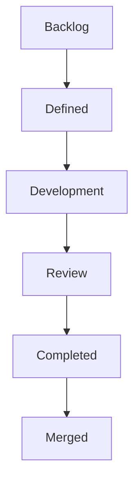

# Contributing

**[Documentation](docs/README.md)** · **[Roadmap](docs/ROADMAP.md)** ·
**[Pending tasks](docs/TODO.md)** · **[Installation](docs/INSTALL.md)** ·
**[Project instructions](CLAUDE.md)**

Contributions are welcome for application code, tests, documentation and bug
reports. This guide summarizes the development workflow and the headless dev
container; [`CLAUDE.md`](CLAUDE.md) holds the full project rules.

## Contents

- [Development workflow](#development-workflow)
- [Building and testing](#building-and-testing)
- [Building outside Plasma](#building-outside-plasma)
- [Submitting changes](#submitting-changes)

## Development workflow

1. Read the [scope](docs/philosophy/scope.md) and the relevant
   [roadmap](docs/ROADMAP.md) milestone.
2. Track the work on the
   [project board](https://github.com/users/mikepadiernos/projects/4): each
   milestone has a parent issue with feature sub-issues.
3. Work on a focused branch and add or update QtTest coverage.
4. Run the smallest relevant tests, then the full CTest suite when practical.
5. Record blockers in [pending tasks](docs/TODO.md), confirmed defects in
   [reported bugs](docs/BUGS.md) and limitations in [caveats](docs/CAVEATS.md).

### Board statuses

Issues move forward only, never back:



Review means implemented, not done: a feature's roadmap item is checked only
after its issue reaches Completed or Merged. See
[project workflow](CLAUDE.md#project-workflow) for when each move happens and
[roadmap](CLAUDE.md#roadmap) for checkbox rules.

### Branches and commits

| Topic       | Convention                                                                                                                                                                                                                |
| ----------- | ------------------------------------------------------------------------------------------------------------------------------------------------------------------------------------------------------------------------- |
| 🌿 Branches | One `feature/<short-name>` branch per milestone, such as `feature/m02-shell-next`. Bugs, caveats and other issues get their own branch, such as `fix/GH241-plasma-app-icon`. Do not commit issue work directly to `main`. |
| 📝 Commits  | [Conventional Commits](https://www.conventionalcommits.org/): `<type>(<scope>): <summary>`, such as `fix(GH241): resolve the project icon in Plasma`. Commit by scope.                                                    |
| 🐞 Bugs     | Title prefix `[bug]`, `bug` label, an entry in [`docs/BUGS.md`](docs/BUGS.md).                                                                                                                                            |
| ⚠️ Caveats  | Title prefix `[caveat]`, `caveat` label, an entry in [`docs/CAVEATS.md`](docs/CAVEATS.md) linked to the issue.                                                                                                            |

Details: [branches and merging](CLAUDE.md#branches-and-merging) and
[issues and caveats](CLAUDE.md#issues-and-caveats).

### Code conventions

- 🧪 **Tests:** cover non-widget logic with QtTest in `tests/`. Isolate tests
  from the real home folder, mail data and configuration with `QTemporaryDir`
  and `QStandardPaths::setTestModeEnabled(true)`.
- 🌐 **Strings:** localize new user-visible strings with `i18n()` or `i18nc()`.
- 🎨 **Icons:** use Plasma's active icon theme through `QIcon::fromTheme()`;
  never bundle a replacement theme. At 24 logical pixels or smaller, prefer
  `-symbolic` variants.
- ⚙️ **Settings:** store settings in KConfig and session state through
  `KSharedConfig::openStateConfig()`. Prefer KDE Frameworks facilities to custom
  implementations.

See [development](CLAUDE.md#development) for the complete list.

## Building and testing

On Linux with Qt 6 and KDE Frameworks 6 installed:

```sh
cmake -S . -B build -G Ninja -DCMAKE_BUILD_TYPE=Debug
cmake --build build
QT_QPA_PLATFORM=offscreen ctest --test-dir build --output-on-failure
./build/plasma-impresario
```

`BUILD_TESTING` and `WITH_WEBENGINE` default to `ON`. For an installed build and
its options, see the [installation guide](docs/INSTALL.md).

## Building outside Plasma

Plasma Impresario targets KDE Plasma on Linux. On other hosts, such as macOS,
use the headless Fedora container in `tools/dev-container/` to build and run the
test suite. It needs Docker.

```sh
tools/dev-container/run.sh cmake -S . -B build -G Ninja -DCMAKE_BUILD_TYPE=Debug
tools/dev-container/run.sh cmake --build build
tools/dev-container/run.sh ctest --test-dir build --output-on-failure
```

The repository is mounted at `/src` in the container, so `build/` is shared with
the host. ccache data persists in the `plasma-impresario-ccache` Docker volume,
and the container sets `QT_QPA_PLATFORM=offscreen`.

| `run.sh` usage           | Effect                                                                                                                       |
| ------------------------ | ---------------------------------------------------------------------------------------------------------------------------- |
| No arguments             | Open an interactive shell.                                                                                                   |
| `command [args…]`        | Run the command in the container.                                                                                            |
| `--rebuild`              | Rebuild the image before running. The image is built automatically on first use.                                             |
| `--publish PORT`         | Publish the container's `PORT` on the host's loopback interface only.                                                        |
| `EXTRA_CA_CERT=file.pem` | Trust an extra root certificate, for a TLS-intercepting proxy, when the image is built. Falls back to `NODE_EXTRA_CA_CERTS`. |

> [!IMPORTANT]
>
> The container has no Plasma session. Verify desktop integration, including
> KWallet, notifications, Akonadi, icon theming and window behavior, in a real
> Plasma session.

### Live mail, screenshots and a VNC view

These scripts start a disposable, loopback-only Dovecot with synthetic accounts
and messages (all at `example.test`, with the shared password
`synthetic-test-only`). The server and its data are deleted when the script
ends. Build first; each script takes the build directory as an optional first
argument (default `build`).

```sh
tools/dev-container/run.sh sh tools/dev-container/live-imap-accounts.sh
tools/dev-container/run.sh sh tools/dev-container/live-imap-panels.sh
tools/dev-container/vnc.sh
```

| Script                  | What it does                                                                                                                                                                                                                                                                               |
| ----------------------- | ------------------------------------------------------------------------------------------------------------------------------------------------------------------------------------------------------------------------------------------------------------------------------------------ |
| `live-imap-accounts.sh` | Runs `test_LiveImapAccounts`: connects a work and a home account and switches between them.                                                                                                                                                                                                |
| `live-imap-panels.sh`   | Seeds a conversation, a message with attachments and a signed message, then runs `test_LiveImapPanels` against the Message Details, Contacts, Related Messages and Attachments panels. Saves layout screenshots to `build/shell-screenshots/` or a directory given as the second argument. |
| `vnc.sh`                | Runs the application on a virtual display with the same seeded mailbox. Connect to `vnc://localhost:5901` with the password `synthvnc`; set `VNC_PORT` for another port. Quit the application, or press <kbd>Ctrl</kbd>+<kbd>C</kbd>, to stop.                                             |

> [!NOTE]
>
> The live IMAP tests are opt-in: they are built with the test suite but are not
> part of CTest, because they need the server these scripts provide. Never point
> them at a real account. `test_LiveImap` has no wrapper script; see
> [pending verification](docs/TODO.md#m02-shell-and-account-foundation) for its
> settings.

The screenshots and the VNC view use plain Qt without Plasma's style, fonts or
color scheme, so they show the layout but not the Plasma look. In the VNC view,
a newly opened dialog or tooltip can stay black until it is moved; press
<kbd>Return</kbd> or <kbd>Esc</kbd> to answer a black dialog. The session trusts
its own synthetic server certificate in advance, so no certificate prompt
appears.

## Submitting changes

Push the branch to
[mikepadiernos/plasma-impresario](https://github.com/mikepadiernos/plasma-impresario)
and open a pull request into `main`. Describe what changed, why and the
verification you actually ran, and reference the issue, such as `Closes #123`.

Plasma Impresario is a fork of KDE's
[Trojitá](https://invent.kde.org/pim/trojita), whose merge requests are reviewed
in KDE Invent. Plasma Impresario changes go through pull requests in this
repository.
