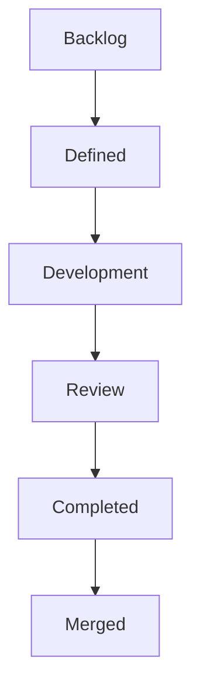

# Contributing

**[Documentation](docs/README.md)** · **[Roadmap](docs/ROADMAP.md)** ·
**[Pending tasks](docs/TODO.md)** · **[Bugs](docs/BUGS.md)** ·
**[Caveats](docs/CAVEATS.md)** · **[Installation](docs/INSTALL.md)** ·
**[Project instructions](CLAUDE.md)** ·
**[Project board](https://github.com/users/mikepadiernos/projects/4)**

Contributions are welcome for application code, tests, documentation and bug
reports. This guide summarizes the development workflow and the headless dev
container; [`CLAUDE.md`](CLAUDE.md) holds the full project rules.

## Contents

- [Development workflow](#development-workflow)
- [Building and testing](#building-and-testing)
- [Building outside Plasma](#building-outside-plasma)
- [Documentation style](#documentation-style)
- [Submitting changes](#submitting-changes)

## Development workflow

1. Read the [scope](docs/philosophy/scope.md) and the relevant
   [roadmap](docs/ROADMAP.md) milestone.
2. Track the work on the
   [project board](https://github.com/users/mikepadiernos/projects/4): each
   milestone has a parent issue with feature sub-issues.
3. Work on a focused branch and add or update QtTest coverage.
4. Run the smallest relevant tests, then the full CTest suite when practical.
5. Record blockers in [pending tasks](docs/TODO.md), confirmed defects in
   [reported bugs](docs/BUGS.md) and limitations in [caveats](docs/CAVEATS.md).

### Board statuses

Legend: ![Backlog][backlog] · ![Defined][defined] ·
![Development][development] · ![Review][review] · ![Completed][completed] ·
![Merged][merged]

Issues move forward only, never back:



![Review][review] means implemented, not done: a feature's roadmap item is
checked only after its issue reaches ![Completed][completed] or
![Merged][merged]. See
[project workflow](CLAUDE.md#project-workflow) for when each move happens and
[roadmap](CLAUDE.md#roadmap) for checkbox rules.

### Branches and commits

| Topic        | Convention                                                                                                                                                                                                                |
| ------------ | ------------------------------------------------------------------------------------------------------------------------------------------------------------------------------------------------------------------------- |
| **Branches** | One `feature/<short-name>` branch per milestone, such as `feature/m02-shell-next`. Bugs, caveats and other issues get their own branch, such as `fix/GH241-plasma-app-icon`. Do not commit issue work directly to `main`. |
| **Commits**  | [Conventional Commits](https://www.conventionalcommits.org/): `<type>(<scope>): <summary>`, such as `fix(GH241): resolve the project icon in Plasma`. Commit by scope.                                                    |
| **Bugs**     | Title prefix `[bug]`, `bug` label, an entry in [`docs/BUGS.md`](docs/BUGS.md).                                                                                                                                            |
| **Caveats**  | Title prefix `[caveat]`, `caveat` label, an entry in [`docs/CAVEATS.md`](docs/CAVEATS.md) linked to the issue.                                                                                                            |

Details: [branches and merging](CLAUDE.md#branches-and-merging) and
[issues and caveats](CLAUDE.md#issues-and-caveats).

### Code conventions

- **Tests:** cover non-widget logic with QtTest in `tests/`. Isolate tests
  from the real home folder, mail data and configuration with `QTemporaryDir`
  and `QStandardPaths::setTestModeEnabled(true)`.
- **Strings:** localize new user-visible strings with `i18n()` or `i18nc()`.
- **Icons:** use Plasma's active icon theme through `QIcon::fromTheme()`;
  never bundle a replacement theme. At 24 logical pixels or smaller, prefer
  `-symbolic` variants.
- **Settings:** store settings in KConfig and session state through
  `KSharedConfig::openStateConfig()`. Prefer KDE Frameworks facilities to custom
  implementations.

- **Names:** new project-owned identifiers use the Plasma Impresario name:
  `IMPRESARIO_` for build and preprocessor macros, `impresario_` for CMake
  helpers such as `impresario_option()` and `impresario_test()`, and
  `Impresario` in C++ symbols. Choose a profile with
  `Common::Application::setProfileName()`, which sets
  `PLASMA_IMPRESARIO_PROFILE`.

See [development](CLAUDE.md#development) for the complete list.

#### Trojitá names kept on purpose

The [rename](https://github.com/mikepadiernos/plasma-impresario/issues/242)
leaves names that existing installations, settings or other processes
depend on. Keep them until a migration replaces them.

| Kept name                                                                                                          | Why                                                                                                                                         |
| ------------------------------------------------------------------------------------------------------------------ | ------------------------------------------------------------------------------------------------------------------------------------------- |
| Settings location (`flaska.net/trojita`) and `Common::Application::name`                                           | Plasma Impresario reads Trojitá's settings, cache and mail in place; see [upgrading](docs/INSTALL.md#upgrading-from-trojitá-or-plasma-mail) |
| `TROJITA_PROFILE`                                                                                                  | Still read when `PLASMA_IMPRESARIO_PROFILE` is unset, for launchers written for Trojitá                                                     |
| `bin/trojita`, `org.kde.trojita.desktop`, the `trojita_plugins` library and plugin targets                         | Installed compatibility aliases and file names that the installer upgrades                                                                  |
| `application/x-trojita-*` drag types and `net.flaska.trojita.*` plugin IDs                                         | Exchanged between processes and plugins; renaming them breaks drag and drop or plugin loading across versions                               |
| `x-trojita-*` body parameters, parser keys and URL schemes, `X-Trojita-DisplayName`, the `trojita_qt` translations | Parts of the offline mail cache, contact links and translation catalogues                                                                   |
| `This file is part of the Trojita…` headers, `docs/old`, parity documents                                          | Copyright and license attribution, and history                                                                                              |
| Windows NSIS packaging file names (`packaging/trojita.nsi`, `src/trojita_win32.rc`)                                | Outside the Plasma-only product; kept for reference                                                                                         |

## Building and testing

On Linux with Qt 6 and KDE Frameworks 6 installed:

```sh
cmake -S . -B build -G Ninja -DCMAKE_BUILD_TYPE=Debug
cmake --build build
QT_QPA_PLATFORM=offscreen ctest --test-dir build --output-on-failure
./build/plasma-impresario
```

`BUILD_TESTING` and `WITH_WEBENGINE` default to `ON`. For an installed build and
its options, see the [installation guide](docs/INSTALL.md).

## Building outside Plasma

Plasma Impresario targets KDE Plasma on Linux. On other hosts, such as macOS,
use the headless Fedora container in `tools/dev-container/` to build and run the
test suite. It needs Docker.

```sh
tools/dev-container/run.sh cmake -S . -B build -G Ninja -DCMAKE_BUILD_TYPE=Debug
tools/dev-container/run.sh cmake --build build
tools/dev-container/run.sh ctest --test-dir build --output-on-failure
```

The repository is mounted at `/src` in the container, so `build/` is shared with
the host. ccache data persists in the `plasma-impresario-ccache` Docker volume,
and the container sets `QT_QPA_PLATFORM=offscreen`.

| `run.sh` usage           | Effect                                                                                                                       |
| ------------------------ | ---------------------------------------------------------------------------------------------------------------------------- |
| No arguments             | Open an interactive shell.                                                                                                   |
| `command [args…]`        | Run the command in the container.                                                                                            |
| `--rebuild`              | Rebuild the image before running. The image is built automatically on first use.                                             |
| `--publish PORT`         | Publish the container's `PORT` on the host's loopback interface only.                                                        |
| `EXTRA_CA_CERT=file.pem` | Trust an extra root certificate, for a TLS-intercepting proxy, when the image is built. Falls back to `NODE_EXTRA_CA_CERTS`. |

> [!IMPORTANT]
>
> The container has no Plasma session. Verify desktop integration, including
> KWallet, notifications, Akonadi, icon theming and window behavior, in a real
> Plasma session.

### Live mail, screenshots and a VNC view

These scripts start a disposable, loopback-only Dovecot with synthetic accounts
and messages (all at `example.test`, with the shared password
`synthetic-test-only`). The server and its data are deleted when the script
ends. Build first; each script takes the build directory as an optional first
argument (default `build`).

The container pins Fedora 44, and the scripts require the Dovecot 2.4 series
that their configuration is written for. Each run prints the exact version, such
as `Synthetic Dovecot 2.4.5 on 127.0.0.1:10993`; record it with your results.

```sh
tools/dev-container/run.sh sh tools/dev-container/live-imap-accounts.sh
tools/dev-container/run.sh sh tools/dev-container/live-imap-panels.sh
tools/dev-container/run.sh sh tools/dev-container/live-imap-compose.sh
tools/dev-container/run.sh sh tools/dev-container/live-imap-operations.sh
tools/dev-container/run.sh sh tools/dev-container/live-pop3.sh
tools/dev-container/run.sh sh tools/dev-container/live-clamd.sh
tools/dev-container/vnc.sh
```

| Script                    | What it does                                                                                                                                                                                                                                                                                                                                                                              |
| ------------------------- | ----------------------------------------------------------------------------------------------------------------------------------------------------------------------------------------------------------------------------------------------------------------------------------------------------------------------------------------------------------------------------------------- |
| `live-imap-accounts.sh`   | Runs `test_LiveImapAccounts`: connects a work and a home account, switches between them, and closes and reopens connections across system sleep.                                                                                                                                                                                                                                          |
| `live-imap-panels.sh`     | Seeds a conversation, a message with attachments and a signed message, then runs `test_LiveImapPanels` against the Message Details, Contacts, Related Messages and Attachments panels. Saves layout screenshots to `build/shell-screenshots/` or a directory given as the second argument.                                                                                                |
| `live-imap-compose.sh`    | Seeds the same mailbox with a Sent folder, then runs `test_LiveImapCompose`: opens a message, saves an attachment, replies to all and forwards it, then sends a new message that a local sendmail script first refuses, saves and reopens a draft, and recovers an unsent message after a simulated crash.                                                                                |
| `live-imap-operations.sh` | Seeds INBOX, Trash, Junk and a Projects folder, then runs `test_LiveImapOperations`: moves a message to Trash and undoes it, deletes one permanently, marks one as deleted and expunges it, moves one to Junk and back with **Move messages marked as junk to the Junk folder** on, empties Trash and Junk, and renames the open folder, checking each result in the server's mail files. |
| `live-pop3.sh`            | Starts the same Dovecot with POP3 on, then runs `test_LivePop3`: refuses an untrusted certificate, downloads two messages over TLS and once more over STLS without fetching them twice, removes mail from the server after download, and reports a wrong password.                                                                                                                        |
| `live-clamd.sh`           | Starts ClamAV's `clamd` with a one-line test signature, then runs the live case of `test_ClamdScanner`: a clean file, the signature split across small chunks, and a stream over the size limit. No signature database is downloaded.                                                                                                                                                     |
| `vnc.sh`                  | Runs the application on a virtual display with the same seeded mailbox. Connect to `vnc://localhost:5901` with the password `synthvnc`; set `VNC_PORT` for another port. Quit the application, or press <kbd>Ctrl</kbd>+<kbd>C</kbd>, to stop.                                                                                                                                            |

> [!NOTE]
>
> The live IMAP and POP3 tests are opt-in: they are built with the test suite but are not
> part of CTest, because they need the server these scripts provide. The live
> `clamd` case runs in CTest too, but skips itself without `live-clamd.sh`. Never point
> them at a real account. `test_LiveImap` has no wrapper script; see
> [pending verification](docs/TODO.md#m02-shell-and-account-foundation) for its
> settings.

The screenshots and the VNC view use plain Qt without Plasma's style, fonts or
color scheme, so they show the layout but not the Plasma look. In the VNC view,
a newly opened dialog or tooltip can stay black until it is moved; press
<kbd>Return</kbd> or <kbd>Esc</kbd> to answer a black dialog. The session trusts
its own synthetic server certificate in advance, so no certificate prompt
appears.

## Documentation style

The Markdown in `README.md`, `CONTRIBUTING.md` and `docs/` (except the
[`docs/old`](docs/old/README.md) archive) shares one look. Keep new and edited
pages consistent with it.

| Element         | Convention                                                                                                                                                                                                |
| --------------- | --------------------------------------------------------------------------------------------------------------------------------------------------------------------------------------------------------- |
| **Page layout** | Title, a nav bar of bold links joined by " · ", one or two sentences on what the page is the source of truth for (with an "as of" date when it shows statuses), a legend, and Contents for long pages     |
| **Color**       | [shields.io](https://shields.io) badges, GitHub alerts and Mermaid diagrams. No emoji, and no LaTeX `$\color{…}$` text, which many viewers cannot render                                                  |
| **Badges**      | Reference style, such as `![Merged][merged]`, with the definitions at the end of the file in alphabetical order. Use the shared palette below                                                             |
| **Alerts**      | `NOTE` for context, `TIP` for shortcuts, `IMPORTANT` for rules, `WARNING` for risk of wrong results or data exposure, `CAUTION` for destructive or security-sensitive actions. Use a few per page at most |
| **Diagrams**    | `flowchart TD`, with no `%%{init}%%`, `classDef`, inline HTML or hex colors; the viewer applies its theme                                                                                                 |
| **Text**        | Sentence-case headings, American spelling and prose wrapped at about 80 columns. Menu paths in bold with " › ", such as **View › Layout**; keys in `<kbd>`; code, paths and settings keys in backticks    |
| **Issues**      | Link `#123` as `[#123](https://github.com/mikepadiernos/plasma-impresario/issues/123)` in tables and on first mention in a section; a bare `#123` does not link in repository files                       |
| **Anchors**     | Other pages link to many headings. When renaming one, fix every inbound link                                                                                                                              |

<details>
<summary>Shared badge palette</summary>

| Kind         | Badges                                                                                                                                                                                               |
| ------------ | ---------------------------------------------------------------------------------------------------------------------------------------------------------------------------------------------------- |
| Board status | ![Backlog][backlog] ![Defined][defined] ![Development][development] ![Review][review] ![Completed][completed] ![Merged][merged]                                                                      |
| Verification | ![Verified][verified] ![Offscreen tests][offscreen] ![Needs verification][needs-verification] ![Not validated][not-validated]                                                                        |
| Work state   | ![Done][done] ![In progress][in-progress] ![Planned][planned] ![Blocked][blocked]                                                                                                                    |
| Bugs         | ![Open][open] ![Fix in progress][fix-in-progress] ![Fixed][fixed]                                                                                                                                    |
| Caveats      | ![Limitation][limitation] ![Security][security] ![Resolved][resolved]                                                                                                                                |
| Design       | ![Exists][exists] ![Decided][decided] ![Recommended][recommended]                                                                                                                                    |
| Progress     |    |

Progress badges are green when complete, amber once work starts and gray
before. Copy a badge's URL from the end of this file or from any page that
already uses it.

</details>

## Submitting changes

Push the branch to
[mikepadiernos/plasma-impresario](https://github.com/mikepadiernos/plasma-impresario)
and open a pull request into `main`. Describe what changed, why and the
verification you actually ran, and reference the issue, such as `Closes #123`.

Plasma Impresario is a fork of KDE's
[Trojitá](https://invent.kde.org/pim/trojita), whose merge requests are reviewed
in KDE Invent. Plasma Impresario changes go through pull requests in this
repository.

[backlog]: https://img.shields.io/badge/Backlog-6e7781
[blocked]: https://img.shields.io/badge/Blocked-cf222e
[completed]: https://img.shields.io/badge/Completed-2da44e
[decided]: https://img.shields.io/badge/Decided-1a7f37
[defined]: https://img.shields.io/badge/Defined-57606a
[development]: https://img.shields.io/badge/Development-9a6700
[done]: https://img.shields.io/badge/Done-1a7f37
[exists]: https://img.shields.io/badge/Exists-1a7f37
[fix-in-progress]: https://img.shields.io/badge/Fix_in_progress-9a6700
[fixed]: https://img.shields.io/badge/Fixed-1a7f37
[in-progress]: https://img.shields.io/badge/In_progress-9a6700
[limitation]: https://img.shields.io/badge/Limitation-bc4c00
[merged]: https://img.shields.io/badge/Merged-8250df
[needs-verification]: https://img.shields.io/badge/Needs_verification-0969da
[not-validated]: https://img.shields.io/badge/Not_validated-6e7781
[offscreen]: https://img.shields.io/badge/Offscreen_tests-0969da
[open]: https://img.shields.io/badge/Open-cf222e
[planned]: https://img.shields.io/badge/Planned-6e7781
[recommended]: https://img.shields.io/badge/Recommended-1b7c83
[resolved]: https://img.shields.io/badge/Resolved-1a7f37
[review]: https://img.shields.io/badge/Review-2f81f7
[security]: https://img.shields.io/badge/Security-bf3989
[verified]: https://img.shields.io/badge/Verified-1a7f37
