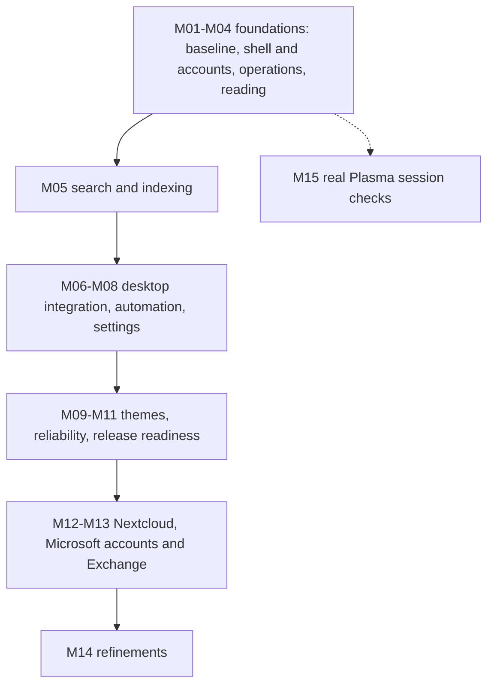

# Plasma Impresario

<p align="center">
  
</p>

<p align="center">
  <strong>A focused IMAP mail client for the KDE Plasma desktop</strong><br>
  Forked from Trojitá · C++20 · Qt 6 · KDE Frameworks 6
</p>

<p align="center">
  
  
  
  
  
  
</p>

**[Screenshots](#screenshots)** · **[Status](#project-status)** ·
**[Features](#implemented-today)** · **[Build and run](#build-and-run)** ·
**[Roadmap](docs/ROADMAP.md)** · **[Documentation](docs/README.md)** ·
**[Security and limitations](docs/CAVEATS.md#security-and-data-protection)**

Plasma Impresario turns the Trojitá IMAP client into a Plasma-native mail
application for focused reading, account management and desktop integration.
Other desktop environments are outside the supported scope.

> [!IMPORTANT]
>
> Plasma Impresario is in development. The four foundation milestones (M01–M04:
> the KDE / Qt 6 baseline, the shell and accounts, mail operations, and
> reading) are merged into `main`. They are verified with offscreen tests and a
> disposable IMAP server, but nothing has been checked in a real Plasma session
> yet. See [project status](#project-status).

## Contents

- [Screenshots](#screenshots)
- [Project status](#project-status)
- [Implemented today](#implemented-today)
- [Using it](#using-it)
- [Build and run](#build-and-run)
- [Product direction](#product-direction)
- [Documentation](#documentation)
- [Application icon](#application-icon)
- [License](#license)

## Screenshots

Captured by `test_LiveImapPanels` against a synthetic mailbox in the headless
[dev container](CONTRIBUTING.md#live-mail-screenshots-and-a-vnc-view), so they
show the container's default Qt style rather than a Plasma theme.

<p align="center">
  
  <br>
  <em>Compact layout with the Attachments panel below the reader</em>
</p>

<details>
<summary>More layouts</summary>

<p align="center">
  
  <br>
  <em>Wide layout with Message Details, Contacts and Related Messages
  in the right column</em>
</p>

<p align="center">
  
  <br>
  <em>Panels around the reader: details on the left, contacts on the right,
  attachments and related messages in the footer</em>
</p>

</details>

## Project status

As of 2026-11-26. **Done** counts roadmap features whose issues are
![Completed][completed] or ![Merged][merged] on the
[project board](https://github.com/users/mikepadiernos/projects/4); **Board**
is the milestone's parent issue.

| Milestone                                                                                | Branch               | Done                                                                 | Board                       | Notes                                                                                                                                                                                                                                                                                                                                                                                                                                        |
| ---------------------------------------------------------------------------------------- | -------------------- | -------------------------------------------------------------------- | --------------------------- | -------------------------------------------------------------------------------------------------------------------------------------------------------------------------------------------------------------------------------------------------------------------------------------------------------------------------------------------------------------------------------------------------------------------------------------------- |
| [M01](docs/ROADMAP.md#m01-kde--qt6-compatibility-baseline) KDE / Qt 6 baseline           | `main`               |  | ![Merged][merged]           | Builds, installs and launches with Qt 6 and KF6                                                                                                                                                                                                                                                                                                                                                                                              |
| [M02](docs/ROADMAP.md#m02-shell-accounts-and-core-mailbox-foundation) Shell and accounts | `main`               |  | ![Merged][merged]           | Checks in a real Plasma session moved to M15                                                                                                                                                                                                                                                                                                                                                                                                 |
| [M03](docs/ROADMAP.md#m03-mail-operations-sorting-and-folder-management) Mail operations | `main`               |  | ![Merged][merged]           | Destructive actions verified against a live server                                                                                                                                                                                                                                                                                                                                                                                           |
| [M04](docs/ROADMAP.md#m04-reading-and-conversation-flow) Reading and conversations       | `main`               |  | ![Merged][merged]           | Merged in [PR #451](https://github.com/mikepadiernos/plasma-impresario/pull/451)                                                                                                                                                                                                                                                                                                                                                             |
| [M05](docs/ROADMAP.md#m05-search-and-indexing) Search and indexing                       | `feature/m05-search` |   | ![Development][development] | Search scope, server search, query syntax, search builder, search with filters, search history and suggestions, saved searches as virtual folders, managing saved searches, mailing-list views, offline index, index coverage and controls, index-first search, index privacy, attachment text indexing, search snippets and relevance done; search facets in review ([#347](https://github.com/mikepadiernos/plasma-impresario/issues/347)) |
| M06–M08: desktop integration, automation, settings                                       | —                    | —                                                                    | ![Backlog][backlog]         | Not started                                                                                                                                                                                                                                                                                                                                                                                                                                  |
| [M09](docs/ROADMAP.md#m09-themes-and-branding-foundation) Themes and branding            | —                    |      | ![Development][development] | Started with the product rename ([#221](https://github.com/mikepadiernos/plasma-impresario/issues/221))                                                                                                                                                                                                                                                                                                                                      |
| M10–M14: reliability, release, Nextcloud, Microsoft, refinements                         | —                    | —                                                                    | ![Backlog][backlog]         | Not started                                                                                                                                                                                                                                                                                                                                                                                                                                  |
| [M15](docs/ROADMAP.md#m15-real-plasma-session-verification) Real Plasma session checks   | —                    |        | ![Defined][defined]         | Needs a real Plasma session                                                                                                                                                                                                                                                                                                                                                                                                                  |

The [roadmap overview](docs/ROADMAP.md#milestones-at-a-glance) tracks every
milestone, and [pending tasks](docs/TODO.md#in-progress) record what each one
is waiting on.

## Implemented today

What works in `main` after M01–M04, as of 2026-11-25.

Legend: ![Verified][verified] against a disposable Dovecot server ·
![Offscreen tests][offscreen] covered by automated tests without a live server
· ![Needs verification][needs-verification] not yet checked end to end

> [!NOTE]
>
> No row has been checked in a real Plasma session; those checks are
> [M15](docs/ROADMAP.md#m15-real-plasma-session-verification). Limitations of
> each area are in the [caveats](docs/CAVEATS.md).

### Inherited from Trojitá

| Area               | What works                                                                    |
| ------------------ | ----------------------------------------------------------------------------- |
| Mail               | IMAP mailbox discovery, synchronization, offline modes, caching and threading |
| Folders and search | Folder navigation, search, sorting, flags and tags                            |
| Reading            | MIME alternatives, HTML rendering through Qt WebEngine and attachments        |
| Composing          | New messages, replies and forwards, local drafts and configurable delivery    |
| Plugins            | Optional password, address-book, spell-check and OpenPGP plugins              |

M01 verified that these build, install and launch with Qt 6. M04 verified
live reading, replies, forwards, attachments, drafts and failed-send recovery
against a disposable Dovecot server
([#93](https://github.com/mikepadiernos/plasma-impresario/issues/93)).

### Added in M02

Shell, accounts and mailbox foundation
([#4](https://github.com/mikepadiernos/plasma-impresario/issues/4)).

| Area              | What works                                                                                                        | Status                                    |
| ----------------- | ----------------------------------------------------------------------------------------------------------------- | ----------------------------------------- |
| Accounts          | Multiple IMAP accounts in one window, each with its own settings, connection, status and stored passwords         | ![Verified][verified]                     |
| Connection status | Connection, authentication, offline and loading states in the footer and per account                              | ![Verified][verified]                     |
| Saved searches    | Folder unread counts and named searches per account, run in the selected folder                                   | ![Verified][verified]                     |
| Sessions          | Layout, pane sizes, row density and the selected message restored across restarts                                 | ![Verified][verified]                     |
| Density           | Compact and comfortable message-list rows                                                                         | ![Verified][verified]                     |
| Embedded panels   | Attachments, Message Details, Contacts and Related Messages, each with its own placement                          | ![Verified][verified]                     |
| Mail shell        | Left, main and right columns and a footer; folder sidebar on either side; compact, wide and one-at-a-time layouts | ![Verified][verified]                     |
| Account sidebar   | Folder sidebar grouped by account, and an optional header with the account, folder and status                     | ![Verified][verified]                     |
| Identities        | Sender identities per account, with the account's default preselected and a **No identity** option                | ![Verified][verified]                     |
| OAuth             | Google and Microsoft sign-in for IMAP and SMTP, chosen per account                                                | ![Needs verification][needs-verification] |
| Capabilities      | Actions the account's protocol cannot perform are hidden                                                          | ![Needs verification][needs-verification] |

M02 was headless work (M02.01,
[#318](https://github.com/mikepadiernos/plasma-impresario/issues/318)); checks
that need a real Plasma session are their own milestone (M15,
[#319](https://github.com/mikepadiernos/plasma-impresario/issues/319)). The
[design guide](docs/philosophy/designs.md#current-interface) describes the shell
and panels in detail, and
[pending tasks](docs/TODO.md#m02-shell-and-account-foundation) record the
verification.

### Added in M03

Mail operations, sorting and folder management
([#5](https://github.com/mikepadiernos/plasma-impresario/issues/5)).

| Area                | What works                                                                                                                                       | Status                        |
| ------------------- | ------------------------------------------------------------------------------------------------------------------------------------------------ | ----------------------------- |
| Folder navigation   | Special folders first with theme icons, **Go to Folder** (<kbd>Ctrl</kbd>+<kbd>J</kbd>), **Go to Next Unread Folder** and **Check for New Mail** | ![Offscreen tests][offscreen] |
| Unified Inbox       | The INBOX of every chosen account in one list, acting on each message's own account                                                              | ![Verified][verified]         |
| Quick actions       | Archive, Move and Copy to recent folders, mark read, unread and flagged, from the menu, toolbar and keyboard                                     | ![Offscreen tests][offscreen] |
| Filters and sorting | Unread, Flagged and With Attachments filters, **Group By**, relevance sorting and a view remembered per folder                                   | ![Verified][verified]         |
| Selection           | Select All, Thread, Similar and Invert, keyboard selection, batch progress and errors in a notification bar                                      | ![Offscreen tests][offscreen] |
| Triage              | **Show Related**, fast next and previous keys, a dense processing layout and a searchable shortcut list                                          | ![Offscreen tests][offscreen] |
| Message rows        | Two-line rows with sender initials and unread, flag and attachment indicators                                                                    | ![Offscreen tests][offscreen] |
| Deleting            | Move to Trash with **Undo**, Delete Permanently, Empty Trash and Junk, and Rename Folder, with confirmations                                     | ![Verified][verified]         |

`test_LiveImapAccounts` and `test_LiveImapPanels` exercise the Unified Inbox,
**Check for New Mail**, filters and grouping against the disposable server.
`test_LiveImapOperations` runs each destructive action and **Undo** in a window
and checks the result in the server's mail files. Limitations are in the
[caveats](docs/CAVEATS.md#mail-operations).

### Added in M04

Reading and conversation flow
([#6](https://github.com/mikepadiernos/plasma-impresario/issues/6)).

| Area             | What works                                                                                                                                                                                                                                  | Status                        |
| ---------------- | ------------------------------------------------------------------------------------------------------------------------------------------------------------------------------------------------------------------------------------------- | ----------------------------- |
| Composing        | Replies, Reply to All but Me and Forward send from the message's account; a refused send keeps the composer open, and unsent mail reopens after a crash                                                                                     | ![Verified][verified]         |
| Reader actions   | A bar above the reader replies, forwards, archives, trashes, flags, marks read, shows attachments, zooms and switches to plain text for the open message                                                                                    | ![Verified][verified]         |
| Reading, triage  | Plain text wraps at a readable width; <kbd>Space</kbd> pages through the open message and then opens the next unread one                                                                                                                    | ![Verified][verified]         |
| Conversations    | <kbd>Alt</kbd>+<kbd>Down</kbd> and <kbd>Alt</kbd>+<kbd>Up</kbd> step through a conversation from oldest to newest; <kbd>Ctrl</kbd>+<kbd>.</kbd> and <kbd>Ctrl</kbd>+<kbd>,</kbd> expand and collapse every thread (keys not exercised live) | ![Verified][verified]         |
| Filters          | Filters keep whole threads and the open message; conversation steps show replies a filter hides                                                                                                                                             | ![Verified][verified]         |
| Subjects         | Replies without links join their conversation by subject within 30 days, ignoring localized prefixes and list tags; References can merge conversations                                                                                      | ![Verified][verified]         |
| Keyboard         | <kbd>F6</kbd> follows the screen order of panes and panels, also in right-to-left layouts; <kbd>Esc</kbd> returns from the reader or a panel to the message list                                                                            | ![Verified][verified]         |
| Search highlight | A message opened from a quick search shows the term in the find bar; <kbd>F3</kbd> steps through the matches (key not exercised live)                                                                                                       | ![Verified][verified]         |
| Reading privacy  | The remote-content bar names the blocked servers; deceptive links ask before opening                                                                                                                                                        | ![Verified][verified]         |
| Load on demand   | Parts which cannot be loaded, for example offline, are reported in the reader and load again on reconnect or **Try Again**                                                                                                                  | ![Verified][verified]         |
| Message security | Message Details shows the reader's signature and decryption results, with the signer, an icon and an accessible name                                                                                                                        | ![Offscreen tests][offscreen] |
| Dark schemes     | Plain text follows the color scheme; HTML without its own background is shown on a light page                                                                                                                                               | ![Offscreen tests][offscreen] |

`test_LiveImapPanels` and `test_LiveImapCompose` exercise the rows marked
![Verified][verified] against the disposable server. The live security check
uses a synthetic signature, so only the unverifiable result is seen there; the
other results are covered offscreen.

> [!WARNING]
>
> Some M04 behavior has known limits: inline PGP is detected but neither
> verified nor decrypted ([message security](docs/CAVEATS.md#message-security));
> a search in a threaded list splits threads
> ([conversations](docs/CAVEATS.md#conversations)); and each refused send files
> another copy in Sent, while drafts do not keep attachments
> ([composing and sending](docs/CAVEATS.md#composing-and-sending)). The live
> compose test sends through a local sendmail script, so SMTP submission has
> not been exercised end to end.

## Using it

### Accounts

- The toolbar account selector switches between accounts without
  reconnecting. <kbd>Ctrl</kbd>+<kbd>Alt</kbd>+<kbd>PgDown</kbd> and
  <kbd>Ctrl</kbd>+<kbd>Alt</kbd>+<kbd>PgUp</kbd> switch to the next and previous
  account; both shortcuts can be rebound.
- **Add Account**, **Rename Account**, **Remove Account** and **Account
  Settings…** are in the application menu; each account's header in the folder
  sidebar has a menu with the last three. Account Settings edits the account's
  identities, IMAP, offline and SMTP settings in its own dialog.
- Removing an account deletes its settings, stored passwords and offline
  cache, but not any mail on the server.
- All accounts connect at startup. An account with a network error, a missing
  password or failed authentication shows a warning in the selector, on its
  sidebar header and in the footer, and raises one desktop notification.
- An existing configuration becomes the first account on startup. New
  profiles store passwords with QtKeychain when it is available. An account can
  sign in with a password or with Google or Microsoft OAuth; see
  [OAuth sign-in](docs/CAVEATS.md#oauth-sign-in).
- Each account has its own sender identities by default, and the composer
  preselects the account's default identity. An account can instead use the
  shared identities, or **No identity**, which starts the composer with an empty
  From address and no signature.
- The reader names each message's account. Replies and forwards start from the
  account that received the message, and the composer can switch to another
  account beside the **From** identities. Drafts remember their account, and the
  composer warns about an account without an outgoing server or an identity of
  another account.
- With two or more accounts, the folder sidebar shows a header for each
  account. Clicking a header switches to that account; clicking the active
  account's header collapses or expands its folders.

> [!NOTE]
>
> Only the active account's folders are shown at a time; the other accounts
> show their header and status. See
> [multiple accounts](docs/CAVEATS.md#multiple-accounts).

### Shell and panels

- **View › Layout** chooses Compact, Wide or One At a Time, and **View ›
  Folder Sidebar Position** puts the folder tree in the left or right column.
- **View › Embedded Panels** shows or hides each panel, hides it while empty
  and places it below the reader, in either side column or in the footer.
  Attachments is on by default; the other panels are off.
- Related Messages lists the open message's conversation and the sender's
  other mail from the loaded list. **Search the Server**, in the panel's search
  menu, also finds them on the server in the message's folder, up to 20 folders
  of the account or chosen folders, without leaving the shown folder.
- **View › Show Header** adds a header above the columns with the active
  account, the folder and the account's status. It is off by default.
- <kbd>F6</kbd> and <kbd>Shift</kbd>+<kbd>F6</kbd> move focus through the
  header, account selector, folder tree, message list, reader and each visible
  panel in the order they appear on screen. <kbd>Esc</kbd> in the reader or a
  panel returns to the message list.
- The Navigation toolbar docks at the left window edge by default. The menu
  bar is hidden; open the menus from the toolbar's main menu button or turn the
  bar on with **View › Show Main Menu Bar**.

### Searching and saved searches

The quick search above the message list searches the selected folder on the
server. Words search the fields chosen in its options menu and must all match;
quote a phrase. Fields narrow a term, such as `from:ann`, `subject:"release
plan"`, `list:dev.lists.example.org`, `tag:$label1`, `is:unread`, `has:attachment`,
`date>=2026-01` or `size>2M`, and `-` or `NOT`, `OR` and parentheses combine
them. An invalid query is explained below the field instead of being sent.
**Search Builder...** in the options menu or the **Mailbox** menu
(<kbd>Ctrl</kbd>+<kbd>Shift</kbd>+<kbd>B</kbd>) builds the same query from rows
of field, comparison and value, matching all or any of them.
The options menu also offers fuzzy matching and a
**Date** range: today, the past week, month or year, or custom days with an
optional start and end. A date range narrows text, field and raw IMAP
queries, and on its own filters the list by date. **Search In** widens the
search to chosen folders of any account, the whole account or all accounts;
results appear in one list, labelled with their account and folder, as each
folder is searched. The status line's tooltip shows each account's progress;
**Stop** ends the search and keeps what was found, and **Retry** searches the
accounts and folders that failed again. A search the server cannot run says why
in the status line instead of showing an empty list.

While a search is shown, each message row adds a snippet of the message's
downloaded text around the first match, with the matched words in bold.
**Mailbox › Sorting › Relevance** puts the best matches first, also in results
of several places, and is remembered for later searches; date stays the
default.

**Narrow** above the results, also under **View › Filter › Narrow Results**,
counts the results by account, folder, sender, date, attachments and tag.
Choosing values narrows the list: values of one kind are alternatives, and
kinds combine. Each chosen value shows as a chip that removes it, and the
facets reset when you search again or elsewhere.

A search applies within the quick filters, and a row above the list shows the
query, date range, places and filters in effect. Its **Clear All** button, or
<kbd>Ctrl</kbd>+<kbd>Shift</kbd>+<kbd>Backspace</kbd>, clears them together and
returns to the message that was current before, or keeps the one you opened
among the results.

The search field remembers the last 20 searches you ran, and while you type it
offers matching recent searches, favorite tags, address book contacts and the
shown account's folders; press <kbd>Down</kbd> to open the list at any time.
**Remember Searches**, **Suggest While Typing** and **Clear Search History**
in the search options control this.

Enter a query and choose **Save Current Search** from the search options menu.
**Saved Searches** in the same menu runs, edits, renames or deletes the active
account's saved queries. A saved search keeps its date range and where it searches; preset
ranges stay relative, so a saved "Past Week" search always covers the latest
week. The **Saved Searches** section below the folders shows the saved
searches of every account as virtual folders, with the unread and total
messages each found when it last ran. Choosing one runs it, switching to its
account first when it searches the shown folder or account; choosing a folder
returns to that folder. Its context menu edits a search with a preview of what
it finds, renames, reorders, moves or deletes it, and updates a search whose
account or chosen folders are gone.

Messages from a mailing list name the list in the reader's header, with its
**Post**, **Subscribe**, **Unsubscribe**, **Help**, **Archive** and **Owner**
links from the message's `List-*` headers. Each link asks first and says
whether it writes a message or opens a web page. **Mailing Lists** in the
search options shows the messages of any list among the loaded messages, and
**Pin Shown List as Saved Search** keeps that view as a saved search of every
folder of every account. `list:` matches a list's `List-Id`, or its posting
address when it has none.

**Index downloaded mail for searching offline**, in an account's **Offline**
settings, keeps a full-text index of the headers and downloaded text of the
mail the account keeps offline. It is off by default, and nothing is
downloaded for it; **Download Message Text for Offline Search...** in a
folder's context menu asks before fetching the text of messages that lack it.
While the account is offline, searches are answered from the index and the
status line says so, warning when results may be incomplete. **Application ›
Offline Search Index…** shows which folders are confirmed as indexed, the
progress of an update, and lets you pause, resume, rebuild or delete the
index, and uncheck folders to keep them out of it. Decrypted text of
encrypted messages is indexed only if you choose to, when you open them, and
so is the text of attachments you download, such as PDF and office files,
read by the same extractors as Plasma's file search. Turning the option off
deletes the index.

Online, a search of several places or of the Unified Inbox is answered from
the index first. **Search Server**, next to the status line, then adds the
messages found on the server, such as older mail the account does not keep
offline, without listing any message twice.

### Command line

| Option                | Effect                                                  |
| --------------------- | ------------------------------------------------------- |
| `-p`, `--profile`     | Use a separate configuration with its own accounts      |
| `-c`, `--compose`     | Open the composer                                       |
| `mailto:…`            | Open the composer with the address and fields prefilled |
| `-a`, `--addressbook` | Open the address book, when a plugin provides one       |
| `-l`, `--log-to-disk` | Log IMAP traffic to disk from startup                   |
| `-v`, `--version`     | Print the version                                       |

Run `plasma-impresario --help` for the full list.

## Build and run

> [!TIP]
>
> The quickest route is the installer, which checks dependencies, builds and
> installs into `~/.local`:
>
> ```bash
> ./install.sh
> ```
>
> The [installation guide](docs/INSTALL.md) covers per-distribution packages,
> custom prefixes, build-only mode and troubleshooting.

**Requirements:** CMake, Ninja, a C++20 compiler, Qt 6.7 or later and KDE
Frameworks 6.26 or later (ItemModels, Config and I18n). Qt WebEngine Widgets is
needed to display messages. Optional plugins have additional dependencies; see
the [compatibility baseline](docs/philosophy/compatibility.md).

To build and test by hand:

```bash
cmake -S . -B build -G Ninja -DCMAKE_BUILD_TYPE=Debug
cmake --build build
QT_QPA_PLATFORM=offscreen ctest --test-dir build --output-on-failure
./build/plasma-impresario
```

Tests are built by default (`BUILD_TESTING=ON`), and the build always uses Qt 6.

> [!WARNING]
>
> Qt WebEngine is on by default (`WITH_WEBENGINE=ON`). A build without it
> (`-DWITH_WEBENGINE=OFF` or `./install.sh --without-webengine`) cannot display
> message contents.

On hosts without Plasma, such as macOS, build and test in the headless Fedora
container under `tools/dev-container/`; see
[building outside Plasma](CONTRIBUTING.md#building-outside-plasma). Desktop
integration still needs a real Plasma session.

## Product direction

The [roadmap](docs/ROADMAP.md) puts reliable mail and account boundaries first,
then search, desktop and provider integration, automation, settings, themes and
release quality. Real Plasma session checks run alongside as M15.



Rules, theme profiles, an optional Vim mode and workspace features are planned.
[Plasma Opus](docs/integrations/plasma-opus.md) is the companion file manager;
the two apps are planned to share file dialogs, themes, Vim mode settings and
workspace context. The [scope](docs/philosophy/scope.md) sets the product
boundaries.

## Documentation

| Start with                                          | For                                                             |
| --------------------------------------------------- | --------------------------------------------------------------- |
| [Documentation index](docs/README.md)               | Every guide, grouped by purpose                                 |
| [Installation](docs/INSTALL.md)                     | Installer options, prerequisites and troubleshooting            |
| [Roadmap](docs/ROADMAP.md)                          | Milestones, status and project-board links                      |
| [Interface design](docs/philosophy/designs.md)      | The current shell and the planned Plasma Impresario design      |
| [Pending tasks](docs/TODO.md)                       | Blockers, verification records and handoffs                     |
| [Bugs](docs/BUGS.md) and [caveats](docs/CAVEATS.md) | Reported issues, limitations and security guidance              |
| [Contributing](CONTRIBUTING.md)                     | Development workflow, documentation style and the dev container |

## Application icon

The [application icon](src/icons/plasma-impresario.svg) combines an envelope
with the Plasma Opus golden spiral. The application and its desktop entry use
it.

## License

Plasma Impresario keeps Trojitá's license: GPL version 2, or (at your option)
version 3 or any later version accepted by the membership of KDE e.V. See
[LICENSE](LICENSE).

[backlog]: https://img.shields.io/badge/Backlog-6e7781
[completed]: https://img.shields.io/badge/Completed-2da44e
[defined]: https://img.shields.io/badge/Defined-57606a
[development]: https://img.shields.io/badge/Development-9a6700
[merged]: https://img.shields.io/badge/Merged-8250df
[needs-verification]: https://img.shields.io/badge/Needs_verification-0969da
[offscreen]: https://img.shields.io/badge/Offscreen_tests-0969da
[verified]: https://img.shields.io/badge/Verified-1a7f37
