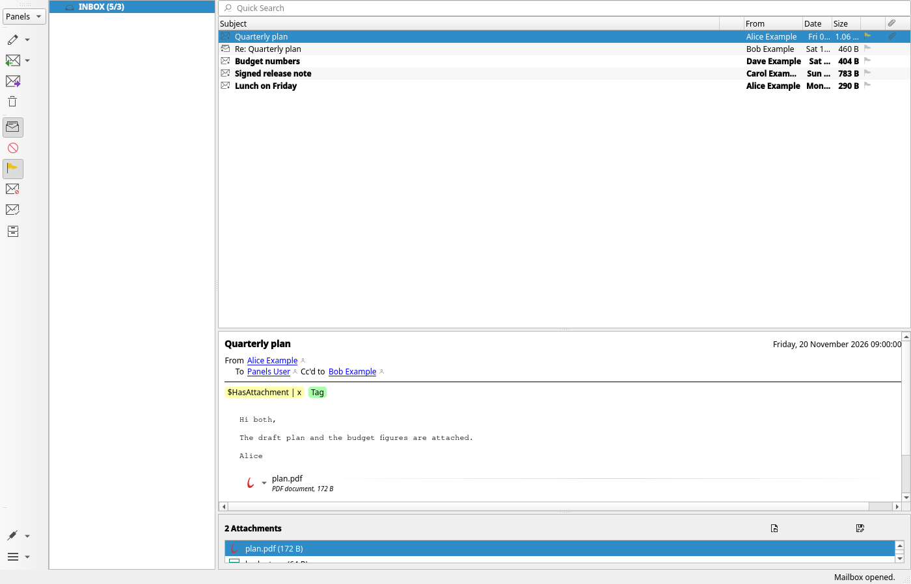

# Plasma Impresario

<p align="center">
  
</p>

<p align="center">
  <strong>A focused IMAP mail client for the KDE Plasma desktop</strong><br>
  Forked from Trojitá · C++20 · Qt 6 · KDE Frameworks 6
</p>

<p align="center">
  
  
  
  
  
  
</p>

**[Screenshots](#screenshots)** · **[Status](#project-status)** ·
**[Features](#implemented-today)** · **[Build and run](#build-and-run)** ·
**[Roadmap](docs/ROADMAP.md)** · **[Documentation](docs/README.md)** ·
**[Security and limitations](docs/CAVEATS.md#security-and-data-protection)**

Plasma Impresario turns the Trojitá IMAP client into a Plasma-native mail
application for focused reading, account management and desktop integration.
Other desktop environments are outside the supported scope.

> [!IMPORTANT]
>
> Plasma Impresario is in development. Only the KDE / Qt 6 baseline (M01) is in
> `main`; the work below it lives on feature branches until each milestone is
> complete. See [project status](#project-status).

## Screenshots

Captured by `test_LiveImapPanels` against a synthetic mailbox in the headless
[dev container](CONTRIBUTING.md#live-mail-screenshots-and-a-vnc-view), so they
show the container's default style rather than a Plasma theme.

<p align="center">
  
  <br>
  <em>Compact layout with the Attachments panel below the reader</em>
</p>

<details>
<summary>More layouts</summary>

<p align="center">
  
  <br>
  <em>Wide layout with Message Details, Contacts and Related Messages
  in the right column</em>
</p>

<p align="center">
  
  <br>
  <em>Panels around the reader: details on the left, contacts on the right,
  attachments and related messages in the footer</em>
</p>

</details>

## Project status

Features done are roadmap items whose issues are
$\color{#2da44e}\textbf{Completed}$ or $\color{#8957e5}\textbf{Merged}$ on the
[project board](https://github.com/users/mikepadiernos/projects/4), as of
2026-11-25.

| Milestone                                  | Branch                        | Done                                                                 | State                                                                                                                                                                                |
| ------------------------------------------ | ----------------------------- | -------------------------------------------------------------------- | ------------------------------------------------------------------------------------------------------------------------------------------------------------------------------------ |
| M01 KDE / Qt 6 baseline                    | `main`                        |  | ![Merged][merged]                                                                                                                                                                    |
| M02 Shell, accounts and mailbox foundation | `main`                        |  | ![Merged][merged]; checks in a real Plasma session moved to M15                                                                                                                      |
| M03 Mail operations, sorting and folders   | `feature/m03-mail-operations` |     | ![Development][development] Folder navigation, sorting and triage, quick actions, and folder actions with recoverable deletion are Completed                                         |
| M04–M15                                    | —                             | —                                                                    | ![Planned][planned] Including search and indexing in M05, Microsoft accounts and Exchange in M13 and real Plasma session checks in M15; M09 branding started with the product rename |

The [roadmap overview](docs/ROADMAP.md#milestones-at-a-glance) tracks every
milestone, and [pending tasks](docs/TODO.md#in-progress) record what each one
is waiting on.

## Implemented today

This section covers M01 and M02. M03 features are summarized in
[project status](#project-status) until their branch is merged.

Legend: ![Verified][verified] against a disposable IMAP server ·
![Needs verification][needs-verification]

### Inherited from Trojitá

| Area               | What works                                                                    |
| ------------------ | ----------------------------------------------------------------------------- |
| Mail               | IMAP mailbox discovery, synchronization, offline modes, caching and threading |
| Folders and search | Folder navigation, search, sorting, flags and tags                            |
| Reading            | MIME alternatives, HTML rendering through Qt WebEngine and attachments        |
| Composing          | New messages, replies and forwards, local drafts and configurable delivery    |
| Plugins            | Optional password, address-book, spell-check and OpenPGP plugins              |

M01 verified that these build, install and launch with Qt 6. Live reading,
replies and attachments are scheduled for verification in M04
([#93](https://github.com/mikepadiernos/plasma-impresario/issues/93)).

### Added in M02

| Area              | What works                                                                                                        | Status                                    |
| ----------------- | ----------------------------------------------------------------------------------------------------------------- | ----------------------------------------- |
| Accounts          | Multiple IMAP accounts in one window, each with its own settings, connection, status and stored passwords         | ![Verified][verified]                     |
| Connection status | Connection, authentication, offline and loading states in the footer and per account                              | ![Verified][verified]                     |
| Saved searches    | Folder unread counts and named searches per account, run in the selected folder                                   | ![Verified][verified]                     |
| Sessions          | Layout, pane sizes, row density and the selected message restored across restarts                                 | ![Verified][verified]                     |
| Density           | Compact and comfortable message-list rows                                                                         | ![Verified][verified]                     |
| Mail shell        | Left, main and right columns and a footer; folder sidebar on either side; compact, wide and one-at-a-time layouts | ![Needs verification][needs-verification] |
| Embedded panels   | Attachments, Message Details, Contacts and Related Messages, each with its own placement                          | ![Needs verification][needs-verification] |
| Identities        | Sender identities per account, with the account's default preselected and a **No identity** option                | ![Needs verification][needs-verification] |
| OAuth             | Google and Microsoft sign-in for IMAP and SMTP, chosen per account                                                | ![Needs verification][needs-verification] |
| Account sidebar   | Folder sidebar grouped by account, and an optional header with the account, folder and status                     | ![Needs verification][needs-verification] |
| Capabilities      | Actions the account's protocol cannot perform are hidden                                                          | ![Needs verification][needs-verification] |

M02 is headless work (M02.01,
[#318](https://github.com/mikepadiernos/plasma-impresario/issues/318)). Checks
that need a real Plasma session are their own milestone (M15,
[#319](https://github.com/mikepadiernos/plasma-impresario/issues/319)), and none
has been done yet. The mail shell and embedded panels are Completed
([#35](https://github.com/mikepadiernos/plasma-impresario/issues/35)); the
[design guide](docs/philosophy/designs.md#current-interface) describes them in
detail, and [pending tasks](docs/TODO.md#m02-shell-and-account-foundation)
record the verification.

### Accounts

- The toolbar account selector switches between accounts without
  reconnecting. <kbd>Ctrl</kbd>+<kbd>Alt</kbd>+<kbd>PgDown</kbd> and
  <kbd>Ctrl</kbd>+<kbd>Alt</kbd>+<kbd>PgUp</kbd> switch to the next and previous
  account; both shortcuts can be rebound.
- **Add Account**, **Rename Account**, **Remove Account** and **Account
  Settings…** are in the application menu. Account Settings edits the active
  account's identities, IMAP, offline and SMTP settings in its own dialog.
  Removing an account deletes its settings and stored passwords, but not its
  offline cache or any mail on the server.
- All accounts connect at startup. An account with a network error, a missing
  password or failed authentication shows a warning in the selector.
- An existing configuration becomes the first account on startup. New
  profiles store passwords with QtKeychain when it is available. An account can
  sign in with a password or with Google or Microsoft OAuth; see
  [caveat #362](docs/CAVEATS.md#oauth-sign-in).
- Each account has its own sender identities by default, and the composer
  preselects the account's default identity. An account can instead use the
  shared identities, or **No identity**, which starts the composer with an empty
  From address and no signature.
- With two or more accounts, the folder sidebar shows a header for each
  account. Clicking a header switches to that account; clicking the active
  account's header collapses or expands its folders.

> [!NOTE]
>
> Only the active account's folders are shown at a time. See
> [caveat #262](docs/CAVEATS.md#multiple-accounts) for current limits.

### Shell and panels

- **View › Layout** chooses Compact, Wide or One At a Time, and **View ›
  Folder Sidebar Position** puts the folder tree in the left or right column.
- **View › Embedded Panels** shows or hides each panel, hides it while empty
  and places it below the reader, in either side column or in the footer.
  Attachments is on by default; the other panels are off.
- **View › Show Header** adds a header above the columns with the active
  account, the folder and the account's status. It is off by default.
- <kbd>F6</kbd> and <kbd>Shift</kbd>+<kbd>F6</kbd> move focus through the
  header, account selector, folder tree, message list, reader and each visible
  panel.
- The Navigation toolbar docks at the left window edge by default. The menu
  bar is hidden; open the menus from the toolbar's main menu button or turn the
  bar on with **View › Show Main Menu Bar**.

### Saved searches

Enter a query and choose **Save Current Search** from the search options menu.
**Saved Searches** in the same menu runs or deletes the active account's saved
queries; a query runs in the selected folder. Searching across folders and
accounts, virtual folders and an optional offline index are planned in
[M05](docs/ROADMAP.md#m05-search-and-indexing).

### Command line

| Option                | Effect                                                  |
| --------------------- | ------------------------------------------------------- |
| `-p`, `--profile`     | Use a separate configuration with its own accounts      |
| `-c`, `--compose`     | Open the composer                                       |
| `mailto:…`            | Open the composer with the address and fields prefilled |
| `-a`, `--addressbook` | Open the address book, when a plugin provides one       |
| `-l`, `--log-to-disk` | Log IMAP traffic to disk from startup                   |
| `-v`, `--version`     | Print the version                                       |

Run `plasma-impresario --help` for the full list.

## Build and run

> [!TIP]
>
> The quickest route is the installer, which checks dependencies, builds and
> installs into `~/.local`:
>
> ```bash
> ./install.sh
> ```
>
> The [installation guide](docs/INSTALL.md) covers per-distribution packages,
> custom prefixes, build-only mode and troubleshooting.

**Requirements:** CMake, Ninja, a C++20 compiler, Qt 6.7 or later and KDE
Frameworks 6.26 or later (ItemModels, Config and I18n). Qt WebEngine Widgets is
needed to display messages. Optional plugins have additional dependencies; see
the [compatibility baseline](docs/philosophy/compatibility.md).

To build and test by hand:

```bash
cmake -S . -B build -G Ninja -DCMAKE_BUILD_TYPE=Debug
cmake --build build
QT_QPA_PLATFORM=offscreen ctest --test-dir build --output-on-failure
./build/plasma-impresario
```

Tests are built by default (`BUILD_TESTING=ON`), and the build always uses Qt 6.

> [!WARNING]
>
> Qt WebEngine is on by default (`WITH_WEBENGINE=ON`). A build without it
> (`-DWITH_WEBENGINE=OFF` or `./install.sh --without-webengine`) cannot display
> message contents.

On hosts without Plasma, such as macOS, build and test in the headless Fedora
container under `tools/dev-container/`; see
[building outside Plasma](CONTRIBUTING.md#building-outside-plasma). Desktop
integration still needs a real Plasma session.

## Product direction

The [roadmap](docs/ROADMAP.md) puts reliable mail and account boundaries first,
then mail operations, reading, search and indexing, desktop and provider
integration,
automation, settings, themes and release quality. Grouped account navigation,
rules, provider OAuth, theme profiles and workspace features are planned.
[Plasma Opus](docs/integrations/plasma-opus.md) is the companion file manager;
the two apps are planned to share file dialogs, themes and workspace context.

## Documentation

| Start with                                          | For                                                     |
| --------------------------------------------------- | ------------------------------------------------------- |
| [Installation](docs/INSTALL.md)                     | Installer options, prerequisites and troubleshooting    |
| [Documentation index](docs/README.md)               | Product guides, design, integrations and specifications |
| [Roadmap](docs/ROADMAP.md)                          | Milestones, status and project-board links              |
| [Interface design](docs/philosophy/designs.md)      | Current shell and the planned Plasma Impresario design  |
| [Pending tasks](docs/TODO.md)                       | Blockers, verification records and handoffs             |
| [Bugs](docs/BUGS.md) and [caveats](docs/CAVEATS.md) | Reported issues, limitations and security guidance      |
| [Contributing](CONTRIBUTING.md)                     | Development workflow and the headless dev container     |

## Application icon

The [application icon](src/icons/plasma-impresario.svg) combines an envelope
with the Plasma Opus golden spiral. The application and its desktop entry use
it.

## License

Plasma Impresario keeps Trojitá's license: GPL version 2, or (at your option)
version 3 or any later version accepted by the membership of KDE e.V. See
[LICENSE](LICENSE).

[development]: https://img.shields.io/badge/Development-9a6700
[merged]: https://img.shields.io/badge/Merged-8250df
[needs-verification]: https://img.shields.io/badge/Needs_verification-0969da
[planned]: https://img.shields.io/badge/Planned-6e7781
[verified]: https://img.shields.io/badge/Verified-1a7f37
