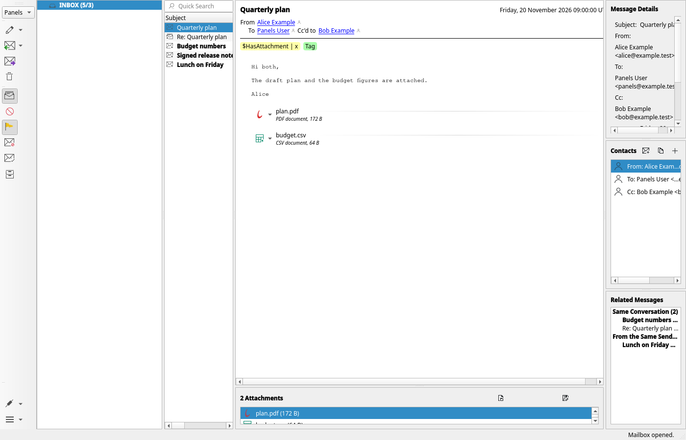
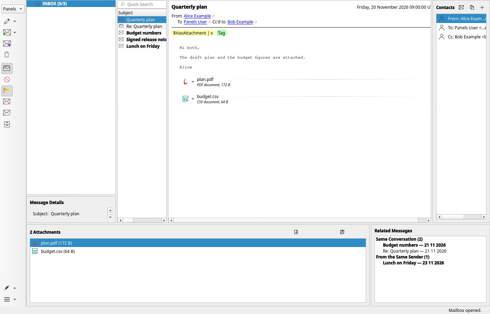
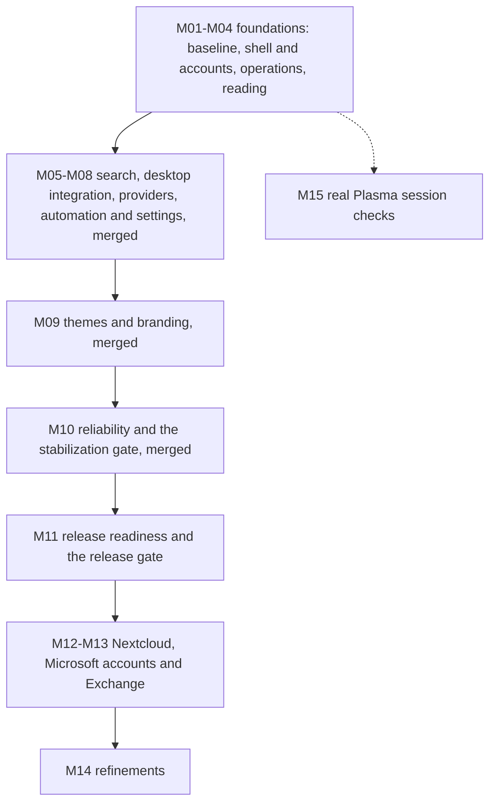

# Plasma Impresario

<p align="center">
  
</p>

<p align="center">
  <strong>A focused IMAP mail client for the KDE Plasma desktop</strong><br>
  Forked from Trojitá · C++20 · Qt 6 · KDE Frameworks 6
</p>

<p align="center">
  
  
  
  
  
  
</p>

**[Screenshots](#screenshots)** · **[Status](#project-status)** ·
**[Features](#implemented-today)** · **[Build and run](#build-and-run)** ·
**[Roadmap](docs/ROADMAP.md)** · **[Documentation](docs/README.md)** ·
**[Security](SECURITY.md)** ·
**[Limitations](docs/CAVEATS.md#security-and-data-protection)**

Plasma Impresario turns the Trojitá IMAP client into a Plasma-native mail
application for focused reading, account management and desktop integration.
Other desktop environments are outside the supported scope.

> [!IMPORTANT]
>
> Plasma Impresario is in development. The four foundation milestones (M01–M04:
> the KDE / Qt 6 baseline, the shell and accounts, mail operations, and
> reading), M05, search and indexing, M06, desktop integration and provider
> support, M07, rules and notifications, and M08, settings and workspaces, are
> merged into `main`. They are verified with offscreen tests and disposable
> mail servers, but nothing has been checked in a real Plasma session yet. See [project status](#project-status).

## Contents

- [Screenshots](#screenshots)
- [Project status](#project-status)
- [Implemented today](#implemented-today)
- [Using it](#using-it)
- [Build and run](#build-and-run)
- [Product direction](#product-direction)
- [Documentation](#documentation)
- [Application icon](#application-icon)
- [License](#license)

## Screenshots

Captured by `test_LiveImapPanels` against a synthetic mailbox in the headless
[dev container](CONTRIBUTING.md#live-mail-screenshots-and-a-vnc-view), so they
show the container's default Qt style rather than a Plasma theme.

<p align="center">
  
  <br>
  <em>Compact layout with the Attachments panel below the reader</em>
</p>

<details>
<summary>More layouts</summary>

<p align="center">
  
  <br>
  <em>Wide layout with Message Details, Contacts and Related Messages
  in the right column</em>
</p>

<p align="center">
  
  <br>
  <em>Panels around the reader: details on the left, contacts on the right,
  attachments and related messages in the footer</em>
</p>

</details>

## Project status

As of 2026-11-28. **Done** counts roadmap features whose issues are
![Completed][completed] or ![Merged][merged] on the
[project board](https://github.com/users/mikepadiernos/projects/4); **Board**
is the milestone's parent issue.

| Milestone                                                                                    | Branch                | Done                                                                 | Board                   | Notes                                                                            |
| -------------------------------------------------------------------------------------------- | --------------------- | -------------------------------------------------------------------- | ----------------------- | -------------------------------------------------------------------------------- |
| [M01](docs/ROADMAP.md#m01-kde--qt6-compatibility-baseline) KDE / Qt 6 baseline               | `main`                |  | ![Merged][merged]       | Builds, installs and launches with Qt 6 and KF6                                  |
| [M02](docs/ROADMAP.md#m02-shell-accounts-and-core-mailbox-foundation) Shell and accounts     | `main`                |  | ![Merged][merged]       | Checks in a real Plasma session moved to M15                                     |
| [M03](docs/ROADMAP.md#m03-mail-operations-sorting-and-folder-management) Mail operations     | `main`                |  | ![Merged][merged]       | Destructive actions verified against a live server                               |
| [M04](docs/ROADMAP.md#m04-reading-and-conversation-flow) Reading and conversations           | `main`                |  | ![Merged][merged]       | Merged in [PR #451](https://github.com/mikepadiernos/plasma-impresario/pull/451) |
| [M05](docs/ROADMAP.md#m05-search-and-indexing) Search and indexing                           | `main`                |  | ![Merged][merged]       | Merged in [PR #455](https://github.com/mikepadiernos/plasma-impresario/pull/455) |
| [M06](docs/ROADMAP.md#m06-desktop-integration-and-provider-support) Desktop integration      | `main`                |  | ![Merged][merged]       | Merged in [PR #489](https://github.com/mikepadiernos/plasma-impresario/pull/489) |
| [M07](docs/ROADMAP.md#m07-output-notifications-and-rules-automation) Rules and notifications | `main`                |  | ![Merged][merged]       | Merged in [PR #493](https://github.com/mikepadiernos/plasma-impresario/pull/493) |
| [M08](docs/ROADMAP.md#m08-settings-and-workspace-configuration) Settings and workspaces      | `main`                |  | ![Merged][merged]       | Merged in [PR #500](https://github.com/mikepadiernos/plasma-impresario/pull/500) |
| [M09](docs/ROADMAP.md#m09-themes-and-branding-foundation) Themes and branding                | `main`                |  | ![Merged][merged]       | Merged in [PR #504](https://github.com/mikepadiernos/plasma-impresario/pull/504) |
| [M10](docs/ROADMAP.md#m10-reliability-sync-and-notification-quality) Reliability and sync    | `main`                |  | ![Merged][merged]       | Merged in [PR #510](https://github.com/mikepadiernos/plasma-impresario/pull/510) |
| [M11](docs/ROADMAP.md#m11-release-readiness-and-polish) Release readiness                    | `feature/m11-release` |  | ![Completed][completed] | Release gate passed; Ubuntu sandbox check moved to M15                           |
| M12–M14: Nextcloud, Microsoft, refinements                                                   | —                     | —                                                                    | ![Backlog][backlog]     | Not started                                                                      |
| [M15](docs/ROADMAP.md#m15-real-plasma-session-verification) Real Plasma session checks       | —                     |        | ![Defined][defined]     | Needs a real Plasma session                                                      |

The [roadmap overview](docs/ROADMAP.md#milestones-at-a-glance) tracks every
milestone, and [pending tasks](docs/TODO.md#in-progress) record what each one
is waiting on.

## Implemented today

What works in `main` after M01–M11, as of 2026-11-28.

Legend: ![Verified][verified] against a disposable Dovecot server ·
![Offscreen tests][offscreen] covered by automated tests without a live server
· ![Needs verification][needs-verification] not yet checked end to end

> [!NOTE]
>
> No row has been checked in a real Plasma session; those checks are
> [M15](docs/ROADMAP.md#m15-real-plasma-session-verification). Limitations of
> each area are in the [caveats](docs/CAVEATS.md).

### Inherited from Trojitá

| Area               | What works                                                                    |
| ------------------ | ----------------------------------------------------------------------------- |
| Mail               | IMAP mailbox discovery, synchronization, offline modes, caching and threading |
| Folders and search | Folder navigation, search, sorting, flags and tags                            |
| Reading            | MIME alternatives, HTML rendering through Qt WebEngine and attachments        |
| Composing          | New messages, replies and forwards, local drafts and configurable delivery    |
| Plugins            | Optional password, address-book, spell-check and OpenPGP plugins              |

M01 verified that these build, install and launch with Qt 6. M04 verified
live reading, replies, forwards, attachments, drafts and failed-send recovery
against a disposable Dovecot server
([#93](https://github.com/mikepadiernos/plasma-impresario/issues/93)).

### Added in M02

Shell, accounts and mailbox foundation
([#4](https://github.com/mikepadiernos/plasma-impresario/issues/4)).

| Area              | What works                                                                                                        | Status                                    |
| ----------------- | ----------------------------------------------------------------------------------------------------------------- | ----------------------------------------- |
| Accounts          | Multiple IMAP accounts in one window, each with its own settings, connection, status and stored passwords         | ![Verified][verified]                     |
| Connection status | Connection, authentication, offline and loading states in the footer and per account                              | ![Verified][verified]                     |
| Saved searches    | Folder unread counts and named searches per account, run in the selected folder                                   | ![Verified][verified]                     |
| Sessions          | Layout, pane sizes, row density and the selected message restored across restarts                                 | ![Verified][verified]                     |
| Density           | Compact and comfortable message-list rows                                                                         | ![Verified][verified]                     |
| Embedded panels   | Attachments, Message Details, Contacts and Related Messages, each with its own placement                          | ![Verified][verified]                     |
| Mail shell        | Left, main and right columns and a footer; folder sidebar on either side; compact, wide and one-at-a-time layouts | ![Verified][verified]                     |
| Account sidebar   | Folder sidebar grouped by account, and an optional header with the account, folder and status                     | ![Verified][verified]                     |
| Identities        | Sender identities per account, with the account's default preselected and a **No identity** option                | ![Verified][verified]                     |
| OAuth             | Google and Microsoft sign-in for IMAP and SMTP, chosen per account                                                | ![Needs verification][needs-verification] |
| Capabilities      | Actions the account's protocol cannot perform are hidden                                                          | ![Needs verification][needs-verification] |

M02 was headless work (M02.01,
[#318](https://github.com/mikepadiernos/plasma-impresario/issues/318)); checks
that need a real Plasma session are their own milestone (M15,
[#319](https://github.com/mikepadiernos/plasma-impresario/issues/319)). The
[design guide](docs/philosophy/designs.md#current-interface) describes the shell
and panels in detail, and
[pending tasks](docs/TODO.md#m02-shell-and-account-foundation) record the
verification.

### Added in M03

Mail operations, sorting and folder management
([#5](https://github.com/mikepadiernos/plasma-impresario/issues/5)).

| Area                | What works                                                                                                                                       | Status                        |
| ------------------- | ------------------------------------------------------------------------------------------------------------------------------------------------ | ----------------------------- |
| Folder navigation   | Special folders first with theme icons, **Go to Folder** (<kbd>Ctrl</kbd>+<kbd>J</kbd>), **Go to Next Unread Folder** and **Check for New Mail** | ![Offscreen tests][offscreen] |
| Unified Inbox       | The INBOX of every chosen account in one list, acting on each message's own account                                                              | ![Verified][verified]         |
| Quick actions       | Archive, Move and Copy to recent folders, mark read, unread and flagged, from the menu, toolbar and keyboard                                     | ![Offscreen tests][offscreen] |
| Filters and sorting | Unread, Flagged and With Attachments filters, **Group By**, relevance sorting and a view remembered per folder                                   | ![Verified][verified]         |
| Selection           | Select All, Thread, Similar and Invert, keyboard selection, batch progress and errors in a notification bar                                      | ![Offscreen tests][offscreen] |
| Triage              | **Show Related**, fast next and previous keys, a dense processing layout and a searchable shortcut list                                          | ![Offscreen tests][offscreen] |
| Message rows        | Two-line rows with sender initials and unread, flag and attachment indicators                                                                    | ![Offscreen tests][offscreen] |
| Deleting            | Move to Trash with **Undo**, Delete Permanently, Empty Trash and Junk, and Rename Folder, with confirmations                                     | ![Verified][verified]         |

`test_LiveImapAccounts` and `test_LiveImapPanels` exercise the Unified Inbox,
**Check for New Mail**, filters and grouping against the disposable server.
`test_LiveImapOperations` runs each destructive action and **Undo** in a window
and checks the result in the server's mail files. Limitations are in the
[caveats](docs/CAVEATS.md#mail-operations).

### Added in M04

Reading and conversation flow
([#6](https://github.com/mikepadiernos/plasma-impresario/issues/6)).

| Area             | What works                                                                                                                                                                                                                                  | Status                        |
| ---------------- | ------------------------------------------------------------------------------------------------------------------------------------------------------------------------------------------------------------------------------------------- | ----------------------------- |
| Composing        | Replies, Reply to All but Me and Forward send from the message's account; a refused send keeps the composer open, and unsent mail reopens after a crash                                                                                     | ![Verified][verified]         |
| Reader actions   | A bar above the reader replies, forwards, archives, trashes, flags, marks read, shows attachments, zooms and switches to plain text for the open message                                                                                    | ![Verified][verified]         |
| Reading, triage  | Plain text wraps at a readable width; <kbd>Space</kbd> pages through the open message and then opens the next unread one                                                                                                                    | ![Verified][verified]         |
| Conversations    | <kbd>Alt</kbd>+<kbd>Down</kbd> and <kbd>Alt</kbd>+<kbd>Up</kbd> step through a conversation from oldest to newest; <kbd>Ctrl</kbd>+<kbd>.</kbd> and <kbd>Ctrl</kbd>+<kbd>,</kbd> expand and collapse every thread (keys not exercised live) | ![Verified][verified]         |
| Filters          | Filters keep whole threads and the open message; conversation steps show replies a filter hides                                                                                                                                             | ![Verified][verified]         |
| Subjects         | Replies without links join their conversation by subject within 30 days, ignoring localized prefixes and list tags; References can merge conversations                                                                                      | ![Verified][verified]         |
| Keyboard         | <kbd>F6</kbd> follows the screen order of panes and panels, also in right-to-left layouts; <kbd>Esc</kbd> returns from the reader or a panel to the message list                                                                            | ![Verified][verified]         |
| Search highlight | A message opened from a quick search shows the term in the find bar; <kbd>F3</kbd> steps through the matches (key not exercised live)                                                                                                       | ![Verified][verified]         |
| Reading privacy  | The remote-content bar names the blocked servers; hovering a link or opening its menu shows the full target and reasons for caution, and deceptive links ask before opening                                                                 | ![Verified][verified]         |
| Load on demand   | Parts which cannot be loaded, for example offline, are reported in the reader and load again on reconnect or **Try Again**                                                                                                                  | ![Verified][verified]         |
| Message security | Message Details shows the reader's signature and decryption results, with the signer, an icon and an accessible name                                                                                                                        | ![Offscreen tests][offscreen] |
| Dark schemes     | Plain text follows the color scheme; HTML without its own background is shown on a light page                                                                                                                                               | ![Offscreen tests][offscreen] |

`test_LiveImapPanels` and `test_LiveImapCompose` exercise the rows marked
![Verified][verified] against the disposable server. The live security check
uses a synthetic signature, so only the unverifiable result is seen there; the
other results are covered offscreen.

> [!WARNING]
>
> Some M04 behavior has known limits: inline PGP is detected but neither
> verified nor decrypted ([message security](docs/CAVEATS.md#message-security));
> a search in a threaded list splits threads
> ([conversations](docs/CAVEATS.md#conversations)); and each refused send files
> another copy in Sent, while drafts do not keep attachments
> ([composing and sending](docs/CAVEATS.md#composing-and-sending)). The live
> compose test sends through a local sendmail script, so SMTP submission has
> not been exercised end to end.

### Added in M05

Search and indexing
([#324](https://github.com/mikepadiernos/plasma-impresario/issues/324)).

| Area                 | What works                                                                                                                                                                                                          | Status                        |
| -------------------- | ------------------------------------------------------------------------------------------------------------------------------------------------------------------------------------------------------------------- | ----------------------------- |
| Places               | The quick search covers the shown folder, chosen folders, a whole account or all accounts; results arrive per folder, labelled with account and folder, with **Stop** and **Retry** for places that failed          | ![Verified][verified]         |
| Queries              | `from:`, `subject:`, `body:`, `tag:`, `is:`, `has:attachment`, `list:`, dates and sizes, negation, `OR` and groups; a search builder; searches the server cannot run are explained instead of showing an empty list | ![Verified][verified]         |
| Filters              | Date ranges narrow any search; **Clear All** clears the search and the filters in one step and keeps the selection                                                                                                  | ![Verified][verified]         |
| Virtual folders      | Saved searches appear in the sidebar with counts and can be edited, renamed, reordered and moved between accounts                                                                                                   | ![Verified][verified]         |
| Mailing lists        | Lists found in loaded messages can be shown, pinned as a saved search and unsubscribed from after confirming                                                                                                        | ![Verified][verified]         |
| Offline index        | An opt-in local index answers searches offline and first online, with **Search Server** adding the server's results; coverage, pausing, exclusions and deletion in a status dialog                                  | ![Verified][verified]         |
| Attachment text      | Downloaded attachments within a size limit are read into the index when the option is on                                                                                                                            | ![Verified][verified]         |
| Results              | Snippets with marked matches, sorting by relevance, facets by account, folder, sender, date, attachments and tag, and a Search Results panel with **Show in Folder**                                                | ![Verified][verified]         |
| Message-ID           | `mid:` links and `--message-id` open a message from the list, the index or a server search                                                                                                                          | ![Verified][verified]         |
| Keyboard             | <kbd>Ctrl</kbd>+<kbd>F</kbd> moves to the quick search from the list and opens the find bar in the reader; <kbd>Esc</kbd> and <kbd>F6</kbd> move between them                                                       | ![Verified][verified]         |
| History, suggestions | Recent searches, and `tag:`, contact and folder suggestions while typing, both optional                                                                                                                             | ![Offscreen tests][offscreen] |
| Saved files          | **Find Saved Files** searches downloaded attachments through Baloo, following its indexed folders, or searches live                                                                                                 | ![Offscreen tests][offscreen] |

`test_LiveImapSearch` exercises the rows marked ![Verified][verified] against
the disposable server, and `test_LiveImapPanels` the keyboard row.

> [!WARNING]
>
> Some M05 behavior has known limits: `has:attachment` follows the top-level
> message type, the index holds only the mail the offline cache keeps, and an
> online search of the shown folder alone still runs on the server. See the
> [search caveats](docs/CAVEATS.md#search).

### Added in M06

Desktop integration and provider support
([#7](https://github.com/mikepadiernos/plasma-impresario/issues/7)).

| Area                | What works                                                                                                                                                  | Status                        |
| ------------------- | ----------------------------------------------------------------------------------------------------------------------------------------------------------- | ----------------------------- |
| POP3                | POP3 accounts download mail into a store on this computer, shown as one inbox, with server retention settings and SMTP sending                              | ![Verified][verified]         |
| JMAP                | JMAP accounts discover the server's capabilities, synchronize folders and messages both ways and send through the server                                    | ![Verified][verified]         |
| Gmail and discovery | Gmail sign-in and settings, and server settings found from the address when adding an account                                                               | ![Offscreen tests][offscreen] |
| Mail safety         | ClamAV scanning and spam-handling hooks, junk handling, attachment warnings, link targets shown before opening, and header hardening with private Bcc       | ![Offscreen tests][offscreen] |
| Files               | **Show in Folder**, opening attachments with other apps, remote files through KIO, and the portal file chooser                                              | ![Offscreen tests][offscreen] |
| My Day and contacts | An agenda panel with today's events, due tasks and flagged mail, and address-book names, photos and organizations                                           | ![Offscreen tests][offscreen] |
| Desktop             | Running in the background, starting after login, window activation, notifications and job progress, Plasma Search, Plasma widgets, and user-only local data | ![Offscreen tests][offscreen] |

The POP3 row runs against the disposable Dovecot server
(`tools/dev-container/live-pop3.sh`) and the JMAP row against a disposable
Stalwart server (`tools/dev-container/live-jmap.sh`, run separately from
ctest).

> [!WARNING]
>
> The desktop rows need a real Plasma session to confirm, which is
> [M15](docs/ROADMAP.md#m15-real-plasma-session-verification). POP3 and JMAP
> accounts have known limits, such as no push for JMAP and no server folders
> for POP3; see the [POP3](docs/CAVEATS.md#pop3-accounts) and
> [JMAP](docs/CAVEATS.md#jmap-accounts) caveats.

### Added in M07

Output, notifications and rules automation
([#8](https://github.com/mikepadiernos/plasma-impresario/issues/8)).

| Area       | What works                                                                                                                                                                       | Status                        |
| ---------- | -------------------------------------------------------------------------------------------------------------------------------------------------------------------------------- | ----------------------------- |
| Mail rules | Ordered rules per account and folder on senders, recipients, subject, attachments, folder, tags and junk, which move, archive, delete, flag, mark read, tag or announce new mail | ![Offscreen tests][offscreen] |
| Previews   | Moving rules wait for a preview of their current version; **Apply to Folder…** asks first; rules can be made from searches and saved searches                                    | ![Offscreen tests][offscreen] |
| New mail   | One updatable notification per IMAP account with **Open**, **Mark as Read** and **Delete**, per-account modes and per-folder announcements                                       | ![Offscreen tests][offscreen] |
| Activity   | Connections, offline text downloads, attachment scans, rules and announcements, with actions to resolve them                                                                     | ![Offscreen tests][offscreen] |

> [!WARNING]
>
> Rules have not been tried against a live server, and only IMAP accounts are
> covered. See the [Mail rules](docs/CAVEATS.md#mail-rules) and
> [New-mail notifications and activity](docs/CAVEATS.md#new-mail-notifications-and-activity)
> caveats.

### Added in M08

Settings and workspace configuration
([#9](https://github.com/mikepadiernos/plasma-impresario/issues/9)).

| Area         | What works                                                                                                                                                       | Status                                    |
| ------------ | ---------------------------------------------------------------------------------------------------------------------------------------------------------------- | ----------------------------------------- |
| Settings     | **Settings...** groups General, Accounts, Appearance, Reading, Composition, Privacy, Notifications, Search, Integrations, Workspaces and Keyboard in a page list | ![Offscreen tests][offscreen]             |
| Overrides    | Reading, message and search settings per account or folder, each explaining where an inherited value comes from                                                  | ![Offscreen tests][offscreen]             |
| Layout       | Compact, Comfortable and Focus layout presets                                                                                                                    | ![Offscreen tests][offscreen]             |
| Workspaces   | Accounts, a notes folder and a Plasma Activity grouped together; the window can follow the current activity                                                      | ![Needs verification][needs-verification] |
| Tabs         | Optional mail tabs, off by default, in any shell region, horizontally or vertically, restored at the next start                                                  | ![Offscreen tests][offscreen]             |
| Vim mode     | Optional Vim keys, off by default, for the folder tree, message list and reader, with hints and a status indicator                                               | ![Offscreen tests][offscreen]             |
| Keymap       | Export, import with a preview, undo and follow a keymap shared with Plasma Opus                                                                                  | ![Offscreen tests][offscreen]             |
| Productivity | **Add to Calendar…** and **Save as Note**, off by default and explained when unavailable                                                                         | ![Offscreen tests][offscreen]             |

> [!WARNING]
>
> Activities, the calendar hand-off and Marknote have not been tried in a
> Plasma session. See the [Settings and workspaces](docs/CAVEATS.md#settings-and-workspaces), [Mail tabs](docs/CAVEATS.md#mail-tabs),
> [Vim mode and shared shortcuts](docs/CAVEATS.md#vim-mode-and-shared-shortcuts) and
> [Messages to calendar and notes](docs/CAVEATS.md#messages-to-calendar-and-notes) caveats.

### Added in M09

Themes and branding foundation
([#10](https://github.com/mikepadiernos/plasma-impresario/issues/10)).

| Area            | What works                                                                                                                                                           | Status                                    |
| --------------- | -------------------------------------------------------------------------------------------------------------------------------------------------------------------- | ----------------------------------------- |
| Colors          | Plasma's scheme and accent by default, or app-local light and dark presets, installed KDE schemes, a color editor with contrast checks, an own accent and pane tints | ![Offscreen tests][offscreen]             |
| Effects         | KWin blur behind translucent windows, window, pane and panel opacity, and corner radii                                                                               | ![Needs verification][needs-verification] |
| Lines and lists | Dividers, tree lines and their colors, message cards, row striping, hover and selection styles                                                                       | ![Offscreen tests][offscreen]             |
| Account colors  | Colors for accounts and folders, set by hand or by rules, in the folder tree, cards, tabs and pickers                                                                | ![Offscreen tests][offscreen]             |
| Text            | Fonts per area, compact to comfortable spacing, tab and status bar styles, and animation speed                                                                       | ![Offscreen tests][offscreen]             |
| Accessibility   | High-contrast schemes suspend effects; layouts stay readable from 800x600 to 2560x1440, with large text and at 200%                                                  | ![Offscreen tests][offscreen]             |
| Profiles        | Versioned theme profiles, import and export, exchange with Plasma Opus and a checked Qt Style Sheet                                                                  | ![Offscreen tests][offscreen]             |
| Workspaces      | A workspace carries a theme profile and selected appearance options                                                                                                  | ![Offscreen tests][offscreen]             |
| Shell           | Toolbar buttons with a menu show an accent corner marker; the tray can use a symbolic icon                                                                           | ![Offscreen tests][offscreen]             |
| Naming          | Project code uses Plasma Impresario names; `PLASMA_IMPRESARIO_PROFILE` chooses the profile                                                                           | ![Offscreen tests][offscreen]             |

> [!WARNING]
>
> Blur, Breeze and high-contrast schemes have not been tried in a Plasma
> session. See the [Themes and appearance](docs/CAVEATS.md#themes-and-appearance) and
> [Project naming and compatibility](docs/CAVEATS.md#project-naming-and-compatibility) caveats.

### Added in M10

Reliability, sync and notification quality
([#11](https://github.com/mikepadiernos/plasma-impresario/issues/11)), the
[stabilization gate](docs/stabilization-gate.md) before broader product
expansion.

| Area           | What works                                                                                                                           | Status                        |
| -------------- | ------------------------------------------------------------------------------------------------------------------------------------ | ----------------------------- |
| Recovery       | Retries with a growing delay, offline handling, expired sign-ins and server errors recover without silently losing messages          | ![Verified][verified]         |
| Counts         | Folder and unread counts stay consistent across accounts and concurrent changes                                                      | ![Verified][verified]         |
| Activity       | Failed background work stays in the activity log with **Retry** or **Retry All Failed** until resolved                               | ![Offscreen tests][offscreen] |
| Outbox         | Unsent messages wait in a persistent outbox across restarts and offline periods, are never sent twice and refused ones become drafts | ![Offscreen tests][offscreen] |
| Header loading | The last 30 days of headers load first; older headers follow in small batches that wait for your actions and the outbox              | ![Verified][verified]         |
| Search index   | The offline search index follows CONDSTORE and QRESYNC updates and rebuilds after UIDVALIDITY changes or corruption                  | ![Offscreen tests][offscreen] |
| Performance    | Large folders, long threads, bulk actions and attachments are measured against [workload budgets](docs/performance.md#budgets)       | ![Verified][verified]         |
| Sanitizers     | The test suite and live scripts run clean under [AddressSanitizer and UndefinedBehaviorSanitizer](docs/sanitizers.md)                | ![Verified][verified]         |

> [!WARNING]
>
> The gate runs headless against fake and disposable local servers, not real
> providers, and ThreadSanitizer is not run. See the
> [Read state and unread counts](docs/CAVEATS.md#read-state-and-unread-counts),
> [Performance and resource use](docs/CAVEATS.md#performance-and-resource-use),
> [Sanitizers and data races](docs/CAVEATS.md#sanitizers-and-data-races),
> [Persistent outbox](docs/CAVEATS.md#persistent-outbox) and
> [Background header loading](docs/CAVEATS.md#background-header-loading) caveats.

### Added in M11

Release readiness and polish
([#12](https://github.com/mikepadiernos/plasma-impresario/issues/12)): the audits, scenarios, gate and
guidance that decide whether a release can ship. It is
[not ready yet](docs/RELEASE.md#release-decision).

| Area              | What works                                                                                                                                       | Status                                    |
| ----------------- | ------------------------------------------------------------------------------------------------------------------------------------------------ | ----------------------------------------- |
| Accessibility     | Accessible names, keyboard-only workflows, localization and scaled displays pass an [audit](docs/accessibility.md)                               | ![Offscreen tests][offscreen]             |
| End-to-end        | Every core workflow, from account setup to reply, compose, search, rules and recovery, maps to a [test](docs/e2e-coverage.md)                    | ![Verified][verified]                     |
| Desktop scenarios | Nine [scripted scenarios](docs/e2e-coverage.md#desktop-scenarios) drive the installed app through AT-SPI on a virtual display, with screenshots  | ![Verified][verified]                     |
| Release gate      | Formatting, dependency versions, a reproducible build, the tests with coverage and static analysis pass the [release gate](docs/release-gate.md) | ![Verified][verified]                     |
| Release guidance  | [Release criteria](docs/RELEASE.md), known issues, a triage of every open caveat, and install, upgrade and security guidance                     | ![Verified][verified]                     |
| Renderer sandbox  | On Ubuntu 24.04 and later the installer adds an [AppArmor profile](docs/INSTALL.md#renderer-sandbox-on-ubuntu) instead of disabling the sandbox  | ![Needs verification][needs-verification] |

> [!WARNING]
>
> The scenarios run plain Qt on a virtual display, not a Plasma session, and
> the AppArmor profile is untried on Ubuntu; both are checked in
> [M15](docs/ROADMAP.md#m15-real-plasma-session-verification). See the
> [Release gate scope](docs/CAVEATS.md#release-gate-scope) caveat.

## Using it

### Accounts

- The toolbar account selector switches between accounts without
  reconnecting. <kbd>Ctrl</kbd>+<kbd>Alt</kbd>+<kbd>PgDown</kbd> and
  <kbd>Ctrl</kbd>+<kbd>Alt</kbd>+<kbd>PgUp</kbd> switch to the next and previous
  account; both shortcuts can be rebound.
- **Add Account**, **Rename Account**, **Remove Account** and **Account
  Settings…** are in the application menu; each account's header in the folder
  sidebar has a menu with the last three. Account Settings edits the account's
  identities, IMAP, offline and SMTP settings in its own dialog.
- **Add Account** asks for your name and email address. **Find Settings**
  looks up the IMAP and SMTP servers from built-in providers, the domain's
  autoconfig file, Thunderbird's database of mail providers, DNS records and
  common host names, without signing in. It shows where the servers came from
  and any provider guidance, such as app passwords or OAuth sign-in, and asks
  you to confirm servers found through unsigned DNS outside your mail domain.
  The account settings open next so you can sign in. See
  [Server settings discovery](docs/CAVEATS.md#server-settings-discovery).
- [Mail providers](docs/integrations/providers.md) explains how Gmail,
  Outlook.com, Microsoft 365, the other built-in providers and any IMAP and
  SMTP server sign in and which server features are used. On Gmail,
  **Archive** uses **All Mail**, sent messages are not uploaded twice, and the
  open message shows its labels. See [Provider setup and Gmail](docs/CAVEATS.md#provider-setup-and-gmail).
- **Add Account** can also create a POP3 account, which downloads mail into a
  store on this computer, keeps it on the server or removes it as you choose,
  and shows it as a single inbox. See
  [POP3 accounts](docs/CAVEATS.md#pop3-accounts).
- **Add Account** can also create a JMAP account, which keeps a copy of the
  server's folders and messages on this computer, synchronizes it both ways
  and sends through the JMAP server or SMTP. See
  [JMAP accounts](docs/CAVEATS.md#jmap-accounts).
- Removing an account deletes its settings, stored passwords and offline
  cache, but not any mail on the server. Removing a POP3 account also deletes
  the mail it downloaded.
- All accounts connect at startup. An account with a network error, a missing
  password or failed authentication shows a warning in the selector, on its
  sidebar header and in the footer, and raises one desktop notification.
- An existing configuration becomes the first account on startup. New
  profiles store passwords with QtKeychain when it is available. An account can
  sign in with a password or with Google or Microsoft OAuth; see
  [OAuth sign-in](docs/CAVEATS.md#oauth-sign-in).
- Each account has its own sender identities by default, and the composer
  preselects the account's default identity. An account can instead use the
  shared identities, or **No identity**, which starts the composer with an empty
  From address and no signature.
- The reader names each message's account. Replies and forwards start from the
  account that received the message, and the composer can switch to another
  account beside the **From** identities. Drafts remember their account, and the
  composer warns about an account without an outgoing server or an identity of
  another account.
- With two or more accounts, the folder sidebar shows a header for each
  account. Clicking a header switches to that account; clicking the active
  account's header collapses or expands its folders.

> [!NOTE]
>
> Only the active account's folders are shown at a time; the other accounts
> show their header and status. See
> [multiple accounts](docs/CAVEATS.md#multiple-accounts).

### Shell and panels

- **View › Layout** chooses Compact, Wide or One At a Time, and **View ›
  Folder Sidebar Position** puts the folder tree in the left or right column.
- **View › Embedded Panels** shows or hides each panel, hides it while empty
  and places it below the reader, in either side column or in the footer.
  Attachments is on by default; the other panels are off.
- Related Messages lists the open message's conversation and the sender's
  other mail from the loaded list. **Search the Server**, in the panel's search
  menu, also finds them on the server in the message's folder, up to 20 folders
  of the account or chosen folders, without leaving the shown folder.
- Contacts lists everyone in the open message once, with their roles. With an
  address book that can describe contacts, it shows the contact's name,
  organization and stored photo, opens known contacts and adds unknown ones;
  nothing is looked up online. See
  [Contacts from the address book](docs/CAVEATS.md#contacts-from-the-address-book).
- My Day lists today's events and tasks due today or overdue from KDE PIM
  calendars, then flagged and `$TODO` messages from the shown folder and each
  account's search index. Events with an online meeting link offer **Join**,
  and **Open in Calendar** starts KOrganizer or Merkuro Calendar. Without
  calendars, it lists the messages only. See
  [My Day calendars and follow-up mail](docs/CAVEATS.md#my-day-calendars-and-follow-up-mail).
- **View › Show Header** adds a header above the columns with the active
  account, the folder and the account's status. It is off by default.
- <kbd>F6</kbd> and <kbd>Shift</kbd>+<kbd>F6</kbd> move focus through the
  header, account selector, folder tree, quick search, message list, reader and
  each visible panel in the order they appear on screen. <kbd>Esc</kbd> in the reader or a
  panel returns to the message list.
- The Navigation toolbar docks at the left window edge by default. The menu
  bar is hidden; open the menus from the toolbar's main menu button or turn the
  bar on with **View › Show Main Menu Bar**.
- Closing the window quits. **Settings › General › Run in the background**
  keeps mail checked with the window closed; open it again from the tray icon
  or the launcher. **Start after login** then starts it hidden when you log in.
  See [desktop integration](docs/CAVEATS.md#desktop-integration).
- The offline cache is readable only by you. An attachment opened in another
  application is a read-only copy in the cache that is removed after a day;
  use **Save Attachment** to keep it. See
  [local data](docs/CAVEATS.md#local-data-and-opened-attachments).
- After an attachment or message is saved, the notice above the message list
  offers **Show in Folder**, which opens the folder in your file manager with
  the file selected. See
  [saved files](docs/CAVEATS.md#saved-files-in-the-file-manager).
- File managers can start a message with files attached, through KDE's e-mail
  sharing or `plasma-impresario --attach <file>`. A notice in the composer
  names each file so you can check them before sending, and lists any that
  could not be attached. Links inside messages cannot attach files.
  See [handed-over files](docs/CAVEATS.md#files-handed-over-by-file-managers).
- Files on other computers, such as `sftp:` or `smb:` URLs, can be dropped on
  the composer, chosen with **Attach** or handed over. Each is fetched into a
  private copy, with progress and **Cancel**, and a notice lists what was
  fetched and what failed. Web links dropped into the text stay links. See
  [fetched files](docs/CAVEATS.md#files-fetched-from-other-computers).
- Line breaks pasted into a subject or name become spaces. Bcc recipients are
  hidden from everyone who receives the message but kept in Sent and drafts,
  and Message-IDs use your mail domain rather than the computer's name. See
  [outgoing headers](docs/CAVEATS.md#outgoing-headers-and-bcc).

### Searching and saved searches

The quick search above the message list searches the selected folder on the
server. **Mailbox › Find...** (<kbd>Ctrl</kbd>+<kbd>F</kbd>) or <kbd>/</kbd>
moves to it with the last query selected, and <kbd>Esc</kbd> returns to the
list; while the reader has focus, <kbd>Ctrl</kbd>+<kbd>F</kbd> finds text in the
open message instead. Words search the fields chosen in its options menu and must all match;
quote a phrase. Fields narrow a term, such as `from:ann`, `subject:"release
plan"`, `list:dev.lists.example.org`, `tag:$label1`, `is:unread`, `has:attachment`,
`date>=2026-01` or `size>2M`, and `-` or `NOT`, `OR` and parentheses combine
them. An invalid query is explained below the field instead of being sent.
**Search Builder...** in the options menu or the **Mailbox** menu
(<kbd>Ctrl</kbd>+<kbd>Shift</kbd>+<kbd>B</kbd>) builds the same query from rows
of field, comparison and value, matching all or any of them.
The options menu also offers fuzzy matching and a
**Date** range: today, the past week, month or year, or custom days with an
optional start and end. A date range narrows text, field and raw IMAP
queries, and on its own filters the list by date. **Search In** widens the
search to chosen folders of any account, the whole account or all accounts;
results appear in one list, labelled with their account and folder, as each
folder is searched. The status line's tooltip shows each account's progress;
**Stop** ends the search and keeps what was found, and **Retry** searches the
accounts and folders that failed again. A search the server cannot run says why
in the status line instead of showing an empty list.

The query syntax follows the advanced search of the Plasma Opus file manager
where it fits mail, so the same habits work in both; neither app needs the
other.

| Terms                                                                                                        | In Plasma Impresario                                  | In Plasma Opus                                          |
| ------------------------------------------------------------------------------------------------------------ | ----------------------------------------------------- | ------------------------------------------------------- |
| Words and `"quoted phrases"`                                                                                 | All must match, in the fields chosen in the options   | All must match, in file names                           |
| `-`, `NOT`, `AND`, `OR` and parentheses                                                                      | `AND` binds tighter than `OR`; `-(…)` negates a group | The same, but `-` before a parenthesis is a plain minus |
| `date:`, or `date` with `=`, `<`, `<=`, `>`, `>=`, and `YYYY-MM-DD`, `YYYY-MM`, `YYYY`, `today`, `yesterday` | The message's Date header                             | The modification date, also as `modified`               |
| `size` with `<`, `<=`, `>` or `>=`, and `K`, `M` or `G`                                                      | The message size, up to 4 GB                          | The file size, also with `size:`, `=` and `T`           |
| `content:` or `contents:`                                                                                    | The message text, the same as `body:`                 | The text within files                                   |
| `tag:` or `tags:`                                                                                            | A message tag, such as `tag:$label1`                  | A file tag                                              |
| `from:`, `to:`, `cc:`, `bcc:`, `subject:`, `body:`, `text:`, `list:`, `is:`, `has:attachment`                | Mail only                                             | Not available                                           |
| `name:`, `path:`, `type:`, `tagged:`, `meta:`                                                                | Not available; quote them to search for the text      | Files only                                              |

While a search is shown, each message row adds a snippet of the message's
downloaded text around the first match, with the matched words in bold.
**Mailbox › Sorting › Relevance** puts the best matches first, also in results
of several places, and is remembered for later searches; date stays the
default.

**Narrow** above the results, also under **View › Filter › Narrow Results**,
counts the results by account, folder, sender, date, attachments and tag.
Choosing values narrows the list: values of one kind are alternatives, and
kinds combine. Each chosen value shows as a chip that removes it, and the
facets reset when you search again or elsewhere.

**View › Embedded Panels › Search Results** lists the results in their own
panel instead, so the message list keeps showing its folder. Opening a result
shows it in the reader without leaving that folder, and **Show in Folder**, in
the panel or the message list's context menu, switches to the result's account
and folder and selects it there. The panel sorts by relevance or date from its
header; turning it off moves the results back to the message list.

A search applies within the quick filters, and a row above the list shows the
query, date range, places and filters in effect. Its **Clear All** button, or
<kbd>Ctrl</kbd>+<kbd>Shift</kbd>+<kbd>Backspace</kbd>, clears them together and
returns to the message that was current before, or keeps the one you opened
among the results.

The search field remembers the last 20 searches you ran, and while you type it
offers matching recent searches, favorite tags, address book contacts and the
shown account's folders; press <kbd>Down</kbd> to open the list at any time.
**Remember Searches**, **Suggest While Typing** and **Clear Search History**
in the search options control this.

Enter a query and choose **Save Current Search** from the search options menu.
**Saved Searches** in the same menu runs, edits, renames or deletes the active
account's saved queries. A saved search keeps its date range and where it searches; preset
ranges stay relative, so a saved "Past Week" search always covers the latest
week. The **Saved Searches** section below the folders shows the saved
searches of every account as virtual folders, with the unread and total
messages each found when it last ran. Choosing one runs it, switching to its
account first when it searches the shown folder or account; choosing a folder
returns to that folder. Its context menu edits a search with a preview of what
it finds, renames, reorders, moves or deletes it, and updates a search whose
account or chosen folders are gone.

Messages from a mailing list name the list in the reader's header, with its
**Post**, **Subscribe**, **Unsubscribe**, **Help**, **Archive** and **Owner**
links from the message's `List-*` headers. Each link asks first and says
whether it writes a message or opens a web page. **Mailing Lists** in the
search options shows the messages of any list among the loaded messages, and
**Pin Shown List as Saved Search** keeps that view as a saved search of every
folder of every account. `list:` matches a list's `List-Id`, or its posting
address when it has none.

**Index downloaded mail for searching offline**, in an account's **Offline**
settings, keeps a full-text index of the headers and downloaded text of the
mail the account keeps offline. It is off by default, and nothing is
downloaded for it; **Download Message Text for Offline Search...** in a
folder's context menu asks before fetching the text of messages that lack it.
While the account is offline, searches are answered from the index and the
status line says so, warning when results may be incomplete. **Application ›
Offline Search Index…** shows which folders are confirmed as indexed, the
progress of an update, and lets you pause, resume, rebuild or delete the
index, and uncheck folders to keep them out of it. Decrypted text of
encrypted messages is indexed only if you choose to, when you open them, and
so is the text of attachments you download, such as PDF and office files,
read by the same extractors as Plasma's file search. Turning the option off
deletes the index.

Online, a search of several places or of the Unified Inbox is answered from
the index first. **Search Server**, next to the status line, then adds the
messages found on the server, such as older mail the account does not keep
offline, without listing any message twice.

**Settings › General › Show indexed mail in Plasma Search** lets Plasma
Search (KRunner) find mail in the offline search index. Every word of three or
more letters must appear in a message's subject or sender; message text is not
searched. Each result shows the subject, the sender and the date, and choosing
one opens the message. The option is off by default; results come only from
accounts with an index, and only while the app is running. See
[Plasma Search mail](docs/CAVEATS.md#plasma-search-mail).

**Mailbox › Find Saved Files…** finds attachments and messages you saved, with
Plasma's File Search in your file manager, such as Dolphin or Plasma Opus. It
starts in the folder you last saved to, or Downloads, and says whether File
Search is set to index that folder, or only a folder inside it, worded as
Plasma Opus words it; when it is not, **Live Search** looks through the names
and text of the files there instead. **Find Saved Copies…** in the
attachment panel's context menu searches for that attachment's file name. Mail
is not added to File Search; only the files you save are, like any other file.

A `mid:` link, such as `mid:report@example.com`, or `plasma-impresario
--message-id report@example.com`, opens the message with that Message-ID, in
the running window if there is one. Messages already listed, or in the offline
search index, open at once, switching accounts if needed. Otherwise the app
asks before searching every folder on your mail servers, which you can stop,
and says when no message was found. When there are several copies, the first
one opens and the bar names the folders of the others.

Requests from a launcher, a `mailto:` or `mid:` link, a file manager, Plasma
Search or a notification go to the running window of the same profile and
bring the window they are about to the front: the main window, or the composer
for new mail. They pass on Plasma's activation token, so Plasma's focus
stealing prevention lets the window come forward. Windows are never pinned to a
virtual desktop, Activity or screen. See
[Window activation for requests](docs/CAVEATS.md#window-activation-for-requests).

When the Plasma session ends, open composers save their unsent messages as
drafts without asking, and the next start reopens them. Attachments are not
saved with drafts. See
[Saving unsent messages at session end](docs/CAVEATS.md#saving-unsent-messages-at-session-end).

Files to attach, drafts to edit and folders for saved-file search are chosen
through the XDG desktop portal's file chooser, so the dialog comes from
whichever program serves the portal, such as Plasma or, once it does, Plasma
Opus. When no portal answers, the KDE dialog appears. Save dialogs still use
the KDE dialog directly. See
[Portal file chooser](docs/CAVEATS.md#portal-file-chooser).

The task manager entry shows how many messages are unread in the inboxes of
all accounts. Only the number leaves the application; turn it off under
**Settings → General**. Feedback on the desktop never takes the focus or raises
a window. See
[Desktop feedback](docs/integrations/kde-plasma.md#desktop-feedback) and
[Unread count on the task manager](docs/CAVEATS.md#unread-count-on-the-task-manager).

Two optional Plasma widgets follow the running app. **Mail Status** puts an
unread badge on the panel and, opened, lists each account's unread count and
state with **Compose** and **Open Plasma Impresario**. **Mail Ticker** scrolls
or pages through the newest unread mail; it pauses under the pointer, steps
with Left and Right, and opens a message with Enter or a click.
**Settings › General › Plasma widgets may show** chooses what they learn:
nothing, unread counts and account status (the default), or also the senders,
or the senders and subjects, of unread mail in accounts with an offline search
index. See [Plasma widgets](docs/integrations/kde-plasma.md#plasma-widgets) and
the [caveat](docs/CAVEATS.md#plasma-widgets).

Icons come from the active Plasma icon theme, with symbolic variants for small
action icons, and error, warning and success states take their colors from the
Plasma color scheme. The main controls have names for screen readers and can
be reached with the keyboard. See
[Appearance and accessibility](docs/integrations/kde-plasma.md#appearance-and-accessibility)
and [Accessibility and theming](docs/CAVEATS.md#accessibility-and-theming).

### Rules, notifications and activity

**Mail Rules…** in the application menu keeps rules in the order they run.
Each rule covers one account or every account and the INBOX or chosen
folders, matches all or any of its conditions on the sender, recipients,
subject, attachments, folder, tags or junk, and moves, archives, deletes,
flags, marks read, tags or announces the message. **Preview** lists what a
rule matches in the folder shown, and **Apply to Folder…** runs it there after
asking. A rule that moves messages runs on new mail by itself only after its
current version was previewed; until then the activity log asks for a
review. **Create Rule from Search…** in the mailbox menu, or **Create
Rule...** on a saved search, turns a search into a rule and previews it. See
[Mail rules](docs/CAVEATS.md#mail-rules).

New mail in each IMAP account is announced in one desktop notification,
updated as mail arrives, with **Open**, **Mark as Read** and, for a single
message, **Delete**. Mail already read, old mail moved into the INBOX and the
conversation you are reading are left out. **Configure Notifications…** sets
each account to every message, a summary or nothing, chooses the folders
announced besides the INBOX, waits while the window is in use, and can hide
senders and subjects; **Notify About New Mail** on a folder turns it on there.

The **Activity** window, opened from the application menu or the button in the
status bar, lists connections, offline text downloads, attachment scans, rules
and announcements, newest first, with **Retry**, **Sign In** or **Review
Rule** where they help. See
[New-mail notifications and activity](docs/CAVEATS.md#new-mail-notifications-and-activity).

### Sending and the outbox

When an account is offline, the composer puts the message in the outbox;
after a failed send, **Send Later** does the same. The status bar shows how
many messages wait; its button opens the **Outbox** window, where a message
can be sent, sent again after a confirmation, moved to the drafts or
forgotten. Messages are sent oldest first once their account is online, also
after a restart. A message whose send was interrupted is never sent again on
its own: the outbox asks whether to **Send Again…** or **Move to Drafts**. A
message the server refuses returns to the drafts with the server's reason.
See [Persistent outbox](docs/CAVEATS.md#persistent-outbox).

### Settings, tabs and Vim mode

**Settings...** in the application menu shows every group in a page list and
reopens the one shown last. Under **Accounts**, reading, message and search
settings can be set for one account or one folder, including **Folder shown
first**; each override says where the inherited value comes from, such as
**Inherited from account Work**, and can be removed. **Appearance** chooses
the Compact, Comfortable or Focus layout and turns on **Open folders and
messages in tabs**, with the tab bar's region and orientation. **Search**
chooses where searches look, whether the offline index or the server answers
while online, how many searches are kept and which accounts are indexed. See
[Settings and workspaces](docs/CAVEATS.md#settings-and-workspaces) and [Mail tabs](docs/CAVEATS.md#mail-tabs).

**Workspaces** groups accounts, a notes folder and a Plasma Activity; with
**Show a workspace's account when its activity becomes current** on, the
window follows the activity. Under **Integrations**, **Add to Calendar…**
hands the message in the reader to the calendar application and **Save as
Note** writes it to a notes folder, such as Marknote's; both are off by
default and explain why when they cannot be offered. See
[Messages to calendar and notes](docs/CAVEATS.md#messages-to-calendar-and-notes).

**Keyboard** turns on the optional Vim mode: `j` and `k` move, sequences such
as `gt` switch tabs, a hint popup lists what may follow, and the status bar
shows the pending keys. Text fields keep their keys. **Export…**,
**Import…**, **Undo Import** and **Follow changes to a shared keymap file**
share Vim mode and the shared commands with
[Plasma Opus](docs/integrations/plasma-opus.md#vim-mode-and-shortcuts). See
[Vim mode and shared shortcuts](docs/CAVEATS.md#vim-mode-and-shared-shortcuts).

### Themes and appearance

**Theme** in the settings changes how Plasma Impresario looks without touching
the desktop. Every option follows Plasma until it is changed, and **Preview
changes in the window** shows a change before it is saved. **Colours** picks a
color scheme, an accent, colors for named roles and accounts, and a pane tint;
**Effects** sets translucency, blur, corner radii and motion; **Lines and
Lists** sets dividers, tree lines, striping, selection and folder color rules;
**Text and Tabs** sets fonts, spacing and the look of tabs and the status bar.
**Profiles** saves the options as a theme profile, imports and exports
profiles, including Plasma Opus ones, and can follow a profile file;
**Stylesheet** checks and applies a Qt Style Sheet. **Reset to Plasma
Defaults** undoes it all. **Cards** or **Rows** in the density menu choose the
message list style, and a folder's menu chooses its color. Under
**Workspaces**, a workspace can carry a theme profile and selected options.
See [Themes and appearance](docs/CAVEATS.md#themes-and-appearance).

### Command line

| Option                      | Effect                                                         |
| --------------------------- | -------------------------------------------------------------- |
| `-p`, `--profile`           | Use a separate configuration with its own accounts             |
| `-c`, `--compose`           | Open the composer                                              |
| `mailto:…`                  | Open the composer with the address and fields prefilled        |
| `--message-id <id>`         | Open the message with this Message-ID                          |
| `mid:…`                     | Open the message named by a `mid:` URL                         |
| `-a`, `--addressbook`       | Open the address book, when a plugin provides one              |
| `-l`, `--log-to-disk`       | Log IMAP traffic to disk from startup                          |
| `--background`              | Start without the window, when running in the background is on |
| `--reset-appearance`        | Reset the theme options to Plasma's defaults before starting   |
| `--no-workspace-appearance` | Start without workspaces' theme profiles and overrides         |
| `-v`, `--version`           | Print the version                                              |

Run `plasma-impresario --help` for the full list.

## Build and run

> [!TIP]
>
> The quickest route is the installer, which checks dependencies, builds and
> installs into `~/.local`:
>
> ```bash
> ./install.sh
> ```
>
> The [installation guide](docs/INSTALL.md) covers supported platforms,
> per-distribution packages, custom prefixes, updating, uninstalling and
> troubleshooting.

**Requirements:** CMake, Ninja, a C++20 compiler, Qt 6.7 or later and KDE
Frameworks 6.26 or later (ItemModels, Config and I18n). Qt WebEngine Widgets is
needed to display messages. Optional plugins have additional dependencies; see
the [compatibility baseline](docs/philosophy/compatibility.md).

To build and test by hand:

```bash
cmake -S . -B build -G Ninja -DCMAKE_BUILD_TYPE=Debug
cmake --build build
QT_QPA_PLATFORM=offscreen ctest --test-dir build --output-on-failure
./build/plasma-impresario
```

Tests are built by default (`BUILD_TESTING=ON`), and the build always uses Qt 6.

> [!WARNING]
>
> Qt WebEngine is on by default (`WITH_WEBENGINE=ON`). A build without it
> (`-DWITH_WEBENGINE=OFF` or `./install.sh --without-webengine`) cannot display
> message contents.

On hosts without Plasma, such as macOS, build and test in the headless Fedora
container under `tools/dev-container/`; see
[building outside Plasma](CONTRIBUTING.md#building-outside-plasma). Desktop
integration still needs a real Plasma session.

The [stabilization gate](docs/stabilization-gate.md) runs the build, the test
suite, the workload budgets, the roadmap link check and the live server tests
in that container, and the sanitizer run on request:

```bash
tools/dev-container/run.sh sh tools/dev-container/stabilization-gate.sh build -E Cryptography_PGP
```

## Product direction

The [roadmap](docs/ROADMAP.md) puts reliable mail and account boundaries first,
then search, desktop and provider integration, automation, settings, themes and
release quality. Real Plasma session checks run alongside as M15.



Vim mode and workspaces arrived in M08, themes and theme profiles in M09, and
the outbox and background header loading in M10, and the release gate in M11.
[Plasma Opus](docs/integrations/plasma-opus.md) is the companion file manager;
the two apps share Vim mode settings through a keymap file and themes through
theme profiles, and are planned to share file dialogs and workspace context. The [scope](docs/philosophy/scope.md) sets the product
boundaries.

## Documentation

| Start with                                          | For                                                                                 |
| --------------------------------------------------- | ----------------------------------------------------------------------------------- |
| [Documentation index](docs/README.md)               | Every guide, grouped by purpose                                                     |
| [Installation](docs/INSTALL.md)                     | Supported platforms, installer options, updates, data locations and troubleshooting |
| [Security policy](SECURITY.md)                      | Supported versions, private vulnerability reports and security posture              |
| [Roadmap](docs/ROADMAP.md)                          | Milestones, status and issue links                                                  |
| [Interface design](docs/philosophy/designs.md)      | The current shell and the planned Plasma Impresario design                          |
| [Pending tasks](docs/TODO.md)                       | Blockers, verification records and handoffs                                         |
| [Release readiness](docs/RELEASE.md)                | Release criteria, known issues and the caveat triage                                |
| [Bugs](docs/BUGS.md) and [caveats](docs/CAVEATS.md) | Reported issues, limitations and security guidance                                  |
| [Contributing](CONTRIBUTING.md)                     | Development workflow, documentation style and the dev container                     |

## Application icon

The [application icon](src/icons/plasma-impresario.svg) combines an envelope
with the Plasma Opus golden spiral. The application and its desktop entry use
it.

## License

Plasma Impresario keeps Trojitá's license: GPL version 2, or (at your option)
version 3 or any later version accepted by the membership of KDE e.V. See
[LICENSE](LICENSE).

[backlog]: https://img.shields.io/badge/Backlog-6e7781
[completed]: https://img.shields.io/badge/Completed-2da44e
[defined]: https://img.shields.io/badge/Defined-57606a
[merged]: https://img.shields.io/badge/Merged-8250df
[needs-verification]: https://img.shields.io/badge/Needs_verification-0969da
[offscreen]: https://img.shields.io/badge/Offscreen_tests-0969da
[verified]: https://img.shields.io/badge/Verified-1a7f37
