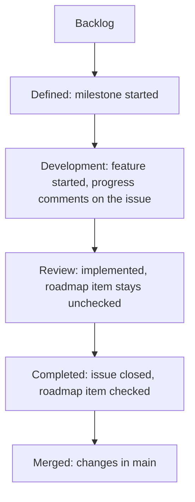

<!-- markdownlint-disable MD013 -->

# Plasma Impresario roadmap

**[Documentation](README.md)** · **[Pending tasks](TODO.md)** ·
**[Bugs](BUGS.md)** · **[Caveats](CAVEATS.md)** ·
**[Scope](philosophy/scope.md)** · **[Design](philosophy/designs.md)** ·
**[Contributing](../CONTRIBUTING.md)** ·
**[Project board](https://github.com/users/mikepadiernos/projects/4)**

Plasma Impresario is an in-development IMAP mail client for the KDE Plasma
desktop only, forked from Trojitá and built with C++20, Qt 6 and KDE
Frameworks 6. This roadmap is the source of truth for milestone order, scope
and feature completion. It orders foundational mailbox work before desktop
integration, productivity features and release-quality refinements. Board
statuses and checkboxes are as of 2026-11-25.

Legend: ![Backlog][backlog] · ![Defined][defined] ·
![Development][development] · ![Review][review] · ![Completed][completed] ·
![Merged][merged] into `main`

> [!IMPORTANT]
>
> Feature completion follows the project board. An item is checked only when its
> issue is ![Completed][completed] or ![Merged][merged] and its implementation
> is verified; items in ![Review][review] or earlier stay unchecked. Blocked or
> unverifiable work is recorded in [pending tasks](TODO.md), and limitations of
> completed features in [caveats](CAVEATS.md), including
> [security and data protection](CAVEATS.md#security-and-data-protection).

> [!NOTE]
>
> M01–M05 are merged into `main` and verified with offscreen tests and a
> synthetic Dovecot server. Nothing has been checked in a real Plasma session
> yet; those checks are
> [M15](#m15-real-plasma-session-verification).

## Contents

- [Milestones at a glance](#milestones-at-a-glance)
- [Recommended priority](#recommended-priority)
- [Milestones](#milestones)
  - [M01: KDE / Qt6 compatibility baseline](#m01-kde--qt6-compatibility-baseline)
  - [M02: Shell, accounts, and core mailbox foundation](#m02-shell-accounts-and-core-mailbox-foundation)
  - [M03: Mail operations, sorting, and folder management](#m03-mail-operations-sorting-and-folder-management)
  - [M04: Reading and conversation flow](#m04-reading-and-conversation-flow)
  - [M05: Search and indexing](#m05-search-and-indexing)
  - [M06: Desktop integration and provider support](#m06-desktop-integration-and-provider-support)
  - [M07: Output, notifications, and rules automation](#m07-output-notifications-and-rules-automation)
  - [M08: Settings and workspace configuration](#m08-settings-and-workspace-configuration)
  - [M09: Themes and branding foundation](#m09-themes-and-branding-foundation)
  - [M10: Reliability, sync, and notification quality](#m10-reliability-sync-and-notification-quality)
  - [M11: Release readiness and polish](#m11-release-readiness-and-polish)
  - [M12: Nextcloud and digital asset management](#m12-nextcloud-and-digital-asset-management)
  - [M13: Microsoft accounts and Exchange](#m13-microsoft-accounts-and-exchange)
  - [M14: Refinements](#m14-refinements)
  - [M15: Real Plasma session verification](#m15-real-plasma-session-verification)
- [Keeping the roadmap current](#keeping-the-roadmap-current)

## Milestones at a glance

**Done** counts roadmap features whose issues are ![Completed][completed] or
![Merged][merged]. The count is green when all are done, amber once work starts
and gray before. **Board** is the parent issue's status.

| Milestone                                                 | Focus                                          | Parent issue                                                          | Done                                                                 | Board                                                                                                                                    |
| --------------------------------------------------------- | ---------------------------------------------- | --------------------------------------------------------------------- | -------------------------------------------------------------------- | ---------------------------------------------------------------------------------------------------------------------------------------- |
| [M01](#m01-kde--qt6-compatibility-baseline)               | KDE / Qt 6 compatibility baseline              | [#1](https://github.com/mikepadiernos/plasma-impresario/issues/1)     |  | ![Merged][merged]                                                                                                                        |
| [M02](#m02-shell-accounts-and-core-mailbox-foundation)    | Shell, accounts and core mailbox foundation    | [#4](https://github.com/mikepadiernos/plasma-impresario/issues/4)     |  | ![Merged][merged]                                                                                                                        |
| [M03](#m03-mail-operations-sorting-and-folder-management) | Mail operations, sorting and folder management | [#5](https://github.com/mikepadiernos/plasma-impresario/issues/5)     |  | ![Merged][merged]                                                                                                                        |
| [M04](#m04-reading-and-conversation-flow)                 | Reading and conversation flow                  | [#6](https://github.com/mikepadiernos/plasma-impresario/issues/6)     |  | ![Merged][merged]                                                                                                                        |
| [M05](#m05-search-and-indexing)                           | Search and indexing                            | [#324](https://github.com/mikepadiernos/plasma-impresario/issues/324) |  | ![Merged][merged]: merged in [PR #455](https://github.com/mikepadiernos/plasma-impresario/pull/455)                                      |
| [M06](#m06-desktop-integration-and-provider-support)      | Desktop integration and provider support       | [#7](https://github.com/mikepadiernos/plasma-impresario/issues/7)     |      | ![Backlog][backlog]                                                                                                                      |
| [M07](#m07-output-notifications-and-rules-automation)     | Output, notifications and rules automation     | [#8](https://github.com/mikepadiernos/plasma-impresario/issues/8)     |      | ![Backlog][backlog]                                                                                                                      |
| [M08](#m08-settings-and-workspace-configuration)          | Settings and workspace configuration           | [#9](https://github.com/mikepadiernos/plasma-impresario/issues/9)     |      | ![Backlog][backlog]                                                                                                                      |
| [M09](#m09-themes-and-branding-foundation)                | Themes and branding foundation                 | [#10](https://github.com/mikepadiernos/plasma-impresario/issues/10)   |      | ![Development][development]: M09.01 started with the merged rename [#221](https://github.com/mikepadiernos/plasma-impresario/issues/221) |
| [M10](#m10-reliability-sync-and-notification-quality)     | Reliability, sync and notification quality     | [#11](https://github.com/mikepadiernos/plasma-impresario/issues/11)   |      | ![Backlog][backlog]                                                                                                                      |
| [M11](#m11-release-readiness-and-polish)                  | Release readiness and polish                   | [#12](https://github.com/mikepadiernos/plasma-impresario/issues/12)   |      | ![Backlog][backlog]                                                                                                                      |
| [M12](#m12-nextcloud-and-digital-asset-management)        | Nextcloud and digital asset management         | [#31](https://github.com/mikepadiernos/plasma-impresario/issues/31)   |        | ![Backlog][backlog]                                                                                                                      |
| [M13](#m13-microsoft-accounts-and-exchange)               | Microsoft accounts and Exchange                | [#388](https://github.com/mikepadiernos/plasma-impresario/issues/388) |      | ![Backlog][backlog]                                                                                                                      |
| [M14](#m14-refinements)                                   | Refinements                                    | [#15](https://github.com/mikepadiernos/plasma-impresario/issues/15)   |      | ![Backlog][backlog]                                                                                                                      |
| [M15](#m15-real-plasma-session-verification)              | Real Plasma session verification               | [#319](https://github.com/mikepadiernos/plasma-impresario/issues/319) |        | ![Defined][defined]                                                                                                                      |

## Recommended priority

| Priority | Focus                            | Recommended next work                                                                                                                                                                                 | Where it stands (2026-11-25)                                                                                                                                                                                                                                                                                                                                                                                        |
| -------- | -------------------------------- | ----------------------------------------------------------------------------------------------------------------------------------------------------------------------------------------------------- | ------------------------------------------------------------------------------------------------------------------------------------------------------------------------------------------------------------------------------------------------------------------------------------------------------------------------------------------------------------------------------------------------------------------- |
| **P0**   | Reproducible, safe baseline      | Confirm product identity and supported build matrix; establish verified TLS and safe credential defaults; document cache and logging behavior; add focused connection/security and launch smoke tests | Build matrix, installer and launch smoke tests merged with M01 ([#1](https://github.com/mikepadiernos/plasma-impresario/issues/1)); the product rename [#221](https://github.com/mikepadiernos/plasma-impresario/issues/221) is merged. Other distribution families and protected prefixes are [pending](TODO.md#m01-release-gate-and-integration)                                                                  |
| **P1**   | Rendering and account boundaries | Verify live reader workflows; design stable per-account settings, cache and credentials before adding simultaneous accounts                                                                           | Per-account settings, cache and credentials merged with M02 ([#4](https://github.com/mikepadiernos/plasma-impresario/issues/4)), together with simultaneous accounts ([#222](https://github.com/mikepadiernos/plasma-impresario/issues/222)); live reader workflows verified against synthetic Dovecot in M04 ([#93](https://github.com/mikepadiernos/plasma-impresario/issues/93)). Real-session checks are in M15 |
| **P2**   | Shell and reliability            | Prototype the Plasma Impresario layout over existing mailbox/list/reader behavior; validate accessibility, keyboard use, responsive layouts and partial-failure recovery                              | Shell merged with M02 ([#35](https://github.com/mikepadiernos/plasma-impresario/issues/35)); accessibility, responsive layouts and recovery continue in M09, M10, M11 and M14                                                                                                                                                                                                                                       |
| **P3**   | Optional productivity features   | Add provider APIs, rules, Nextcloud, calendar/contacts and workspace features only after core reliability, permissions and privacy behavior are defined                                               | M05 is merged; planned in M06–M08, M12 and M13, whose parent issues are in the Backlog                                                                                                                                                                                                                                                                                                                              |

These are sequencing priorities, not issue statuses or completion markers.
Follow the [board workflow](../CONTRIBUTING.md#board-statuses) before updating
milestone completion.

## Milestones

Milestones are ordered by product dependency. Compare each one with the current
baseline in the [backend](parity/backend.md) and [UI](parity/ui.md) parity
guides before treating foundational mailbox functionality as entirely new. The
issue synchronization handoff is tracked in
[pending tasks](TODO.md#milestone-feature-issue-synchronization).

### M01: KDE / Qt6 compatibility baseline

**Status:** ![Merged][merged]
 ·
**Parent issue:** [#1](https://github.com/mikepadiernos/plasma-impresario/issues/1)

**Project:** [M01 milestone](https://github.com/users/mikepadiernos/projects/4?pane=issue&itemId=314445774)

**Goal:** Deliver a reproducible Qt 6 / KDE build that users can install,
launch, and use to read mail. Establish the compatibility and smoke-test gate
for later milestones.

**Verification handoff:** The renderer and M01.04 release-gate issues are
merged. The deferred live account and message-reading checks were since
completed against a disposable Dovecot server in M02
([#78](https://github.com/mikepadiernos/plasma-impresario/issues/78)) and M04
([#93](https://github.com/mikepadiernos/plasma-impresario/issues/93)).
Plasma-session checks remain deferred to M06 and M15. See
[TODO](TODO.md#m01-release-gate-and-integration).

Work through the supported environment, renderer, installer, and verification
in that order. Installer improvements can proceed in parallel, but a complete
installation depends on the working renderer.

- **M01.01: Supported environment and dependencies**

  **Project:** [Subsection](https://github.com/users/mikepadiernos/projects/4?pane=issue&itemId=314566982) · [Dependency audit](https://github.com/users/mikepadiernos/projects/4?pane=issue&itemId=314499124) ·
  [Compatibility matrix](https://github.com/users/mikepadiernos/projects/4?pane=issue&itemId=314538695)

  - [x] Define supported distributions, package managers, compilers, Qt 6 and KDE
        Frameworks versions, and KDE Plasma versions and sessions. [Board](https://github.com/users/mikepadiernos/projects/4?pane=issue&itemId=314538695)
  - [x] Audit CMake, SDK assumptions, and package names and versions for each
        supported distribution. Separate required dependencies from optional
        integrations and report unsupported or missing requirements clearly. [Board](https://github.com/users/mikepadiernos/projects/4?pane=issue&itemId=314499124)
  - [x] Verify dependencies and compatibility limitations for IMAP, local storage,
        message rendering, and desktop services. [Board](https://github.com/users/mikepadiernos/projects/4?pane=issue&itemId=314568575)
        The [initial compatibility baseline](philosophy/compatibility.md) records the
        first target, component evidence, and outstanding full-reader verification.

- **M01.02: Qt WebEngine message renderer**

  **Project:** [Renderer port](https://github.com/users/mikepadiernos/projects/4?pane=issue&itemId=314539659)

  The WebEngine reader is integrated with per-message profiles and request
  policy. The renderer-enabled build, CTest suite, temporary-prefix
  installation, executable startup, and installer checks passed. The live
  message-reading, reply, and attachment smoke tests were completed headless in
  M04; see [TODO](TODO.md#m01-release-gate-and-integration).

  1. [x] Define the WebEngine profile and request lifecycle, including per-message isolation, cancellation, and cleanup when switching messages. [Board](https://github.com/users/mikepadiernos/projects/4?pane=issue&itemId=314568588)
  2. [x] Add regression tests for MIME loading, cancellation, message switching, remote-content policy, navigation, quoting, and rendering failures. [Board](https://github.com/users/mikepadiernos/projects/4?pane=issue&itemId=314568809)
  3. [x] Update CMake to use Qt6::WebEngineWidgets and retain the explicitly labeled renderer-free build. [Board](https://github.com/users/mikepadiernos/projects/4?pane=issue&itemId=314568819)
  4. [x] Register and implement MIME-part and `cid:` URL handling using the existing IMAP model, including asynchronous fetching, errors, and inline images. [Board](https://github.com/users/mikepadiernos/projects/4?pane=issue&itemId=314568598)
  5. [x] Enforce message privacy: disable scripts, plugins, and persistent web storage; block remote and local-file access by default; allow remote content only after explicit per-message consent, including redirects. [Board](https://github.com/users/mikepadiernos/projects/4?pane=issue&itemId=314568610)
  6. [x] Port the message view, headers, source view, and rendering layout to WebEngine while preserving MIME alternatives, nested messages, and attachments. [Board](https://github.com/users/mikepadiernos/projects/4?pane=issue&itemId=314568620)
  7. [x] Replace synchronous WebKit APIs for reply quoting, selection, search, links, context menus, zoom, and styling with WebEngine-compatible behavior. [Board](https://github.com/users/mikepadiernos/projects/4?pane=issue&itemId=314568798)

- **M01.03: Installer**

  **Project:** [Installer](https://github.com/users/mikepadiernos/projects/4?pane=issue&itemId=314544368) ·
  [Package manager](https://github.com/users/mikepadiernos/projects/4?pane=issue&itemId=314445891) ·
  [Renderer fallback](https://github.com/users/mikepadiernos/projects/4?pane=issue&itemId=314446004)

  - [x] Complete the existing installer for dependency setup, configuration, build,
        and installation. Provide flags for check-only dependency inspection,
        skipping dependency handling, and building without installing the app.
        Surface errors and request administrator privileges only when needed.
        [Board](https://github.com/users/mikepadiernos/projects/4?pane=issue&itemId=314568548)
  - [x] Detect the appropriate supported package manager, prefer Arch/CachyOS
        tooling where applicable, and install only missing dependencies without
        falling back to an unrelated package manager. [Board](https://github.com/users/mikepadiernos/projects/4?pane=issue&itemId=314445891)
  - [x] Support user and system prefixes; verify executable and plugin loading,
        runtime libraries, desktop entries, icons, translations, handbook, and man
        page. [Board](https://github.com/users/mikepadiernos/projects/4?pane=issue&itemId=314568559)
  - [x] Document prerequisites, installation options, troubleshooting, and
        distribution-specific risks. Keep renderer-free builds explicitly labeled
        as unable to display messages. [Board](https://github.com/users/mikepadiernos/projects/4?pane=issue&itemId=314446004)
  - [x] Integrate the WebEngine dependency and full reader once the port is ready;
        installing a renderer-free build does not satisfy this milestone. [Board](https://github.com/users/mikepadiernos/projects/4?pane=issue&itemId=314568565)

  The installer checks for installed packages and provides explicit WebEngine
  and renderer-free options. The latter is an opt-in incomplete build, not the
  default or a substitute for the reader. Remaining validation and
  compatibility work is tracked in
  [TODO](TODO.md#m01-release-gate-and-integration).

- **M01.04: Verification and release gate**

  **Project:** [Subsection](https://github.com/users/mikepadiernos/projects/4?pane=issue&itemId=314568447) · [Build and launch](https://github.com/users/mikepadiernos/projects/4?pane=issue&itemId=314498915) ·
  [Installation and smoke tests](https://github.com/users/mikepadiernos/projects/4?pane=issue&itemId=314539763)

  - [x] Verify clean builds and installs across the observed CachyOS target and
        package managers, including user and system prefixes and the renderer-free
        configuration. Other distribution families and protected system prefixes remain
        pending. [Board](https://github.com/users/mikepadiernos/projects/4?pane=issue&itemId=314539763)
  - [x] Check package-manager selection, already-installed and missing dependencies,
        failure handling, and explicit renderer options without modifying the
        system during automated tests. [Board](https://github.com/users/mikepadiernos/projects/4?pane=issue&itemId=314568832)
  - [x] Smoke-test launch and application startup in the supported target
        environment. Run renderer and privacy regression tests and verify recovery
        from build, startup, installer, and configuration failures.
        Account setup, live mailbox reading, replies and attachment workflows are
        deferred to M02 and M04; Plasma session integration is deferred to M06.
        [Board](https://github.com/users/mikepadiernos/projects/4?pane=issue&itemId=314498915)
  - [x] Record tested environments, reproducible verification steps, and remaining
        protocol, storage, rendering, and desktop-service limitations. Later
        milestones depend on this gate. [Board](https://github.com/users/mikepadiernos/projects/4?pane=issue&itemId=314568837)

### M02: Shell, accounts, and core mailbox foundation

**Status:** ![Merged][merged]
 ·
**Parent issue:** [#4](https://github.com/mikepadiernos/plasma-impresario/issues/4)

**Project:** [M02 milestone](https://github.com/users/mikepadiernos/projects/4?pane=issue&itemId=314497855)

- **M02.01: Headless implementation and verification**

  **Project:** [Subsection](https://github.com/users/mikepadiernos/projects/4?pane=issue&itemId=317303874)

  Work that can be built and verified without a desktop session, using
  offscreen QtTest runs and the synthetic Dovecot server in
  `tools/dev-container/`.

  - [x] Build a Plasma Opus-inspired shell with a header, left column, main
        column, right column, and footer. Existing widgets and panes, such as the
        folder tree, message list, and reader, keep their current appearance and
        layout, adapted to the new shell, so the default look is unchanged. See the
        [shell and interface widget designs](philosophy/designs.md).
        [Board](https://github.com/users/mikepadiernos/projects/4?pane=issue&itemId=314539964)
    - Keep the current toolbar and menus as the header, and show connection
      status in the footer.
    - Place the mailbox sidebar in either side column, and arrange the message
      list and reader side by side, stacked, or one panel at a time in the main
      column.
    - Show side columns and the footer only while they hold content, and save
      region sizes, sidebar side, and layout per layout.
    - Provide attachments, message details, contacts, and related messages
      embedded panels. Each can be shown, hidden when empty, and placed below
      the reader, in either side column, or in the footer; include shown panels
      in F6 focus cycling.
  - [x] Define account models, connection state, folder structure, and mailbox lifecycle [Board](https://github.com/users/mikepadiernos/projects/4?pane=issue&itemId=314540057)
  - [x] Support multiple simultaneous mail accounts in one window with independent account state and configuration [Board](https://github.com/users/mikepadiernos/projects/4?pane=issue&itemId=314607650)
  - [x] Design protocol-aware account and capability models that preserve existing IMAP behavior and allow POP3 and JMAP integrations in M06 [Board](https://github.com/users/mikepadiernos/projects/4?pane=issue&itemId=314594590)
  - [x] Support OAuth account authentication with secure desktop authorization, per-account token storage, renewal, and recovery [Board](https://github.com/users/mikepadiernos/projects/4?pane=issue&itemId=314595922)
  - [x] Implement the app skeleton in the same overall layout as the design spec [Board](https://github.com/users/mikepadiernos/projects/4?pane=issue&itemId=314568848)
  - [x] Support compact and comfortable density modes before moving into feature-heavy workflows [Board](https://github.com/users/mikepadiernos/projects/4?pane=issue&itemId=314568860)
  - [x] Add folder counts, unread counts, and saved-search entry points to the mailbox foundation [Board](https://github.com/users/mikepadiernos/projects/4?pane=issue&itemId=314568869)
  - [x] Keep this milestone as the blocker for all later mailbox productivity work [Board](https://github.com/users/mikepadiernos/projects/4?pane=issue&itemId=314569071)
  - [x] Provide account setup, editing, removal, identities, and secure credential storage for IMAP and sending accounts [Board](https://github.com/users/mikepadiernos/projects/4?pane=issue&itemId=314569080)
  - [x] Verify baseline account setup and recovery with an isolated test account,
        as the M01.04 live-account acceptance handoff. [Board](https://github.com/users/mikepadiernos/projects/4?pane=issue&itemId=314569080)
  - [x] Expose connection, authentication, offline, and loading states without blocking the interface [Board](https://github.com/users/mikepadiernos/projects/4?pane=issue&itemId=314569089)
  - [x] Support account grouping, collapsible folder navigation, and keyboard focus across the shell [Board](https://github.com/users/mikepadiernos/projects/4?pane=issue&itemId=314569100)
  - [x] Preserve pane layout, selection, and density preferences across sessions [Board](https://github.com/users/mikepadiernos/projects/4?pane=issue&itemId=314569110)

Later milestone parent issues are blocked by
[#4](https://github.com/mikepadiernos/plasma-impresario/issues/4). Apply the
same gate when starting their feature issues.

Checks that need a real Plasma session moved to
[M15](#m15-real-plasma-session-verification) so they do not block M02.

Pending: [M02 handoff](TODO.md#m02-shell-and-account-foundation).

**Caveats:**

- [Related messages and message details panels](CAVEATS.md#related-messages-and-message-details-panels)
  ([#264](https://github.com/mikepadiernos/plasma-impresario/issues/264))
  ![Review][review]
- [OAuth sign-in](CAVEATS.md#oauth-sign-in)
  ([#362](https://github.com/mikepadiernos/plasma-impresario/issues/362))
  ![Review][review]

### M03: Mail operations, sorting, and folder management

**Status:** ![Merged][merged]
 ·
**Parent issue:** [#5](https://github.com/mikepadiernos/plasma-impresario/issues/5)

**Project:** [M03 milestone](https://github.com/users/mikepadiernos/projects/4?pane=issue&itemId=314497950) ·
[Folders and views](https://github.com/users/mikepadiernos/projects/4?pane=issue&itemId=314540205) ·
[Sorting and triage](https://github.com/users/mikepadiernos/projects/4?pane=issue&itemId=314540321)

- [x] Implement folder navigation for inbox, sent, drafts, trash, and custom folders [Board](https://github.com/users/mikepadiernos/projects/4?pane=issue&itemId=314540205)
- [x] Provide an Aqua Mail-inspired unified inbox that combines selected accounts while retaining the source account and folder of each message [Board](https://github.com/users/mikepadiernos/projects/4?pane=issue&itemId=314607669)
- [x] Add sorting, filtering, selection, unread state, and bulk actions for message lists [Board](https://github.com/users/mikepadiernos/projects/4?pane=issue&itemId=314540321)
- [x] Support folder sync, account grouping, and desktop-heavy triage behavior [Board](https://github.com/users/mikepadiernos/projects/4?pane=issue&itemId=314569116)
- [x] Add quick actions for archive, move, flag, mark read, and delete [Board](https://github.com/users/mikepadiernos/projects/4?pane=issue&itemId=314569131)
- [x] Include The Bat!-style power-user workflows: batch actions, filtering, and dense desktop processing [Board](https://github.com/users/mikepadiernos/projects/4?pane=issue&itemId=314569139)
- [x] Add advanced sorting and threading controls for date, relevance, and conversation grouping, and thread messages by sender address, subject, tag, unread state, mailing list, and similar attributes [Board](https://github.com/users/mikepadiernos/projects/4?pane=issue&itemId=314569324)
- [x] This milestone is the blocker for all reading/search and productivity work that depends on real mailbox behavior [Board](https://github.com/users/mikepadiernos/projects/4?pane=issue&itemId=314569335)
- [x] Provide an Aqua Mail-inspired message list of readable compact rows with clear sender, subject, date, unread, flag, and attachment indicators ([design](philosophy/designs.md#message-list-presentation)) [Board](https://github.com/users/mikepadiernos/projects/4?pane=issue&itemId=314569342)
- [x] Add predictable multi-selection, keyboard shortcuts, and progress or error feedback for batch operations [Board](https://github.com/users/mikepadiernos/projects/4?pane=issue&itemId=314569349)
- [x] Define folder actions and confirmation or recovery behavior for destructive message operations [Board](https://github.com/users/mikepadiernos/projects/4?pane=issue&itemId=314569359)
- [x] Support account and folder scoped views and preserve selection and sort state during message updates [Board](https://github.com/users/mikepadiernos/projects/4?pane=issue&itemId=314569367)

The parent issues of M04, M05, M06, M07, M10, M12 and M13, whose features
read, search or act on real mailboxes, are blocked by
[#5](https://github.com/mikepadiernos/plasma-impresario/issues/5). Apply the
same gate when starting their feature issues.

**Caveats:**

- [Mail operations](CAVEATS.md#mail-operations)
  ([#312](https://github.com/mikepadiernos/plasma-impresario/issues/312))
  ![Backlog][backlog]

### M04: Reading and conversation flow

**Status:** ![Merged][merged]
 ·
**Parent issue:** [#6](https://github.com/mikepadiernos/plasma-impresario/issues/6),
merged in pull request
[#451](https://github.com/mikepadiernos/plasma-impresario/pull/451)

**Project:** [M04 milestone](https://github.com/users/mikepadiernos/projects/4?pane=issue&itemId=314498050) ·
[Reading](https://github.com/users/mikepadiernos/projects/4?pane=issue&itemId=314540493) ·
[Conversations](https://github.com/users/mikepadiernos/projects/4?pane=issue&itemId=314540557) ·
[Composition and sending](https://github.com/users/mikepadiernos/projects/4?pane=issue&itemId=314540653)

- [x] Build the reading pane with metadata, preview controls, attachments, and action buttons [Board](https://github.com/users/mikepadiernos/projects/4?pane=issue&itemId=314540493)
- [x] Show the reader's verified signature and decryption results, including inline PGP, in the message details panel [Board](https://github.com/users/mikepadiernos/projects/4?pane=issue&itemId=317147460)
- [x] Add thread-aware grouping and conversation navigation [Board](https://github.com/users/mikepadiernos/projects/4?pane=issue&itemId=314540557)
- [x] Improve the preview panel for readability and fast triage [Board](https://github.com/users/mikepadiernos/projects/4?pane=issue&itemId=314569371)
- [x] Ensure keyboard navigation works for desktop-heavy usage [Board](https://github.com/users/mikepadiernos/projects/4?pane=issue&itemId=314569380)
- [x] Validate the full reading flow from list selection through reading and response actions [Board](https://github.com/users/mikepadiernos/projects/4?pane=issue&itemId=314569544)
- [x] Exercise live message reading, replies, attachments, and failure recovery
      with isolated test mail, completing the M01.04 live-reader smoke handoff.
      [Board](https://github.com/users/mikepadiernos/projects/4?pane=issue&itemId=314569544)
- [x] Load message bodies and attachments on demand and show clear loading, unavailable, and error states [Board](https://github.com/users/mikepadiernos/projects/4?pane=issue&itemId=314569551)
- [x] Support compose, reply, reply-all, forward, drafts, sending, and failed-send recovery [Board](https://github.com/users/mikepadiernos/projects/4?pane=issue&itemId=314540653)
- [x] Preserve the originating account and sending identity in reading, replies, drafts, and composition across individual and unified mail views [Board](https://github.com/users/mikepadiernos/projects/4?pane=issue&itemId=314607717)
- [x] Keep threaded and flat views navigable and preserve conversation context across filters [Board](https://github.com/users/mikepadiernos/projects/4?pane=issue&itemId=314569569)
- [x] Protect reading privacy with explicit remote-content and external-link handling [Board](https://github.com/users/mikepadiernos/projects/4?pane=issue&itemId=314569578)
- [x] Highlight active search terms in the reader and step through matches with
      the find bar, without loading remote content. See
      [M05](#m05-search-and-indexing).
      [Board](https://github.com/users/mikepadiernos/projects/4?pane=issue&itemId=317852924)
- [x] Group replies that lack References and In-Reply-To headers by their
      normalized subject within a time window, ignoring localized prefixes such as
      Re:, AW: and Re[2]: and leading list tags, and merge conversations that a new
      message links together. See [E-Mail](philosophy/inspirations.md#e-mail).
      [Board](https://github.com/users/mikepadiernos/projects/4?pane=issue&itemId=318073350)
- [x] In dark color schemes, show plain-text mail in the app's colors and HTML
      mail that sets no background of its own on a light page, without loading
      remote content or running scripts. See
      [E-Mail](philosophy/inspirations.md#e-mail).
      [Board](https://github.com/users/mikepadiernos/projects/4?pane=issue&itemId=318073669)

Checks in a real Plasma session are in
[M15](#m15-real-plasma-session-verification).

**Caveats:**

- [Message security](CAVEATS.md#message-security)
  ([#442](https://github.com/mikepadiernos/plasma-impresario/issues/442))
  ![Backlog][backlog]
- [Reading privacy](CAVEATS.md#reading-privacy)
  ([#443](https://github.com/mikepadiernos/plasma-impresario/issues/443))
  ![Backlog][backlog]
- [Loading on demand](CAVEATS.md#loading-on-demand)
  ([#444](https://github.com/mikepadiernos/plasma-impresario/issues/444))
  ![Backlog][backlog]
- [Reader actions](CAVEATS.md#reader-actions)
  ([#445](https://github.com/mikepadiernos/plasma-impresario/issues/445))
  ![Backlog][backlog]
- [Conversations](CAVEATS.md#conversations)
  ([#449](https://github.com/mikepadiernos/plasma-impresario/issues/449))
  ![Backlog][backlog]
- [Composing and sending](CAVEATS.md#composing-and-sending)
  ([#450](https://github.com/mikepadiernos/plasma-impresario/issues/450))
  ![Backlog][backlog]

### M05: Search and indexing

**Status:** ![Merged][merged]
 ·
**Parent issue:** [#324](https://github.com/mikepadiernos/plasma-impresario/issues/324)

**Project:** [M05 milestone](https://github.com/users/mikepadiernos/projects/4?pane=issue&itemId=317845712)

Find mail quickly across folders and accounts, online and offline. M05 builds on
the existing per-mailbox IMAP quick search, with its subject, body, sender and
recipient fields, raw IMAP queries, fuzzy matching and per-account saved
searches. Server search stays the default, and the local index is opt-in. See
the [search patterns](philosophy/inspirations.md#search-patterns) and the
[Plasma Opus search integration](integrations/plasma-opus.md#search-and-indexing).
Recommendations for other milestones are in M04, M06.01, M07, M08 and M10.

- **M05.01: Search scope and server search**

  **Project:** [Subsection](https://github.com/users/mikepadiernos/projects/4?pane=issue&itemId=317846014)

  - [x] Provide scoped search by sender, recipient, subject, date, and message
        content where supported
        [Board](https://github.com/users/mikepadiernos/projects/4?pane=issue&itemId=314569556)
  - [x] Search the current folder, selected folders, one account or all
        accounts, and show each result's account and folder
        [Board](https://github.com/users/mikepadiernos/projects/4?pane=issue&itemId=317847205)
  - [x] Run searches in the background with progress, cancellation, partial
        results and per-account errors, so one slow or failing server does not block
        the others
        [Board](https://github.com/users/mikepadiernos/projects/4?pane=issue&itemId=317847423)
  - [x] Keep the IMAP quick-search baseline of subject, body, sender and
        recipient fields, the raw IMAP query mode and fuzzy matching; use ESEARCH
        where the server advertises it and explain unsupported criteria instead of
        showing empty results
        [Board](https://github.com/users/mikepadiernos/projects/4?pane=issue&itemId=317848088)
  - [x] Search related messages on the server and across folders as an opt-in
        option of the related messages panel
        [Board](https://github.com/users/mikepadiernos/projects/4?pane=issue&itemId=317147283)

- **M05.02: Queries and filters**

  **Project:** [Subsection](https://github.com/users/mikepadiernos/projects/4?pane=issue&itemId=317846191)

  - [x] Support a query syntax with AND, OR and NOT, field prefixes such as
        `from:`, `to:`, `subject:`, `has:attachment`, `is:unread`, `tag:` and
        `list:`, and date ranges. Validate queries, explain errors, and translate
        them to IMAP SEARCH or the local index; align the syntax with Plasma Opus
        advanced search and keep the raw IMAP mode
        [Board](https://github.com/users/mikepadiernos/projects/4?pane=issue&itemId=317848327)
  - [x] Provide a search builder with match-all or match-any conditions that
        shows the equivalent query text
        [Board](https://github.com/users/mikepadiernos/projects/4?pane=issue&itemId=317848533)
  - [x] Combine search with the M03 message-list filters, show the active scope
        and filters, and clear them in one step
        [Board](https://github.com/users/mikepadiernos/projects/4?pane=issue&itemId=317848767)
  - [x] Offer optional search history and suggestions from recent queries,
        contacts, folders and tags, with controls to clear or turn them off
        [Board](https://github.com/users/mikepadiernos/projects/4?pane=issue&itemId=317848994)

- **M05.03: Saved searches and virtual folders**

  **Project:** [Subsection](https://github.com/users/mikepadiernos/projects/4?pane=issue&itemId=317846412)

  - [x] Extend saved searches to folders, accounts or all accounts and show them
        as virtual folders with live counts, without moving or copying messages
        [Board](https://github.com/users/mikepadiernos/projects/4?pane=issue&itemId=317849223)
  - [x] Edit, rename, reorder and delete saved searches, show their scope, and
        report folders or accounts that no longer exist
        [Board](https://github.com/users/mikepadiernos/projects/4?pane=issue&itemId=317849481)
  - [x] Offer mailing-list views grouped by List-Id that the user can pin as
        saved searches
        [Board](https://github.com/users/mikepadiernos/projects/4?pane=issue&itemId=317849725)

- **M05.04: Local index and offline search**

  **Project:** [Subsection](https://github.com/users/mikepadiernos/projects/4?pane=issue&itemId=317846628)

  **Decision:** the index lives in each account's SQLite cache and uses FTS5
  with the `trigram` tokenizer, which needs SQLite 3.34 or later; limits are in
  [Search caveats](CAVEATS.md#search).

  - [x] Offer an opt-in, per-account full-text index of headers and downloaded
        message bodies in the existing SQLite cache, evaluating SQLite FTS5 first.
        Search indexed mail offline and never download whole folders without consent
        [Board](https://github.com/users/mikepadiernos/projects/4?pane=issue&itemId=317849976)
  - [x] Show index coverage and progress with pause, resume and rebuild;
        distinguish configured scope from confirmed coverage and warn when the index
        is stale
        [Board](https://github.com/users/mikepadiernos/projects/4?pane=issue&itemId=317850232)
  - [x] Answer searches from the index first, offer server search beyond its
        coverage, and merge results without duplicates by account, mailbox,
        UIDVALIDITY and UID
        [Board](https://github.com/users/mikepadiernos/projects/4?pane=issue&itemId=317850492)
  - [x] Let users exclude folders such as Trash and Junk, do not index the
        decrypted content of encrypted mail unless enabled, and delete an account's
        index when the account is removed or its cache is cleared
        [Board](https://github.com/users/mikepadiernos/projects/4?pane=issue&itemId=317850817)
  - [x] Optionally index the text of downloaded attachments through
        KFileMetaData, on demand and within size limits, and report missing
        extractors
        [Board](https://github.com/users/mikepadiernos/projects/4?pane=issue&itemId=317851093)

- **M05.05: Results and navigation**

  **Project:** [Subsection](https://github.com/users/mikepadiernos/projects/4?pane=issue&itemId=317846844)

  - [x] Show results with account, folder, sender, date and a highlighted
        snippet, sorted by relevance or date
        [Board](https://github.com/users/mikepadiernos/projects/4?pane=issue&itemId=317851301)
  - [x] Narrow results with facets for account, folder, sender, date,
        attachments and tags
        [Board](https://github.com/users/mikepadiernos/projects/4?pane=issue&itemId=317851568)
  - [x] Show results in the message list or an embedded Search Results panel;
        open a result without changing the current folder selection and reveal it in
        its folder
        [Board](https://github.com/users/mikepadiernos/projects/4?pane=issue&itemId=317851804)
  - [x] Provide a toolbar search field with keyboard access and F6 focus cycling
        until the designed header (M14.02) hosts search
        [Board](https://github.com/users/mikepadiernos/projects/4?pane=issue&itemId=317852045)

- **M05.06: Plasma Opus and desktop search**

  **Project:** [Subsection](https://github.com/users/mikepadiernos/projects/4?pane=issue&itemId=317847027)

  - [x] Find saved attachments and exported messages with Baloo by opening KIO
        `baloosearch:` URLs in the default file manager, such as Plasma Opus;
        explain when file indexing is off or incomplete and offer a live search
        instead
        [Board](https://github.com/users/mikepadiernos/projects/4?pane=issue&itemId=317852252)
  - [x] Open a message by Message-ID through `mid:` URLs (RFC 2392) and a
        command-line option, for example from the Plasma Opus `.eml` preview, and
        report when the message is not found
        [Board](https://github.com/users/mikepadiernos/projects/4?pane=issue&itemId=317852484)
  - [x] Share query syntax, coverage notices and saved-search conventions with
        Plasma Opus without depending on it; reuse its query parser only if Plasma
        Opus publishes it as a library
        [Board](https://github.com/users/mikepadiernos/projects/4?pane=issue&itemId=317852714)

### M06: Desktop integration and provider support

**Status:** ![Backlog][backlog]
 ·
**Parent issue:** [#7](https://github.com/mikepadiernos/plasma-impresario/issues/7)

**Project:** [M06 milestone](https://github.com/users/mikepadiernos/projects/4?pane=issue&itemId=314498116)

- **M06.01: KDE and Plasma services**

  **Project:** [KDE and Plasma](https://github.com/users/mikepadiernos/projects/4?pane=issue&itemId=314540788)

  - [ ] Connect the app to KDE and Plasma system services, notifications, and account lifecycle behavior [Board](https://github.com/users/mikepadiernos/projects/4?pane=issue&itemId=314540788)
  - [ ] Use KDE-native file, credential, session, and notification services where supported [Board](https://github.com/users/mikepadiernos/projects/4?pane=issue&itemId=314569603)
  - [ ] Implement KDE Plasma desktop integration for session lifecycle, file dialogs, KIO, KConfig, KWallet, and Plasma notification conventions. Open files through the XDG portal file chooser so that Plasma Opus can provide the file open dialog when it serves the portal, falling back to the standard KDE dialog [Board](https://github.com/users/mikepadiernos/projects/4?pane=issue&itemId=314569755)
  - [ ] Verify live desktop-session startup, recovery, and integration behavior
        as the M01.04 Plasma-session smoke handoff. [Board](https://github.com/users/mikepadiernos/projects/4?pane=issue&itemId=314569755)
  - [ ] Define workspace-aware behavior for cross-context desktop usage and Plasma conventions [Board](https://github.com/users/mikepadiernos/projects/4?pane=issue&itemId=314569584)
  - [ ] Support accessibility and theming parity with KDE/Plasma, including contrast, focus visibility, localization, and icon consistency [Board](https://github.com/users/mikepadiernos/projects/4?pane=issue&itemId=314569771)
  - [ ] Keep service integrations in this milestone so provider and desktop features are not mixed into core app deliverables [Board](https://github.com/users/mikepadiernos/projects/4?pane=issue&itemId=314569594)
  - [ ] Provide an opt-in KRunner (Plasma Search) provider for mail from the
        local search index, showing only subject, sender and date, and staying
        silent when the index is off. See [M05](#m05-search-and-indexing).
        [Board](https://github.com/users/mikepadiernos/projects/4?pane=issue&itemId=317853140)
  - [ ] Offer opt-in background running and starting after login through the XDG
        Background portal or an XDG autostart entry, keeping sync, notifications and
        the tray icon active while the window is closed. See
        [E-Mail](philosophy/inspirations.md#e-mail).
        [Board](https://github.com/users/mikepadiernos/projects/4?pane=issue&itemId=318073987)

- **M06.02: Plasma widgets and desktop feedback**

  **Project:** [Subsection](https://github.com/users/mikepadiernos/projects/4?pane=issue&itemId=317152866)

  - [ ] Provide optional Plasma desktop and panel widgets, including an
        unread-mail marquee inspired by The Bat!'s MailTicker. Support configurable
        scope, privacy, accessibility, and unavailable-service feedback; consider
        unread-count, sync-status, and compose widgets. See the
        [integration design](integrations/kde-plasma.md#plasma-widgets).
        [Board](https://github.com/users/mikepadiernos/projects/4?pane=issue&itemId=315433787)
  - [ ] Define Plasma mail integration expectations for rich desktop feedback without interrupting the reading workflow [Board](https://github.com/users/mikepadiernos/projects/4?pane=issue&itemId=314569766)

- **M06.03: File manager handoff**

  **Project:** [Subsection](https://github.com/users/mikepadiernos/projects/4?pane=issue&itemId=317153051)

  - [ ] Accept attachments in compose requests from file managers such as Plasma Opus, through the XDG Email portal and a supported command-line handoff, and open them in an unsent draft [Board](https://github.com/users/mikepadiernos/projects/4?pane=issue&itemId=317001066)
  - [ ] Attach remote files dropped or handed off from file managers such as Plasma Opus, fetching them through KIO with progress and cancellation [Board](https://github.com/users/mikepadiernos/projects/4?pane=issue&itemId=317001559)
  - [ ] After the user saves an attachment, offer to show it in the default file manager, such as Plasma Opus, through the `org.freedesktop.FileManager1` service [Board](https://github.com/users/mikepadiernos/projects/4?pane=issue&itemId=317001997)

- **M06.04: Agenda and contacts**

  **Project:** [Subsection](https://github.com/users/mikepadiernos/projects/4?pane=issue&itemId=317153236)

  - [ ] Provide a My Day / Agenda embedded panel with today's events, due tasks, and flagged or follow-up mail, using KDE PIM and Akonadi when available and mail-derived items otherwise. See the [design](philosophy/designs.md#embedded-panels). [Board](https://github.com/users/mikepadiernos/projects/4?pane=issue&itemId=317147641)
  - [ ] Show KDE address-book names, photos, and organizations in the contacts panel, with open and add actions, without remote lookups [Board](https://github.com/users/mikepadiernos/projects/4?pane=issue&itemId=317147800)

- **M06.05: Mail providers**

  **Project:** [Mail providers](https://github.com/users/mikepadiernos/projects/4?pane=issue&itemId=314540857)

  Microsoft accounts, Microsoft 365 and Exchange are planned in
  [M13](#m13-microsoft-accounts-and-exchange).

  - [ ] Add provider support for Gmail, Outlook, and other major mail services alongside IMAP [Board](https://github.com/users/mikepadiernos/projects/4?pane=issue&itemId=314540857)
  - [ ] Support POP3 mail retrieval with SMTP submission, secure authentication and transport, and explicit local-storage and server-retention behavior [Board](https://github.com/users/mikepadiernos/projects/4?pane=issue&itemId=314594687)
  - [ ] Support JMAP mail accounts with capability discovery, secure authentication, mailbox and message synchronization, and supported sending options [Board](https://github.com/users/mikepadiernos/projects/4?pane=issue&itemId=314594740)
  - [ ] Document provider authentication, capabilities, limitations, and setup for Gmail, Outlook, and generic IMAP/SMTP [Board](https://github.com/users/mikepadiernos/projects/4?pane=issue&itemId=314569776)
  - [ ] Discover IMAP and SMTP settings from the email address through built-in
        providers, autoconfig and ISPDB, DNS SRV (RFC 6186), MX hosts and common
        host names; show app-password guidance for known providers, and confirm
        servers found through unsigned DNS outside the mail domain before sending a
        password. See [E-Mail](philosophy/inspirations.md#e-mail).
        [Board](https://github.com/users/mikepadiernos/projects/4?pane=issue&itemId=318074343)

- **M06.06: Security and privacy**

  **Project:** [Security and privacy](https://github.com/users/mikepadiernos/projects/4?pane=issue&itemId=314540934)

  - [ ] Add ClamAV and spam-handling hooks for safer mail processing and filtering [Board](https://github.com/users/mikepadiernos/projects/4?pane=issue&itemId=314540934)
  - [ ] Define how scan results, unavailable scanners, spam classification, and user overrides are surfaced [Board](https://github.com/users/mikepadiernos/projects/4?pane=issue&itemId=314569785)
  - [ ] Avoid exposing message content or attachments to external services without informed user action [Board](https://github.com/users/mikepadiernos/projects/4?pane=issue&itemId=314569792)
  - [ ] Strip line breaks and control characters from header input, remove Bcc
        before sending while keeping it in Sent and drafts, and create Message-IDs
        without the computer's host name. See
        [E-Mail](philosophy/inspirations.md#e-mail).
        [Board](https://github.com/users/mikepadiernos/projects/4?pane=issue&itemId=318074727)
  - [ ] Show a link's real target before it opens, pointing out user information
        in the address, punycode host names and link text that names a different
        address. See [E-Mail](philosophy/inspirations.md#e-mail).
        [Board](https://github.com/users/mikepadiernos/projects/4?pane=issue&itemId=318074996)
  - [ ] Keep the offline cache and opened attachments user-only (folders 0700,
        files 0600, never executable), keep attachment names inside their folder,
        and remove opened attachment copies after a day. See
        [E-Mail](philosophy/inspirations.md#e-mail).
        [Board](https://github.com/users/mikepadiernos/projects/4?pane=issue&itemId=318075280)

### M07: Output, notifications, and rules automation

**Status:** ![Backlog][backlog]
 ·
**Parent issue:** [#8](https://github.com/mikepadiernos/plasma-impresario/issues/8)

**Project:** [M07 milestone](https://github.com/users/mikepadiernos/projects/4?pane=issue&itemId=314498225) ·
[Output and notifications](https://github.com/users/mikepadiernos/projects/4?pane=issue&itemId=314541075) ·
[Rule execution](https://github.com/users/mikepadiernos/projects/4?pane=issue&itemId=314541165)

- [ ] Define the output surfaces for sync status, alerts, notifications, and background job feedback [Board](https://github.com/users/mikepadiernos/projects/4?pane=issue&itemId=314541075)
- [ ] Add a rules engine for sender, subject, attachment, folder, and tag-based message automation [Board](https://github.com/users/mikepadiernos/projects/4?pane=issue&itemId=314541165)
- [ ] Support actions such as move, flag, archive, notify, and tag assignment [Board](https://github.com/users/mikepadiernos/projects/4?pane=issue&itemId=314569796)
- [ ] Keep notification and automation behavior separate from the core shell and reader milestones [Board](https://github.com/users/mikepadiernos/projects/4?pane=issue&itemId=314569801)
- [ ] This milestone is a blocker for workflow tuning, spam handling, and high-volume mail management [Board](https://github.com/users/mikepadiernos/projects/4?pane=issue&itemId=314569967)
- [ ] Support per-account and per-folder notification controls, with summaries that avoid interrupting focused work [Board](https://github.com/users/mikepadiernos/projects/4?pane=issue&itemId=314569976)
- [ ] Define rule order, matching conditions, actions, and account or folder scope for incoming mail [Board](https://github.com/users/mikepadiernos/projects/4?pane=issue&itemId=314569988)
- [ ] Preview or test rule matches and report execution failures before rules perform destructive actions [Board](https://github.com/users/mikepadiernos/projects/4?pane=issue&itemId=314569999)
- [ ] Make background sync, scanning, and rule activity visible with actionable error and progress states [Board](https://github.com/users/mikepadiernos/projects/4?pane=issue&itemId=314570007)
- [ ] Create a rule or notification from a search or saved search, previewing
      the matching messages first. See [M05](#m05-search-and-indexing).
      [Board](https://github.com/users/mikepadiernos/projects/4?pane=issue&itemId=317853439)
- [ ] Keep one updatable new-mail notification per account, skip old mail moved
      into the inbox and the conversation being read, and offer Mark as read and
      Delete actions; test the notification decisions without a desktop. See
      [E-Mail](philosophy/inspirations.md#e-mail).
      [Board](https://github.com/users/mikepadiernos/projects/4?pane=issue&itemId=318075528)

### M08: Settings and workspace configuration

**Status:** ![Backlog][backlog]
 ·
**Parent issue:** [#9](https://github.com/mikepadiernos/plasma-impresario/issues/9)

**Project:** [M08 milestone](https://github.com/users/mikepadiernos/projects/4?pane=issue&itemId=314498306) ·
[Mail settings](https://github.com/users/mikepadiernos/projects/4?pane=issue&itemId=314541330) ·
[Workspace integrations](https://github.com/users/mikepadiernos/projects/4?pane=issue&itemId=314541421)

- [ ] Design the settings surface using a Plasma Opus-style layout: grouped, readable, and extensible [Board](https://github.com/users/mikepadiernos/projects/4?pane=issue&itemId=314541330)
- [ ] Provide Thunderbird-inspired tabs for mail views and messages as an
      optional setting, **off by default**. Allow the tab bar in any shell region,
      horizontally or vertically; when first enabled, place it in the header by
      default. Save its placement and orientation. Preserve tab context, keyboard
      access, drafts and pending work when switching, closing or disabling tabs.
      [Board](https://github.com/users/mikepadiernos/projects/4?pane=issue&itemId=315436993)
- [ ] Cover appearance, density, mail behavior, notifications, workspaces, and
      productivity preferences. Adapt Aqua Mail customization to the desktop:
      list and reader display, folder indicators, actions and shortcuts, account
      identities and signatures, sync, notifications, and optional gestures and
      widgets. Expose settings only for available features. Include tabs settings
      for enablement (off by default), placement (header by default) and
      orientation. See the
      [customization design](philosophy/designs.md#aqua-mail-inspired-desktop-customization).
      [Board](https://github.com/users/mikepadiernos/projects/4?pane=issue&itemId=314570018)
- [ ] Define account-specific options and default configuration for the app shell [Board](https://github.com/users/mikepadiernos/projects/4?pane=issue&itemId=314570030)
- [ ] Keep the settings model separate from the core feature work so it can evolve after the app is working [Board](https://github.com/users/mikepadiernos/projects/4?pane=issue&itemId=314570033)
- [ ] Group account, appearance, reading, composition, privacy, notifications, and integration settings consistently [Board](https://github.com/users/mikepadiernos/projects/4?pane=issue&itemId=314570214)
- [ ] Provide compact, comfortable, and focus layout preferences with accessible defaults [Board](https://github.com/users/mikepadiernos/projects/4?pane=issue&itemId=314570223)
- [ ] Support per-account and per-folder behavior where appropriate and explain inherited defaults [Board](https://github.com/users/mikepadiernos/projects/4?pane=issue&itemId=314570232)
- [ ] Validate settings persistence, account isolation, and behavior when an integration is unavailable [Board](https://github.com/users/mikepadiernos/projects/4?pane=issue&itemId=314570240)
- [ ] Define product-level workspace settings for mail, notes, contacts, and
      cross-app context as part of a Plasma Opus-aware workflow. Allow email
      accounts to be attached to workspaces and thereby associated with the
      corresponding Plasma Activities.
      [Board](https://github.com/users/mikepadiernos/projects/4?pane=issue&itemId=314541421)
- [ ] Add defaults and toggles for mail-to-calendar, mail-to-notes, and work-context-aware productivity actions when those integrations are enabled [Board](https://github.com/users/mikepadiernos/projects/4?pane=issue&itemId=314570247)
- [ ] Keep unavailable or optional integrations gracefully hidden and clearly explained in the settings surface [Board](https://github.com/users/mikepadiernos/projects/4?pane=issue&itemId=314570281)
- [ ] Provide search and index settings for default scope, server or local
      search, indexed accounts, excluded folders, attachment indexing, history
      retention and reset, stored in KConfig. See [M05](#m05-search-and-indexing).
      [Board](https://github.com/users/mikepadiernos/projects/4?pane=issue&itemId=317853651)
- [ ] Offer an optional Vim mode, off by default, for keyboard-first mail
      handling: Vim-style movement and multi-key actions in the folder tree,
      message list and reader, a mode indicator in the footer, a which-key style
      hint panel and a searchable shortcut reference. Store it in KConfig through
      KDE shortcut facilities, never intercept typing in the composer or other
      text inputs, and resolve conflicts with existing single-key shortcuts.
      Adapted from Plasma Opus M25 and M31.
      [Board](https://github.com/users/mikepadiernos/projects/4?pane=issue&itemId=318254280)
- [ ] Sync Vim mode and shared shortcut settings with Plasma Opus in both
      directions. Import its keymap profile once or follow later changes, and
      export ours for Plasma Opus to import. Keep syncing opt-in, previewable and
      reversible, keep mail-only actions app-local, and keep the local settings
      without Plasma Opus. See [Plasma Opus integrations](integrations/plasma-opus.md#vim-mode-and-shortcuts).
      [Board](https://github.com/users/mikepadiernos/projects/4?pane=issue&itemId=318254529)

### M09: Themes and branding foundation

**Status:** ![Development][development]
 ·
**Parent issue:** [#10](https://github.com/mikepadiernos/plasma-impresario/issues/10).
M09.01 ([#269](https://github.com/mikepadiernos/plasma-impresario/issues/269))
started with the merged rename
[#221](https://github.com/mikepadiernos/plasma-impresario/issues/221); the rest
of M09 is in the Backlog.

**Project:** [M09 milestone](https://github.com/users/mikepadiernos/projects/4?pane=issue&itemId=314498380)

Customize the appearance of Plasma Impresario without changing the desktop's
global appearance. Every option follows Plasma by default, can be saved in a
theme profile and can be attached to a workspace; see the
[interface design](philosophy/designs.md#themes-and-appearance). Adapted from
[Plasma Opus M17](https://github.com/mikepadiernos/plasma-opus/blob/main/docs/ROADMAP.md#m17-themes)
for mail; HTML message content keeps its own styling and the reader's privacy
policy.

- **M09.01: Branding and visual language**

  **Project:** [Subsection](https://github.com/users/mikepadiernos/projects/4?pane=issue&itemId=317042105)

  - [x] Rename the application, installed identity, documentation, repository, and project board to Plasma Impresario while preserving Trojitá configuration and compatibility aliases [Board](https://github.com/users/mikepadiernos/projects/4?pane=issue&itemId=314606649)
  - [ ] Transition project-owned functions, symbols, namespaces, filenames, and
        code conventions to Plasma Impresario. Preserve historical Trojitá references
        in parity documents, old folders, `inspirations.md`, and README files, as
        well as required copyright and license attribution. Plan and verify
        migration of existing configuration and launch compatibility.
        [Board](https://github.com/users/mikepadiernos/projects/4?pane=issue&itemId=315412467)
  - [ ] Define the default visual language, palette, and KDE-native desktop styling [Board](https://github.com/users/mikepadiernos/projects/4?pane=issue&itemId=314541568)
  - [ ] Align the product shell with Plasma visual expectations for polish and
        clarity. Replace the carets beside navigation toolbar icons that open menus with
        small theme-accented corner markers on the icons. The marker indicates an
        available menu, not selection. Preserve contrast, accessible menu semantics,
        keyboard access, and visible focus; retain disclosure indicators for
        expandable trees.
        [Board](https://github.com/users/mikepadiernos/projects/4?pane=issue&itemId=314570268)

- **M09.02: Color schemes**

  **Project:** [Subsection](https://github.com/users/mikepadiernos/projects/4?pane=issue&itemId=317042664)

  - [ ] Follow the active Plasma color scheme, accent, icon theme, and light or
        dark appearance. Provide an option to use a symbolic icon from the active
        icon theme in the system tray.
        [Board](https://github.com/users/mikepadiernos/projects/4?pane=issue&itemId=314570286)
  - [ ] Offer app-local light and dark presets and installed KDE color schemes
        without changing the desktop's global appearance, widget style, or window
        decorations.
        [Board](https://github.com/users/mikepadiernos/projects/4?pane=issue&itemId=317042960)
  - [ ] Apply app-local colors consistently across Plasma Impresario windows,
        panes, the composer, and dialogs, respecting accessibility settings, native
        icon themes, and the appearance boundaries of the HTML message reader and
        external components. Leave HTML message content to the reader's own
        rendering and privacy policy.
        [Board](https://github.com/users/mikepadiernos/projects/4?pane=issue&itemId=317043194)
  - [ ] Provide an app-local color editor with named palette roles, including
        unread, flagged, and account colors, and live preview. Preserve readable
        text, selection, and focus indicators; validate contrast and allow changes
        to be reverted without saving.
        [Board](https://github.com/users/mikepadiernos/projects/4?pane=issue&itemId=317043451)
  - [ ] Follow Plasma's accent color by default or choose an app-local accent for
        selection, focus, the active pane, progress, unread indicators, and tab
        indicators. Validate contrast against the active color scheme.
        [Board](https://github.com/users/mikepadiernos/projects/4?pane=issue&itemId=317043723)
  - [ ] Tint the background of all panes, or only the active or inactive pane.
        Keep text, selection, unread state, and account and folder colors readable.
        [Board](https://github.com/users/mikepadiernos/projects/4?pane=issue&itemId=317043947)

- **M09.03: Effects and shape**

  **Project:** [Subsection](https://github.com/users/mikepadiernos/projects/4?pane=issue&itemId=317044224)

  - [ ] Offer optional background blur behind translucent windows and panels
        using KWin's blur effect through KWindowEffects; blur strength follows
        KWin's effect settings. Without KWin compositing, report blur as unavailable
        and keep an opaque background. If translucency cannot change live, apply it
        when the window next opens.
        [Board](https://github.com/users/mikepadiernos/projects/4?pane=issue&itemId=317044462)
  - [ ] Adjust background opacity separately for windows, panes, and panels,
        with or without blur, while keeping text, icons, selection, and message
        content fully opaque.
        [Board](https://github.com/users/mikepadiernos/projects/4?pane=issue&itemId=317044705)
  - [ ] Choose a corner radius (none, small, medium, large, or a custom value
        scaled with the display) for item highlights, message cards, panels, input
        fields, tabs, and tooltips, using custom delegates and app-local style
        rules. Leave window corners to KWin and the window decoration, and document
        controls that the widget style draws without a radius.
        [Board](https://github.com/users/mikepadiernos/projects/4?pane=issue&itemId=317044955)

- **M09.04: Lines and dividers**

  **Project:** [Subsection](https://github.com/users/mikepadiernos/projects/4?pane=issue&itemId=317045136)

  - [ ] Show, thin, or hide visible dividers, including splitter handles, panel
        and toolbar separators, header and grid lines, and pane frames. Hidden
        splitters keep a resize area, cursor feedback, keyboard resizing, and
        pane-size reset, and can optionally reveal themselves on hover.
        [Board](https://github.com/users/mikepadiernos/projects/4?pane=issue&itemId=317045372)
  - [ ] Show or hide tree lines in the folder tree and threaded message lists,
        and choose solid or dotted lines. Draw the lines in Plasma Impresario when
        the widget style does not provide the chosen style.
        [Board](https://github.com/users/mikepadiernos/projects/4?pane=issue&itemId=317045603)
  - [ ] Color tree lines with a single color, a configurable palette by nesting
        depth, or each account's or folder's color. Validate contrast and keep
        nesting and thread structure distinguishable without relying on color
        alone.
        [Board](https://github.com/users/mikepadiernos/projects/4?pane=issue&itemId=317045837)

- **M09.05: Message list styles**

  **Project:** [Subsection](https://github.com/users/mikepadiernos/projects/4?pane=issue&itemId=317046066)

  - [ ] Add a card layout alongside compact and comfortable message rows. Show
        each message as a card with the sender, subject, date, an optional preview
        snippet when available, its account or folder color, and unread, flag,
        attachment, and thread indicators. Support card size, density, selection
        markers, drag and drop to folders, quick actions, and keyboard navigation,
        and remember the layout wherever row density is remembered, including
        workspace layouts.
        [Board](https://github.com/users/mikepadiernos/projects/4?pane=issue&itemId=317046290)
  - [ ] Choose row striping in the message list and folder tree, hover
        highlighting, and a selection style such as filled, outlined, rounded, or
        an accent bar. Keep focus, selection, and unread state distinguishable for
        keyboard users.
        [Board](https://github.com/users/mikepadiernos/projects/4?pane=issue&itemId=317046525)

- **M09.06: Account and folder colors**

  **Project:** [Subsection](https://github.com/users/mikepadiernos/projects/4?pane=issue&itemId=317046718)

  - [ ] Assign colors to accounts and folders and show them consistently in the
        folder tree, unified-inbox source indicators, message cards, tabs, and
        folder pickers. Use the icon theme's colored folder icons, such as Breeze's
        `folder-red`, when available and tint them otherwise; alternatively show a
        color badge or colored name. Store colors locally in KConfig without
        changing server folders, and never rely on color alone to identify an
        account.
        [Board](https://github.com/users/mikepadiernos/projects/4?pane=issue&itemId=317046937)
  - [ ] Color folders by rules that match an account, folder path, or name
        pattern, with optional inheritance by subfolders. Explicit folder colors
        take precedence over rules, and rules never modify folders, messages, or
        server state.
        [Board](https://github.com/users/mikepadiernos/projects/4?pane=issue&itemId=317047188)

- **M09.07: Text and spacing**

  **Project:** [Subsection](https://github.com/users/mikepadiernos/projects/4?pane=issue&itemId=317047398)

  - [ ] Establish spacing, density, and readability rules for all mail panes.
        Provide theme spacing options for compact, normal, comfortable, and custom
        spacing. [Board](https://github.com/users/mikepadiernos/projects/4?pane=issue&itemId=314541647)
  - [ ] Follow Plasma's fonts by default or override the font family, size, and
        weight for the message list, folder tree, message headers, plain-text
        messages, tabs, and the status bar, scaled consistently with the display.
        [Board](https://github.com/users/mikepadiernos/projects/4?pane=issue&itemId=317047620)
  - [ ] Scale padding and spacing globally, extending M02 row density to
        toolbars, tabs, panels, and the status bar.
        [Board](https://github.com/users/mikepadiernos/projects/4?pane=issue&itemId=317047870)
  - [ ] Style the optional tabs and the status bar, including the tab shape, the
        active tab indicator, and the strength of account and folder colors on tabs.
        [Board](https://github.com/users/mikepadiernos/projects/4?pane=issue&itemId=317048143)

- **M09.08: Motion and accessibility**

  **Project:** [Subsection](https://github.com/users/mikepadiernos/projects/4?pane=issue&itemId=317048436)

  - [ ] Follow Plasma's animation speed by default, or reduce or disable Plasma
        Impresario transitions such as pane changes, panel slides, and hover fades.
        [Board](https://github.com/users/mikepadiernos/projects/4?pane=issue&itemId=317048712)
  - [ ] Offer to suspend blur, translucency, tints, and custom corner radii with
        high-contrast color schemes, and validate contrast for every custom color.
        Provide a one-step reset of global appearance options to Plasma defaults
        from settings and the command line, and a way to start without workspace
        appearance overrides.
        [Board](https://github.com/users/mikepadiernos/projects/4?pane=issue&itemId=317048962)
  - [ ] Validate contrast, text scaling, focus indicators, and high-contrast behavior across panes [Board](https://github.com/users/mikepadiernos/projects/4?pane=issue&itemId=314570471)
  - [ ] Keep compact and comfortable layouts readable across common window sizes and display scales [Board](https://github.com/users/mikepadiernos/projects/4?pane=issue&itemId=314570493)

- **M09.09: Profiles and stylesheets**

  **Project:** [Subsection](https://github.com/users/mikepadiernos/projects/4?pane=issue&itemId=317049325)

  - [ ] Save, import, and export versioned app-owned theme profiles with palette
        choices, the appearance options in this milestone, and optional
        stylesheets. Validate them, confirm overwrites, and offer a safe reset to
        system appearance; do not execute code from theme files. Report unavailable
        themes and preserve saved references for retry.
        [Board](https://github.com/users/mikepadiernos/projects/4?pane=issue&itemId=317049664)
  - [ ] Support an optional app-local Qt Style Sheet (QSS, a CSS-like subset
        rather than full web CSS) entered in a text box or imported from a file.
        Allow preview, application, disabling, reversion, and export separately or
        with a theme profile. Report invalid or unsupported input, bound resource
        use, and prevent unapproved external resource loading. Stylesheets style
        the application, not HTML message content.
        [Board](https://github.com/users/mikepadiernos/projects/4?pane=issue&itemId=317049979)
  - [ ] Carry theme settings over from Plasma Opus and back. Import its
        app-local appearance choice, palette roles and theme profile, optionally
        following later changes, and export the Plasma Impresario theme for Plasma
        Opus to import. Validate shared profiles, keep applying opt-in and
        reversible, and fall back to the active Plasma color scheme without Plasma
        Opus. See [Plasma Opus integrations](integrations/plasma-opus.md#themes-and-appearance).
        [Board](https://github.com/users/mikepadiernos/projects/4?pane=issue&itemId=317017949)

- **M09.10: Workspaces**

  **Project:** [Subsection](https://github.com/users/mikepadiernos/projects/4?pane=issue&itemId=317050309)

  - [ ] Attach a theme profile and selected appearance options, such as the
        message card layout, folder color rules, blur, corner radius, and divider
        visibility, to an M08 workspace. Choose all, selected, or none of them as
        workspace behaviors and apply them live when switching workspaces. Layer
        them in a documented order from Plasma defaults through the theme profile
        and workspace overrides to the custom stylesheet. Preserve unselected
        global state, report unavailable themes or effects, such as blur without
        KWin, and keep saved references for retry. Workspaces associated with
        Plasma Activities apply their appearance with that Activity.
        [Board](https://github.com/users/mikepadiernos/projects/4?pane=issue&itemId=317050543)

### M10: Reliability, sync, and notification quality

**Status:** ![Backlog][backlog]
 ·
**Parent issue:** [#11](https://github.com/mikepadiernos/plasma-impresario/issues/11)

**Project:** [M10 milestone](https://github.com/users/mikepadiernos/projects/4?pane=issue&itemId=314498466) ·
[Connection and recovery](https://github.com/users/mikepadiernos/projects/4?pane=issue&itemId=314541795) ·
[Mailbox performance](https://github.com/users/mikepadiernos/projects/4?pane=issue&itemId=314541868)

- [ ] Harden retry behavior, offline handling, and background task reporting [Board](https://github.com/users/mikepadiernos/projects/4?pane=issue&itemId=314541795)
- [ ] Improve connection-state reporting, folder sync stability, and message consistency [Board](https://github.com/users/mikepadiernos/projects/4?pane=issue&itemId=314570499)
- [ ] Validate performance and reliability across real-world email workloads [Board](https://github.com/users/mikepadiernos/projects/4?pane=issue&itemId=314541868)
- [ ] This milestone is the stabilization gate before broader product expansion [Board](https://github.com/users/mikepadiernos/projects/4?pane=issue&itemId=314570496)
- [ ] Test intermittent connections, expired credentials, server errors, retries, and recovery without silent message loss [Board](https://github.com/users/mikepadiernos/projects/4?pane=issue&itemId=314570514)
- [ ] Verify folder and unread counts remain consistent across multiple accounts and concurrent changes [Board](https://github.com/users/mikepadiernos/projects/4?pane=issue&itemId=314570519)
- [ ] Measure responsiveness and resource use for large mailboxes, long threads, bulk actions, and attachments [Board](https://github.com/users/mikepadiernos/projects/4?pane=issue&itemId=314570539)
- [ ] Confirm failed background operations remain visible and can be retried or resolved [Board](https://github.com/users/mikepadiernos/projects/4?pane=issue&itemId=314570527)
- [ ] Exercise memory, lifetime, undefined-behavior, and data-race-sensitive
      network, cache, and Qt background-task paths with suitable sanitizers before
      extending concurrency or sync behavior [Board](https://github.com/users/mikepadiernos/projects/4?pane=issue&itemId=314570499)
- [ ] Keep the search index consistent with incremental updates through
      CONDSTORE and QRESYNC, rebuild it after UIDVALIDITY changes or corruption, and
      measure indexing time, disk use and query latency. See
      [M05](#m05-search-and-indexing).
      [Board](https://github.com/users/mikepadiernos/projects/4?pane=issue&itemId=317853918)
- [ ] Queue sending and draft saves in a persistent outbox that survives
      restarts and offline periods, never sends a message twice even if filing it in
      Sent fails, and turns a refused message back into a draft. See
      [E-Mail](philosophy/inspirations.md#e-mail).
      [Board](https://github.com/users/mikepadiernos/projects/4?pane=issue&itemId=318075809)
- [ ] Sync the last 30 days of headers first and older headers in small
      background batches, always sending the user's changes and the outbox before
      sync work. See [E-Mail](philosophy/inspirations.md#e-mail).
      [Board](https://github.com/users/mikepadiernos/projects/4?pane=issue&itemId=318076184)

### M11: Release readiness and polish

**Status:** ![Backlog][backlog]
 ·
**Parent issue:** [#12](https://github.com/mikepadiernos/plasma-impresario/issues/12)

**Project:** [M11 milestone](https://github.com/users/mikepadiernos/projects/4?pane=issue&itemId=314498549) ·
[Accessible workflows](https://github.com/users/mikepadiernos/projects/4?pane=issue&itemId=314542030) ·
[Release guidance and triage](https://github.com/users/mikepadiernos/projects/4?pane=issue&itemId=314542126)

- [ ] Review accessibility, localization, keyboard support, and final visual tuning [Board](https://github.com/users/mikepadiernos/projects/4?pane=issue&itemId=314542030)
- [ ] Validate the end-to-end workflow from account setup through reading, triage, and reply [Board](https://github.com/users/mikepadiernos/projects/4?pane=issue&itemId=314570681)
- [ ] Finalize release criteria, known issues, and handoff documentation [Board](https://github.com/users/mikepadiernos/projects/4?pane=issue&itemId=314542126)
- [ ] Exercise compose, send, attachments, search, rules, notifications, offline recovery, and supported providers end to end [Board](https://github.com/users/mikepadiernos/projects/4?pane=issue&itemId=314570692)
- [ ] Verify accessible navigation, screen-reader labels, keyboard-only workflows, localization, and scaled displays [Board](https://github.com/users/mikepadiernos/projects/4?pane=issue&itemId=314570702)
- [ ] Publish installation, upgrade, troubleshooting, security, and supported-platform guidance [Board](https://github.com/users/mikepadiernos/projects/4?pane=issue&itemId=314570712)
- [ ] Triage outstanding bugs and caveats against explicit release criteria before shipping [Board](https://github.com/users/mikepadiernos/projects/4?pane=issue&itemId=314570728)
- [ ] Require clean formatting, reproducible CMake builds, test coverage,
      supported dependency checks, and static analysis results in the release CI
      gate; document tools, environment, findings, and residual risk [Board](https://github.com/users/mikepadiernos/projects/4?pane=issue&itemId=314542126)
- [ ] Script end-to-end user scenarios through AT-SPI in a headless session
      against the synthetic Dovecot server, recording screenshots and a report per
      scenario, and generate documentation screenshots from invented example mail.
      See [E-Mail](philosophy/inspirations.md#e-mail).
      [Board](https://github.com/users/mikepadiernos/projects/4?pane=issue&itemId=318076576)
- [ ] Verify the QtWebEngine renderer sandbox on Ubuntu 24.04 and later, which
      restrict unprivileged user namespaces, and install a minimal AppArmor profile
      when needed instead of disabling the sandbox. See
      [E-Mail](philosophy/inspirations.md#e-mail).
      [Board](https://github.com/users/mikepadiernos/projects/4?pane=issue&itemId=318076926)

### M12: Nextcloud and digital asset management

**Status:** ![Backlog][backlog]
 ·
**Parent issue:** [#31](https://github.com/mikepadiernos/plasma-impresario/issues/31)

**Project:** [M12 milestone](https://github.com/users/mikepadiernos/projects/4?pane=issue&itemId=314506848) ·
[Nextcloud assets](https://github.com/users/mikepadiernos/projects/4?pane=issue&itemId=314542272) ·
[Permissions and transfers](https://github.com/users/mikepadiernos/projects/4?pane=issue&itemId=314542357)

- [ ] Nextcloud and digital asset management [Board](https://github.com/users/mikepadiernos/projects/4?pane=issue&itemId=314570735)
- [ ] Connect accounts securely and browse authorized Nextcloud files without interrupting mail workflows [Board](https://github.com/users/mikepadiernos/projects/4?pane=issue&itemId=314542272)
- [ ] Attach or link existing files, and save received attachments to a user-selected Nextcloud location [Board](https://github.com/users/mikepadiernos/projects/4?pane=issue&itemId=314570744)
- [ ] Reuse the KDE Online Accounts Nextcloud identities that Plasma Opus also uses, and accept Nextcloud share links handed off from Plasma Opus for a draft after the user reviews the link and its permissions [Board](https://github.com/users/mikepadiernos/projects/4?pane=issue&itemId=317002425)
- [ ] Show upload, download, sharing permissions, failures, and retry states before completing file actions [Board](https://github.com/users/mikepadiernos/projects/4?pane=issue&itemId=314542357)
- [ ] Respect access permissions and make shared-link visibility explicit before sending [Board](https://github.com/users/mikepadiernos/projects/4?pane=issue&itemId=314570751)
- [ ] Validate asset workflows with local and provider-backed mail accounts and document offline limitations [Board](https://github.com/users/mikepadiernos/projects/4?pane=issue&itemId=314570921)

### M13: Microsoft accounts and Exchange

**Status:** ![Backlog][backlog]
 ·
**Parent issue:** [#388](https://github.com/mikepadiernos/plasma-impresario/issues/388)

**Project:** [M13 milestone](https://github.com/users/mikepadiernos/projects/4?pane=issue&itemId=318118134)

Make Outlook.com, Microsoft 365 and Exchange Server accounts work properly, from
sign-in to mail, calendar, contacts, tasks and files. IMAP and SMTP with OAuth
stay the default; Microsoft Graph covers what IMAP does not expose, and EWS is
used only for on-premises Exchange Server because Microsoft announced that it
would start blocking EWS in Exchange Online on October 1, 2026. Graph mail
ships in the first M13 release, and KDE PIM's EWS and Graph code is reused;
see the [Microsoft guide](integrations/microsoft.md) and its
[decisions](integrations/microsoft.md#decisions).

- **M13.01: Microsoft sign-in and consent**

  **Project:** [Subsection](https://github.com/users/mikepadiernos/projects/4?pane=issue&itemId=318118461)

  - [ ] Register a Plasma Impresario Microsoft Entra app for work, school and
        personal accounts, build its client ID into release packages, seek
        publisher verification once an organization such as KDE e.V. can hold
        it, request permissions only for the features in use, and let users
        and administrators replace the client ID, tenant and redirect settings
        in the account settings or through system-wide KConfig defaults
        [Board](https://github.com/users/mikepadiernos/projects/4?pane=issue&itemId=318120621)
  - [ ] Choose personal accounts, any work or school account, or a specific
        tenant instead of the fixed `common` tenant, and explain admin consent,
        Conditional Access and multi-factor authentication errors (AADSTS codes)
        with next steps
        [Board](https://github.com/users/mikepadiernos/projects/4?pane=issue&itemId=318120878)
  - [ ] Share one Microsoft token session per account across IMAP, SMTP and
        Microsoft Graph: reuse access tokens until they expire, add permissions by
        incremental consent when a feature is turned on, handle refresh-token
        rotation and ask once to sign in again after a grant is revoked
        [Board](https://github.com/users/mikepadiernos/projects/4?pane=issue&itemId=318121195)

- **M13.02: Outlook.com and Microsoft 365 mail**

  **Project:** [Subsection](https://github.com/users/mikepadiernos/projects/4?pane=issue&itemId=318118794)

  - [ ] Add Microsoft Graph as an optional mail protocol in the account model
        in the first M13 release, reusing KDE PIM's Graph client, with delta sync,
        sending through Graph when SMTP AUTH is turned off (first, if the M06.05
        protocol layer is not ready) and Retry-After handling for throttling, and
        register its capabilities with `CapabilityActionGate`
        [Board](https://github.com/users/mikepadiernos/projects/4?pane=issue&itemId=318122004)
  - [ ] Support consumer Outlook.com, Hotmail, and Live accounts using
        provider-supported OAuth and mail interfaces
        [Board](https://github.com/users/mikepadiernos/projects/4?pane=issue&itemId=314595964)
  - [ ] Set up Outlook.com, Microsoft 365 and Exchange accounts from the email
        address through M06.05 discovery and Autodiscover, explain when IMAP, POP or
        SMTP AUTH is turned off for the mailbox, and never fall back to a password
        where Microsoft has disabled Basic authentication
        [Board](https://github.com/users/mikepadiernos/projects/4?pane=issue&itemId=318121659)
  - [ ] Map Outlook categories to tags with their colors, keep follow-up flags
        and due dates in step, and offer Focused and Other as a message-list filter,
        using Graph where IMAP does not expose them
        [Board](https://github.com/users/mikepadiernos/projects/4?pane=issue&itemId=318122273)
  - [ ] Open shared mailboxes through IMAP with OAuth or Graph shared-mail
        permissions, and send as or on behalf of another mailbox with clear errors
        when the permission is missing
        [Board](https://github.com/users/mikepadiernos/projects/4?pane=issue&itemId=318122561)
  - [ ] Manage automatic replies and server-side inbox rules through Graph
        mailbox settings and message rules, keep them distinct from local M07 rules
        and show rules with unsupported conditions read-only
        [Board](https://github.com/users/mikepadiernos/projects/4?pane=issue&itemId=318122817)
  - [ ] Report unsupported Microsoft features instead of failing silently,
        including protected `.rpmsg` messages, sensitivity labels, archive mailboxes
        without a supported interface, public folders and servers that offer only
        ActiveSync or MAPI
        [Board](https://github.com/users/mikepadiernos/projects/4?pane=issue&itemId=318123037)

- **M13.03: Exchange Server and hybrid deployments**

  **Project:** [Subsection](https://github.com/users/mikepadiernos/projects/4?pane=issue&itemId=318119144)

  - [ ] Support Exchange Online and on-premises Exchange Server mail accounts
        using supported interfaces and authentication, subject to server and tenant
        policies
        [Board](https://github.com/users/mikepadiernos/projects/4?pane=issue&itemId=314595997)
  - [ ] Discover Exchange settings with Autodiscover v2 (JSON), POX Autodiscover
        and its SRV record, apply the confirmation rules of M06.05 discovery and
        never send credentials to an unconfirmed host
        [Board](https://github.com/users/mikepadiernos/projects/4?pane=issue&itemId=318123531)
  - [ ] Sync on-premises Exchange Server through IMAP and SMTP when they are
        enabled and otherwise through EWS, reusing KDE PIM's EWS client, using OAuth
        with hybrid modern authentication, Kerberos, NTLM or, with a warning, Basic
        authentication over TLS; use EWS only for on-premises servers, test with
        Exchange Server Subscription Edition and document older versions as untested
        [Board](https://github.com/users/mikepadiernos/projects/4?pane=issue&itemId=318123844)

- **M13.04: Calendar and scheduling**

  **Project:** [Subsection](https://github.com/users/mikepadiernos/projects/4?pane=issue&itemId=318119417)

  - [ ] Show Outlook and Exchange calendars in the M06.04 agenda panel through
        KDE PIM's Microsoft 365 (Graph) or EWS Akonadi resource when installed and
        Graph or EWS otherwise, read-only at first, cached for offline use, with
        Windows time zones converted and no duplicate events
        [Board](https://github.com/users/mikepadiernos/projects/4?pane=issue&itemId=318124143)
  - [ ] Accept, tentatively accept or decline meeting invitations, or propose a
        new time, from the reader, updating the Exchange calendar, with iTIP and
        iMIP (RFC 5546 and 6047) as the fallback and conflicts shown before
        answering
        [Board](https://github.com/users/mikepadiernos/projects/4?pane=issue&itemId=318124448)
  - [ ] Create events from messages and check attendees' availability through
        Graph `getSchedule` or EWS GetUserAvailability, and offer the KDE calendar
        app for full editing
        [Board](https://github.com/users/mikepadiernos/projects/4?pane=issue&itemId=318124741)

- **M13.05: Contacts and address book**

  **Project:** [Subsection](https://github.com/users/mikepadiernos/projects/4?pane=issue&itemId=318119704)

  - [ ] Use Outlook and Exchange contacts for recipient completion and the
        contacts panel through KDE PIM first and Graph or EWS otherwise, with
        photos, delta sync and an offline cache; add a sender to contacts only on
        request
        [Board](https://github.com/users/mikepadiernos/projects/4?pane=issue&itemId=318125032)
  - [ ] Look up people in the organization directory and global address list
        while typing, expand distribution lists and Microsoft 365 groups with member
        counts, respect hidden address-list entries and offer directory lookup only
        for work or school accounts
        [Board](https://github.com/users/mikepadiernos/projects/4?pane=issue&itemId=318125366)

- **M13.06: Tasks and files**

  **Project:** [Subsection](https://github.com/users/mikepadiernos/projects/4?pane=issue&itemId=318120025)

  - [ ] Turn a message into a Microsoft To Do task that links back to it through
        a `mid:` URL (M05), show due tasks in the agenda panel and keep the message
        flag in step with the task
        [Board](https://github.com/users/mikepadiernos/projects/4?pane=issue&itemId=318125712)
  - [ ] Attach OneDrive and SharePoint files as sharing links with the link
        scope confirmed before sending, offer a link for attachments that exceed the
        size limit and save received attachments to OneDrive, following the M12
        Nextcloud flow
        [Board](https://github.com/users/mikepadiernos/projects/4?pane=issue&itemId=318125976)

- **M13.07: KDE integration, privacy and verification**

  **Project:** [Subsection](https://github.com/users/mikepadiernos/projects/4?pane=issue&itemId=318120314)

  - [ ] Reuse Microsoft accounts already set up in KDE PIM's Graph or EWS
        resources (KDE Online Accounts has no Microsoft provider), and offer to
        add Outlook calendars and contacts to KDE PIM so Merkuro and Plasma Opus
        can use them
        [Board](https://github.com/users/mikepadiernos/projects/4?pane=issue&itemId=318126231)
  - [ ] Show the Microsoft permissions granted for each feature, let users turn
        features off per account and remove their cached data, and send no telemetry
        [Board](https://github.com/users/mikepadiernos/projects/4?pane=issue&itemId=318126537)
  - [ ] Test Microsoft interfaces offline against local fake Graph, EWS (reusing
        KDE PIM's fake EWS server), Autodiscover and OAuth servers with anonymized
        recordings, covering throttling, consent errors and delta resets, and run
        opt-in live tests with a disposable Outlook.com account, a Microsoft 365
        test tenant and an Exchange Server; real-session checks belong in M15
        [Board](https://github.com/users/mikepadiernos/projects/4?pane=issue&itemId=318126827)
  - [ ] Document Microsoft account setup for users and administrators, including
        turning on IMAP and SMTP AUTH, app consent and Conditional Access, with
        troubleshooting by error
        [Board](https://github.com/users/mikepadiernos/projects/4?pane=issue&itemId=318127103)

This milestone is blocked by M02 and builds on OAuth sign-in
([#218](https://github.com/mikepadiernos/plasma-impresario/issues/218)), the
M06.04 agenda and contacts panels and M06.05 account discovery. Pending tasks:
[M13 handoff](TODO.md#m13-microsoft-milestone-insertion).

### M14: Refinements

**Status:** ![Backlog][backlog]
 ·
**Parent issue:** [#15](https://github.com/mikepadiernos/plasma-impresario/issues/15)

**Project:** [M14 milestone](https://github.com/users/mikepadiernos/projects/4?pane=issue&itemId=314499855)

Adapt the menu, layout, interaction, settings, performance, and testing principles
from [Plasma Opus refinements](https://github.com/mikepadiernos/plasma-opus/blob/main/docs/ROADMAP.md#m32-refinements)
to mail workflows without blocking this milestone on unavailable features.

- **M14.01: Cross-product quality**

  **Project:** [Subsection](https://github.com/users/mikepadiernos/projects/4?pane=issue&itemId=314568448) · [Workflow friction](https://github.com/users/mikepadiernos/projects/4?pane=issue&itemId=314500156) ·
  [Usability and accessibility](https://github.com/users/mikepadiernos/projects/4?pane=issue&itemId=314500285) ·
  [Performance and reliability](https://github.com/users/mikepadiernos/projects/4?pane=issue&itemId=314500423) ·
  [Integration validation](https://github.com/users/mikepadiernos/projects/4?pane=issue&itemId=314500560) ·
  [Refinement findings](https://github.com/users/mikepadiernos/projects/4?pane=issue&itemId=314500676)

  - [ ] Review end-to-end mail and available productivity workflows and prioritize remaining friction [Board](https://github.com/users/mikepadiernos/projects/4?pane=issue&itemId=314500156)
  - [ ] Refine cross-feature usability, accessibility, keyboard navigation, and visual consistency [Board](https://github.com/users/mikepadiernos/projects/4?pane=issue&itemId=314500285)
  - [ ] Tune performance, reliability, and resource usage across realistic workloads [Board](https://github.com/users/mikepadiernos/projects/4?pane=issue&itemId=314500423)
  - [ ] Validate provider, desktop, Nextcloud, and any available Plasma Opus integration behavior together [Board](https://github.com/users/mikepadiernos/projects/4?pane=issue&itemId=314500560)
  - [ ] Resolve refinement findings and document remaining limitations and acceptance results [Board](https://github.com/users/mikepadiernos/projects/4?pane=issue&itemId=314500676)
  - [ ] Compare supported workflows with the inspiration principles and prioritize gaps without assuming feature parity [Board](https://github.com/users/mikepadiernos/projects/4?pane=issue&itemId=314570928)
  - [ ] Record reproducible acceptance results and regression coverage for each refinement area [Board](https://github.com/users/mikepadiernos/projects/4?pane=issue&itemId=314570935)
  - [ ] Inventory implemented workflows and map their entry points to automated or reproducible manual checks [Board](https://github.com/users/mikepadiernos/projects/4?pane=issue&itemId=314570947)
  - [ ] Benchmark cold and warm startup, first interactive window, and settings readiness; record the environment and compare improvements against the baseline [Board](https://github.com/users/mikepadiernos/projects/4?pane=issue&itemId=314570953)
  - [ ] Exercise successful operations, cancellation, partial failure, recovery, and persistence with isolated test data and synthetic credentials [Board](https://github.com/users/mikepadiernos/projects/4?pane=issue&itemId=314570959)
  - [ ] Review accessibility, translations, display scaling, optional dependencies, and representative desktop configurations; record environments not tested [Board](https://github.com/users/mikepadiernos/projects/4?pane=issue&itemId=314570967)
  - [ ] Run suitable static analysis and dependency checks and document security findings and residual risks without claiming testing proves security [Board](https://github.com/users/mikepadiernos/projects/4?pane=issue&itemId=314570972)
  - [ ] Use C++ Core Guidelines and project-specific KDE/Qt conventions for
        findings, and evaluate open static analyzers plus PVS-Studio only where
        licensing and host support allow. Report every analyzer limitation
        explicitly. [Board](https://github.com/users/mikepadiernos/projects/4?pane=issue&itemId=314570972)

- **M14.02: Shell and interaction**

  **Project:** [Shell and interaction](https://github.com/users/mikepadiernos/projects/4?pane=issue&itemId=314502413)

  - [ ] Refine navigation, panes, toolbars, layouts, density, focus states, and keyboard interaction [Board](https://github.com/users/mikepadiernos/projects/4?pane=issue&itemId=314571161)
  - [ ] Preserve pane sizes, visibility, and focus across restarts and layout changes [Board](https://github.com/users/mikepadiernos/projects/4?pane=issue&itemId=314571171)
  - [ ] Make primary actions discoverable without crowding compact layouts.
        Adopt Plasma Opus-style toolbar placement, mixed toolbar items and widgets,
        and a shared customization mode. Provide
        an Impresario-specific navigation icon toolbar that can occupy any shell
        region. In either side column, support placement at the top, bottom,
        left, or right edge, including vertical placement. Also support a vertical
        full-app-height placement at either window edge, from the top of the header
        to the bottom of the status bar; other toolbars remain horizontal.
        [Board](https://github.com/users/mikepadiernos/projects/4?pane=issue&itemId=314571181)
  - [ ] Build the designed header with search, compose, the account switcher, and connection status, as a toolbar region in the shared customization mode [Board](https://github.com/users/mikepadiernos/projects/4?pane=issue&itemId=317147971)
  - [ ] Add sliding and floating panel placements, and rearrange sidebar and embedded panels between regions in the customization mode [Board](https://github.com/users/mikepadiernos/projects/4?pane=issue&itemId=317148200)
  - [ ] Verify keyboard-only navigation, visible focus, and predictable focus restoration after dialogs and actions [Board](https://github.com/users/mikepadiernos/projects/4?pane=issue&itemId=314571193)
  - [ ] Validate compact, comfortable, and focus modes at narrow window sizes and different display scales [Board](https://github.com/users/mikepadiernos/projects/4?pane=issue&itemId=314571207)
  - [ ] Keep menu and toolbar actions synchronized with the active account, folder, and selection, including while views refresh [Board](https://github.com/users/mikepadiernos/projects/4?pane=issue&itemId=314571217)
  - [ ] Preserve customized menus, toolbars, shortcuts, and saved layouts when defaults change or actions are added [Board](https://github.com/users/mikepadiernos/projects/4?pane=issue&itemId=314571227)
  - [ ] Restore windows to a usable visible position after display changes without overriding window-manager placement [Board](https://github.com/users/mikepadiernos/projects/4?pane=issue&itemId=314571245)
  - [ ] Keep controls usable with long translations, right-to-left layouts, and reduced-motion preferences [Board](https://github.com/users/mikepadiernos/projects/4?pane=issue&itemId=314571407)

- **M14.03: Accounts, sync, and storage**

  **Project:** [Accounts, sync, and storage](https://github.com/users/mikepadiernos/projects/4?pane=issue&itemId=314502624)

  - [ ] Refine account setup, authentication, provider compatibility, folder sync, offline recovery, and storage feedback [Board](https://github.com/users/mikepadiernos/projects/4?pane=issue&itemId=314571416)
  - [ ] Clarify account setup errors, authentication renewal, certificate failures, and provider-specific limitations [Board](https://github.com/users/mikepadiernos/projects/4?pane=issue&itemId=314571427)
  - [ ] Show per-account sync progress, last successful sync, offline state, and actionable retry options [Board](https://github.com/users/mikepadiernos/projects/4?pane=issue&itemId=314571432)
  - [ ] Preserve local changes during interruptions and make conflicts or unsent changes visible before recovery [Board](https://github.com/users/mikepadiernos/projects/4?pane=issue&itemId=314571437)
  - [ ] Explain local cache usage and allow users to manage storage without deleting server messages unintentionally [Board](https://github.com/users/mikepadiernos/projects/4?pane=issue&itemId=314571443)
  - [ ] Check new or changed account settings by signing in to IMAP and SMTP
        before saving them, and explain failures by stage: incoming server, sign-in,
        app password or mail access, outgoing server and mailbox. See
        [E-Mail](philosophy/inspirations.md#e-mail).
        [Board](https://github.com/users/mikepadiernos/projects/4?pane=issue&itemId=318077264)
  - [ ] Keep an account's previous OAuth grant when Account Settings signs in
        with another provider or client, and replace it only when the dialog is
        saved
        [Board](https://github.com/users/mikepadiernos/projects/4?pane=issue&itemId=318235163)
  - [ ] Skip revocation when signing out in Account Settings if another account
        shares the OAuth grant
        [Board](https://github.com/users/mikepadiernos/projects/4?pane=issue&itemId=318235339)

- **M14.04: Mail organization and triage**

  **Project:** [Mail organization and triage](https://github.com/users/mikepadiernos/projects/4?pane=issue&itemId=314502794)

  - [ ] Refine folder navigation, message lists, selection, unread counts, quick actions, and bulk operations [Board](https://github.com/users/mikepadiernos/projects/4?pane=issue&itemId=314571453)
  - [ ] Keep unread counts and message selection consistent when folders update or accounts reconnect [Board](https://github.com/users/mikepadiernos/projects/4?pane=issue&itemId=314571460)
  - [ ] Make quick actions and keyboard shortcuts consistent across individual messages and bulk selections [Board](https://github.com/users/mikepadiernos/projects/4?pane=issue&itemId=314571630)
  - [ ] Show progress and partial failures for bulk operations, with confirmation or recovery for destructive actions [Board](https://github.com/users/mikepadiernos/projects/4?pane=issue&itemId=314571640)
  - [ ] Improve folder hierarchy, account grouping, and dense message indicators without obscuring message state [Board](https://github.com/users/mikepadiernos/projects/4?pane=issue&itemId=314571650)
  - [ ] Keep context-menu actions bound to the messages for which the menu opened, even if the selection changes [Board](https://github.com/users/mikepadiernos/projects/4?pane=issue&itemId=314571660)
  - [ ] Distinguish cancellation from rollback and identify completed, skipped, and failed messages in batch results [Board](https://github.com/users/mikepadiernos/projects/4?pane=issue&itemId=314571675)
  - [ ] Apply moves, deletions and spam marking locally at once and send them to
        the server after a short delay, offering Undo until then and restoring
        messages whose change the server refuses. See
        [E-Mail](philosophy/inspirations.md#e-mail).
        [Board](https://github.com/users/mikepadiernos/projects/4?pane=issue&itemId=318077543)

- **M14.05: Reading, composition, and attachments**

  **Project:** [Reading, composition, and attachments](https://github.com/users/mikepadiernos/projects/4?pane=issue&itemId=314502998)

  - [ ] Refine message rendering, conversation navigation, compose and reply flows, drafts, attachment handling, and editor usability [Board](https://github.com/users/mikepadiernos/projects/4?pane=issue&itemId=314571688)
  - [ ] Preserve draft content and attachments across interruptions and clearly report send failures [Board](https://github.com/users/mikepadiernos/projects/4?pane=issue&itemId=314571693)
  - [ ] Improve conversation navigation, message metadata, quoted text readability, and keyboard access to reading actions [Board](https://github.com/users/mikepadiernos/projects/4?pane=issue&itemId=314571695)
  - [ ] Provide clear attachment loading, size, download, open, and error states; request confirmation for risky actions [Board](https://github.com/users/mikepadiernos/projects/4?pane=issue&itemId=314571846)
  - [ ] Validate reply, reply-all, and forward behavior, including recipient visibility and attachment handling [Board](https://github.com/users/mikepadiernos/projects/4?pane=issue&itemId=314571856)
  - [ ] Prevent delayed message or attachment results from replacing the current view after selection changes or cancellation [Board](https://github.com/users/mikepadiernos/projects/4?pane=issue&itemId=314571865)

- **M14.06: Search, sorting, and automation**

  **Project:** [Search, sorting, and automation](https://github.com/users/mikepadiernos/projects/4?pane=issue&itemId=314503192)

  Refines [M05 search and indexing](#m05-search-and-indexing) once it ships.

  - [ ] Refine search, saved filters, sorting, threading, and existing rules; define refinement criteria for potential tagging and advanced automation [Board](https://github.com/users/mikepadiernos/projects/4?pane=issue&itemId=314571876)
  - [ ] Make account and folder search scope, active filters, and unsupported search capabilities explicit [Board](https://github.com/users/mikepadiernos/projects/4?pane=issue&itemId=314571890)
  - [ ] Keep sort and thread order stable as messages arrive and preserve navigation context when filters change [Board](https://github.com/users/mikepadiernos/projects/4?pane=issue&itemId=314571904)
  - [ ] Allow users to inspect rule order and test matches before applying potentially destructive actions [Board](https://github.com/users/mikepadiernos/projects/4?pane=issue&itemId=314571912)
  - [ ] Define how potential tags and advanced automation would interact with folders, search, and existing rules [Board](https://github.com/users/mikepadiernos/projects/4?pane=issue&itemId=314571919)

- **M14.07: Security and privacy**

  **Project:** [Security and privacy](https://github.com/users/mikepadiernos/projects/4?pane=issue&itemId=314503352)

  - [ ] Refine credential handling, remote-content controls, attachment safety, ClamAV and spam feedback, and privacy settings [Board](https://github.com/users/mikepadiernos/projects/4?pane=issue&itemId=314572097)
  - [ ] Use secure credential storage and explain authentication, certificate, and account-access errors [Board](https://github.com/users/mikepadiernos/projects/4?pane=issue&itemId=314572104)
  - [ ] Keep remote content blocked or user-controlled and make external-link destinations visible before opening [Board](https://github.com/users/mikepadiernos/projects/4?pane=issue&itemId=314572110)
  - [ ] Distinguish clean, suspicious, unscanned, and failed scan states without treating unavailable scanning as success [Board](https://github.com/users/mikepadiernos/projects/4?pane=issue&itemId=314572118)
  - [ ] Provide understandable spam controls and recovery from misclassification without exposing mail content unnecessarily [Board](https://github.com/users/mikepadiernos/projects/4?pane=issue&itemId=314572127)
  - [ ] Test untrusted message content, attachment names, links, and imported data across validation, permissions, and error boundaries [Board](https://github.com/users/mikepadiernos/projects/4?pane=issue&itemId=314572134)
  - [ ] Check that settings, logs, temporary files, and backups do not inadvertently expose credentials or message contents [Board](https://github.com/users/mikepadiernos/projects/4?pane=issue&itemId=314572145)

- **M14.08: Settings and notifications**

  **Project:** [Settings and notifications](https://github.com/users/mikepadiernos/projects/4?pane=issue&itemId=314503553)

  - [ ] Refine settings organization, defaults, workspace preferences, notifications, status output, and background-task feedback [Board](https://github.com/users/mikepadiernos/projects/4?pane=issue&itemId=314572150)
  - [ ] Make global, account, and folder settings distinguishable and explain inherited defaults [Board](https://github.com/users/mikepadiernos/projects/4?pane=issue&itemId=314572314)
  - [ ] Keep settings searchable and validate persistence, reset behavior, and unavailable integration states [Board](https://github.com/users/mikepadiernos/projects/4?pane=issue&itemId=314572320)
  - [ ] Offer per-account and per-folder notification controls with privacy-conscious message previews [Board](https://github.com/users/mikepadiernos/projects/4?pane=issue&itemId=314572328)
  - [ ] Surface sync, rule, and background-task failures with actionable details rather than silent status changes [Board](https://github.com/users/mikepadiernos/projects/4?pane=issue&itemId=314572339)
  - [ ] Explain Apply, OK, and Cancel behavior, including live previews and changes committed immediately by external dialogs [Board](https://github.com/users/mikepadiernos/projects/4?pane=issue&itemId=314572351)
  - [ ] Validate settings inline, explain unavailable options, and report save failures or conflicting external changes [Board](https://github.com/users/mikepadiernos/projects/4?pane=issue&itemId=314572362)
  - [ ] Confirm page-specific or global resets and distinguish app-owned settings from shared KDE data and credentials [Board](https://github.com/users/mikepadiernos/projects/4?pane=issue&itemId=314572372)
  - [ ] Keep settings search, keyboard navigation, and unsaved edits responsive while loading larger account or provider lists [Board](https://github.com/users/mikepadiernos/projects/4?pane=issue&itemId=314572381)

- **M14.09: Desktop, services, and assets**

  **Project:** [Desktop, services, and assets](https://github.com/users/mikepadiernos/projects/4?pane=issue&itemId=314503752)

  - [ ] Refine KDE and Plasma integration, provider behavior, and Nextcloud asset workflows; define refinement criteria for potential Plasma Opus integration [Board](https://github.com/users/mikepadiernos/projects/4?pane=issue&itemId=314572521)
  - [ ] Verify Plasma theme, icons, notifications, file dialogs, and session behavior against desktop conventions [Board](https://github.com/users/mikepadiernos/projects/4?pane=issue&itemId=314572530)
  - [ ] Explain provider authentication, capability differences, and recovery when access expires [Board](https://github.com/users/mikepadiernos/projects/4?pane=issue&itemId=314572534)
  - [ ] Make Nextcloud file access, shared-link visibility, upload progress, and permission failures clear before sending [Board](https://github.com/users/mikepadiernos/projects/4?pane=issue&itemId=314572542)
  - [ ] Define a potential Plasma Opus integration contract for context, permissions, and behavior when the other app is unavailable [Board](https://github.com/users/mikepadiernos/projects/4?pane=issue&itemId=314572552)
  - [ ] Review mail integration with KDE Plasma services such as notifications, KIO, file handling, session integration, account storage, and desktop-level actions [Board](https://github.com/users/mikepadiernos/projects/4?pane=issue&itemId=314572563)
  - [ ] Define the user-facing contract for Plasma Opus-aware mail flows: calendar handoff, notes capture, contact lookup, workspace-aware context, and graceful fallback when a companion app is unavailable [Board](https://github.com/users/mikepadiernos/projects/4?pane=issue&itemId=314572568)

- **M14.10: Calendar and contacts**

  **Project:** [Calendar and contacts](https://github.com/users/mikepadiernos/projects/4?pane=issue&itemId=314503888)

  - [ ] Define refinement criteria for potential calendar, scheduling, contacts, and address-book workflows [Board](https://github.com/users/mikepadiernos/projects/4?pane=issue&itemId=314572573)
  - [ ] Define criteria for readable calendar views, time zones, reminders, and event conflict feedback [Board](https://github.com/users/mikepadiernos/projects/4?pane=issue&itemId=314572727)
  - [ ] Define criteria for contact search, recipient lookup, duplicate handling, and account-specific sources [Board](https://github.com/users/mikepadiernos/projects/4?pane=issue&itemId=314572739)
  - [ ] Define privacy, permissions, and error expectations for provider-backed event and contact data [Board](https://github.com/users/mikepadiernos/projects/4?pane=issue&itemId=314572749)
  - [ ] Describe how potential mail-to-event and contact-to-compose workflows should preserve context [Board](https://github.com/users/mikepadiernos/projects/4?pane=issue&itemId=314572758)

- **M14.11: Notes, journal, and workspaces**

  **Project:** [Notes, journal, and workspaces](https://github.com/users/mikepadiernos/projects/4?pane=issue&itemId=314504035)

  - [ ] Define refinement criteria for potential notes, journal, the Plasma Opus editor, and cross-app workspace behavior [Board](https://github.com/users/mikepadiernos/projects/4?pane=issue&itemId=314572767)
  - [ ] Define editor criteria for keyboard navigation, draft recovery, formatting consistency, and accessible text entry [Board](https://github.com/users/mikepadiernos/projects/4?pane=issue&itemId=314572781)
  - [ ] Define note and journal criteria for search, organization, autosave feedback, and storage privacy [Board](https://github.com/users/mikepadiernos/projects/4?pane=issue&itemId=314572787)
  - [ ] Specify potential workspace context switching, account boundaries, and state restoration across apps [Board](https://github.com/users/mikepadiernos/projects/4?pane=issue&itemId=314572799)
  - [ ] Define compatibility and failure expectations for sharing editor or workspace context with Plasma Opus [Board](https://github.com/users/mikepadiernos/projects/4?pane=issue&itemId=314572957)

This milestone follows the core app and Nextcloud integration. Refine
implemented features here and document criteria for potential future work.

### M15: Real Plasma session verification

**Status:** ![Defined][defined]
 ·
**Parent issue:** [#319](https://github.com/mikepadiernos/plasma-impresario/issues/319)

**Project:** [M15 milestone](https://github.com/users/mikepadiernos/projects/4?pane=issue&itemId=317303994)

Checks that need a real KDE Plasma session, KWallet, or a real provider
account, and cannot be completed in the headless environment. They moved here
from M02 so the headless M02 foundation can be completed and merged; each
verifies a feature that is already implemented and tested headless.

- [ ] Verify the mail shell, embedded panels, and F6 focus cycling in a real
      Plasma session with the active Plasma style, color scheme, and icon theme.
      [Board](https://github.com/users/mikepadiernos/projects/4?pane=issue&itemId=317304059)
- [ ] Verify secure credential storage with KWallet in a real Plasma session.
      [Board](https://github.com/users/mikepadiernos/projects/4?pane=issue&itemId=317304111)
- [ ] Verify OAuth authorization, token renewal, and recovery with a real
      provider account in a Plasma session.
      [Board](https://github.com/users/mikepadiernos/projects/4?pane=issue&itemId=317304160)

This milestone is blocked by M02 but does not block later milestones. Pending
checks: [M15 handoff](TODO.md#m15-real-plasma-session-verification).

## Keeping the roadmap current

Issues move forward through the
[board workflow](../CONTRIBUTING.md#board-statuses) and never move back. The
roadmap checkbox follows the issue:

- Keep each milestone's headings, subsections and feature bullets; mark
  progress only with checkboxes.
- Check an item only after its issue is ![Completed][completed] or
  ![Merged][merged] on the
  [project board](https://github.com/users/mikepadiernos/projects/4); leave
  items in ![Review][review] or earlier unchecked.
- Keep each milestone's **Status** line and its row in
  [Milestones at a glance](#milestones-at-a-glance) in step with the
  checkboxes and the parent issue's board status.
- Record blocked work and handoffs in [pending tasks](TODO.md) and link them
  briefly from the affected milestone.
- Record limitations of completed features in [caveats](CAVEATS.md) and
  reference them at the end of the milestone.

[backlog]: https://img.shields.io/badge/Backlog-6e7781
[completed]: https://img.shields.io/badge/Completed-2da44e
[defined]: https://img.shields.io/badge/Defined-57606a
[development]: https://img.shields.io/badge/Development-9a6700
[merged]: https://img.shields.io/badge/Merged-8250df
[review]: https://img.shields.io/badge/Review-2f81f7
