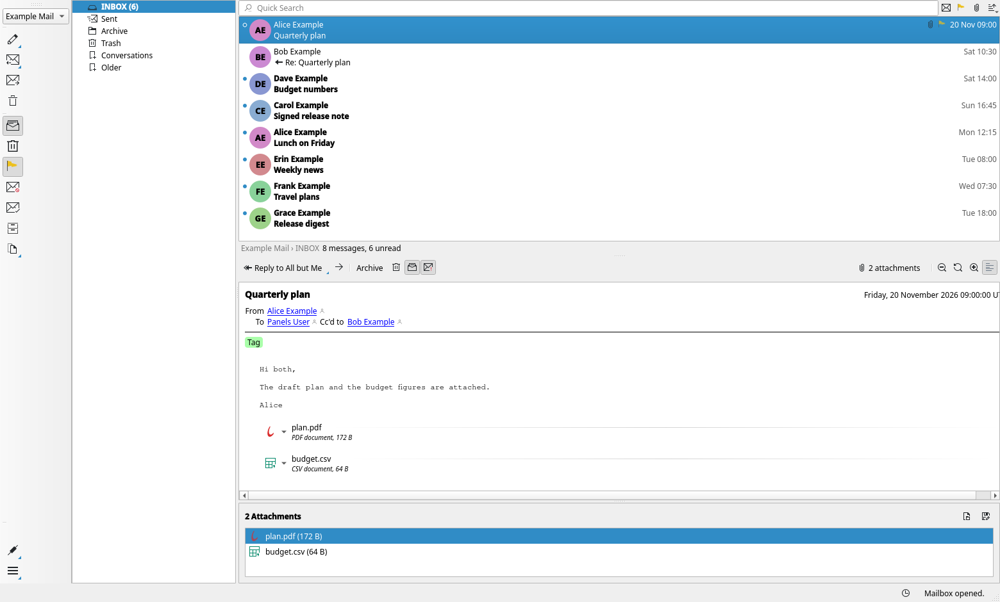
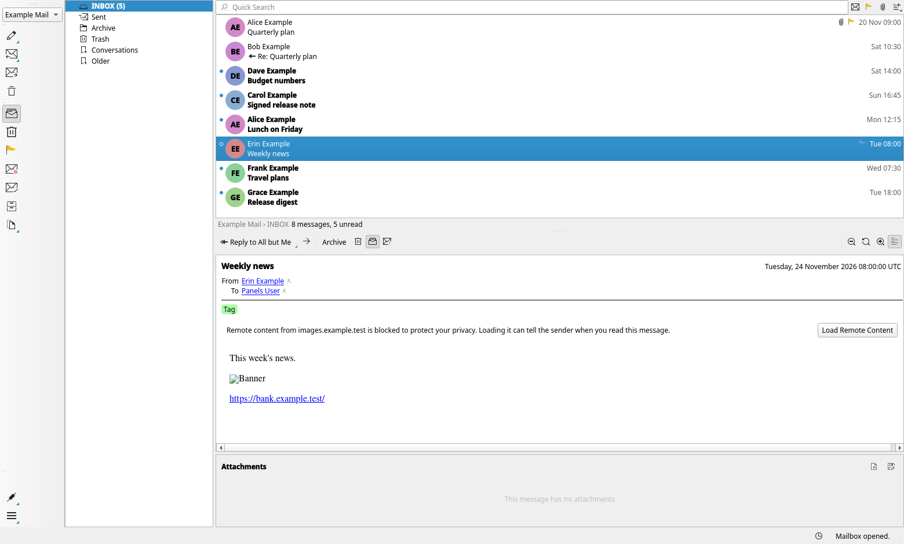
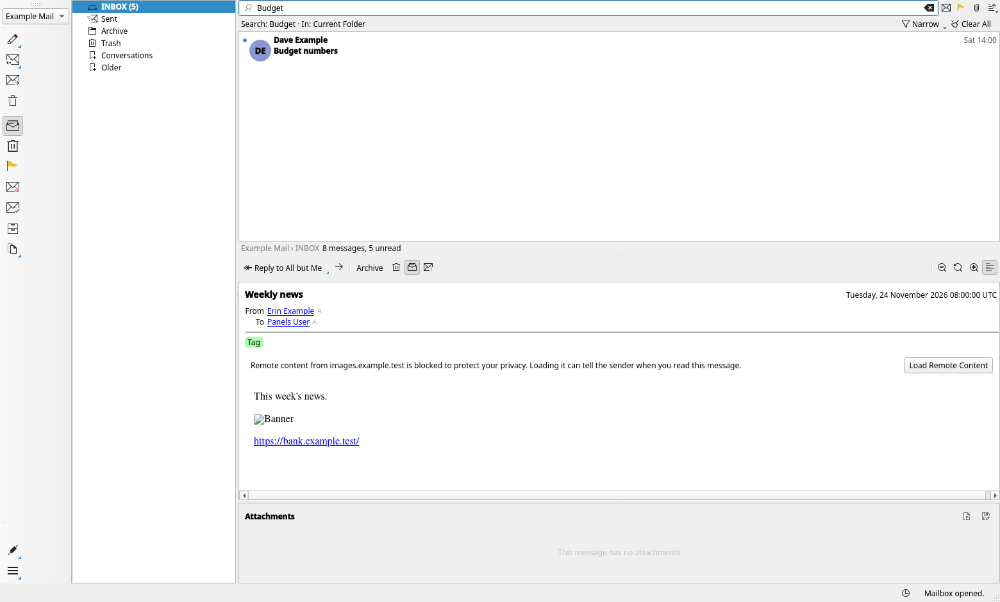
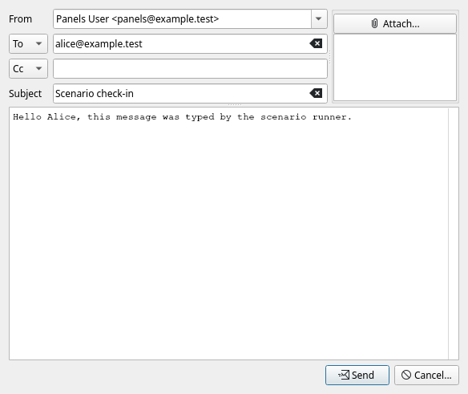

# End-to-end workflow coverage

**[Documentation](README.md)** · **[Roadmap](ROADMAP.md)** ·
**[Pending tasks](TODO.md)** · **[Bugs](BUGS.md)** ·
**[Caveats](CAVEATS.md)** · **[Edge cases](EDGE.md)** ·
**[Project board](https://github.com/users/mikepadiernos/projects/4)**

The [M11](ROADMAP.md#m11-release-readiness-and-polish) map of user workflows to
the tests that drive them from start to finish
([#133](https://github.com/mikepadiernos/plasma-impresario/issues/133),
[#134](https://github.com/mikepadiernos/plasma-impresario/issues/134)). Each
row names the live test slots, the script that runs them and the offscreen
tests that cover the same code without a server. Recorded on 2026-11-28.

Legend: ![Live][live] driven through the main window against a disposable
server · ![Offscreen][offscreen] covered by offscreen tests only ·
![Not covered][not-covered] needs a Plasma session or a real provider, see the
notes

> [!NOTE]
>
> The live tests run in the headless Linux development container against
> loopback-only servers with synthetic users, mail and files. The IMAP tests
> drive the real `MainWindow` with mouse clicks, key presses and the dialogs
> the application opens; the POP3, JMAP and Nextcloud tests drive the
> components behind those windows. All of them check the server's state, not
> only what is shown. They do not run in a Plasma session; see
> [what is not covered](#what-is-not-covered).

## Contents

- [Workflows](#workflows)
- [Live test slots](#live-test-slots)
- [Desktop scenarios](#desktop-scenarios)
  - [Scenarios](#scenarios)
  - [Running the scenarios](#running-the-scenarios)
  - [Screenshots](#screenshots)
  - [Found while running the scenarios](#found-while-running-the-scenarios)
- [How to run](#how-to-run)
- [What is not covered](#what-is-not-covered)

## Workflows

| Workflow                                  | Coverage                    | Live slots                                                                                                                                                                                                                                                           | Offscreen tests                                                                                                                                                                                  |
| ----------------------------------------- | --------------------------- | -------------------------------------------------------------------------------------------------------------------------------------------------------------------------------------------------------------------------------------------------------------------- | ------------------------------------------------------------------------------------------------------------------------------------------------------------------------------------------------ |
| First start: account setup to a reply     | ![Live][live]               | `test_LiveImapCompose::firstStartToReply`                                                                                                                                                                                                                            | `test_AccountSettingsDialog`, `test_AddAccountDialog`, `test_SettingsDialog`                                                                                                                     |
| Reading, triage and responses             | ![Live][live]               | `test_LiveImapCompose::readingFlowToResponses`, `test_LiveImapOperations::destructiveActions`                                                                                                                                                                        | `test_ReaderActionBar`, `test_DestructiveActions`, `test_Imap_CopyAndFlagOperations`                                                                                                             |
| Compose and send                          | ![Live][live]               | `test_LiveImapCompose::composeSendAndRecover`, `bccAndHeaderSafety`                                                                                                                                                                                                  | `test_Composer_Submission`, `test_Composer_HeaderSafety`, `test_SmtpClient`                                                                                                                      |
| Attachments                               | ![Live][live]               | `test_LiveImapCompose::readingFlowToResponses`, `filesFromOtherApplications`, `remoteFiles`; `test_LiveImapPanels::panelsFollowLiveMessages`                                                                                                                         | `test_Composer_AttachmentRequests`, `test_AttachmentPanel`, `test_AttachmentCollector`                                                                                                           |
| Search                                    | ![Live][live]               | The 11 slots of `test_LiveImapSearch`                                                                                                                                                                                                                                | `test_SearchQuery`, `test_SearchIndex`, `test_SearchResultsModel` and related                                                                                                                    |
| Mail rules on new mail                    | ![Live][live]               | `test_LiveImapCompose::newMailRulesAndNotifications`                                                                                                                                                                                                                 | `test_MailRules`, `test_MailAutomation`, `test_RulesDialog`                                                                                                                                      |
| New-mail notifications                    | ![Live][live]               | `test_LiveImapCompose::newMailRulesAndNotifications`, with a recording notifier                                                                                                                                                                                      | `test_NewMail`, `test_NewMailWatcher`, `test_NotificationsDialog`                                                                                                                                |
| Offline use and recovery                  | ![Live][live]               | `test_LiveImap::authenticationFailureAndRecovery`, `test_LiveImapAccounts::sleepClosesTheConnectionAndWakingReconnects`, `test_LiveImapSearch::stopsSlowSearchesAndRetriesFailedPlaces`, `searchesIndexedMailOffline`; `test_LiveImapCompose::composeSendAndRecover` | `test_Imap_Offline`, `test_Imap_Reliability`, `test_Composer_Outbox`, `test_RetryBackoff`                                                                                                        |
| Several accounts                          | ![Live][live]               | `test_LiveImapAccounts::accountsConnectAndSwitchIndependently`, `newProfilesKeepPasswordsOutOfSettings`, `repliesSendFromTheMessagesAccount`                                                                                                                         | `test_MainWindowAccounts`, `test_AccountRegistry`, `test_UnifiedMsgListModel`                                                                                                                    |
| Embedded panels                           | ![Live][live]               | `test_LiveImapPanels::panelsFollowLiveMessages`                                                                                                                                                                                                                      | `test_EmbeddedPanels`, `test_AgendaPanel`, `test_ContactPanelAddressBook`                                                                                                                        |
| Large mailboxes                           | ![Live][live]               | `test_LiveImapWorkloads::realWorldWorkloads`                                                                                                                                                                                                                         | `test_Imap_Workloads`                                                                                                                                                                            |
| POP3 accounts                             | ![Live][live]               | The 5 slots of `test_LivePop3`                                                                                                                                                                                                                                       | `test_Pop3Fetch`, `test_LocalMailStore`                                                                                                                                                          |
| JMAP accounts                             | ![Live][live]               | The 6 slots of `test_LiveJmap`                                                                                                                                                                                                                                       | `test_JmapSync`, `test_JmapSubmission`                                                                                                                                                           |
| Nextcloud files and share links           | ![Live][live]               | The 11 slots of `test_LiveNextcloud`, through the Nextcloud components rather than the main window                                                                                                                                                                   | `test_NextcloudFiles`, `test_NextcloudClient`, `test_NextcloudDialogs`, `test_AttachmentPanel`, `test_MainWindowShell::composerAttachesFromNextcloud`, `composerConfirmsShareLinksBeforeSending` |
| Supported providers: discovery and OAuth  | ![Offscreen][offscreen]     | None; needs provider accounts                                                                                                                                                                                                                                        | `test_ServerDiscovery`, `test_OAuth`, `test_AddAccountDialog`                                                                                                                                    |
| SMTP delivery                             | ![Offscreen][offscreen]     | None; the live tests send through a local sendmail script                                                                                                                                                                                                            | `test_SmtpClient`, `test_Composer_Submission`                                                                                                                                                    |
| Desktop notifications, KWallet and Plasma | ![Not covered][not-covered] | None                                                                                                                                                                                                                                                                 | `test_DesktopFeedback`, `test_PasswordBackend`                                                                                                                                                   |

## Live test slots

| Test                      | Script                                        | Slots                                                                                                                                                                                                                                                                                                                                                                             |
| ------------------------- | --------------------------------------------- | --------------------------------------------------------------------------------------------------------------------------------------------------------------------------------------------------------------------------------------------------------------------------------------------------------------------------------------------------------------------------------- |
| `test_LiveImap`           | None; set `PLASMA_TEST_IMAPS_PORT`            | `authenticationFailureAndRecovery`; see [live verification](TODO.md#live-verification-environment)                                                                                                                                                                                                                                                                                |
| `test_LiveImapAccounts`   | `tools/dev-container/live-imap-accounts.sh`   | `accountsConnectAndSwitchIndependently`, `newProfilesKeepPasswordsOutOfSettings`, `sleepClosesTheConnectionAndWakingReconnects`, `repliesSendFromTheMessagesAccount`                                                                                                                                                                                                              |
| `test_LiveImapCompose`    | `tools/dev-container/live-imap-compose.sh`    | `readingFlowToResponses`, `composeSendAndRecover`, `bccAndHeaderSafety`, `filesFromOtherApplications`, `remoteFiles`, `firstStartToReply`, `newMailRulesAndNotifications`                                                                                                                                                                                                         |
| `test_LiveImapOperations` | `tools/dev-container/live-imap-operations.sh` | `destructiveActions`: Expunge, Empty Trash, Empty Junk and Rename Folder                                                                                                                                                                                                                                                                                                          |
| `test_LiveImapPanels`     | `tools/dev-container/live-imap-panels.sh`     | `panelsFollowLiveMessages`                                                                                                                                                                                                                                                                                                                                                        |
| `test_LiveImapSearch`     | `tools/dev-container/live-imap-search.sh`     | `searchesAcrossFoldersAndAccounts`, `stopsSlowSearchesAndRetriesFailedPlaces`, `explainsSearchesTheServerCannotRun`, `searchesWithQuerySyntax`, `searchesIndexedMailOffline`, `continuesIndexedSearchOnServer`, `opensMessagesByMessageId`, `showsMailingLists`, `clearsSearchAndFiltersInOneStep`, `showsSavedSearchesAsVirtualFolders`, `listsResultsInTheSearchResultsPanel`   |
| `test_LiveImapWorkloads`  | `tools/dev-container/live-imap-workloads.sh`  | `realWorldWorkloads`; see [performance](performance.md)                                                                                                                                                                                                                                                                                                                           |
| `test_LivePop3`           | `tools/dev-container/live-pop3.sh`            | `rejectsAnUntrustedCertificate`, `downloadsOverTlsOnce`, `downloadsOverStartTls`, `removesMailAfterDownload`, `reportsAWrongPassword`                                                                                                                                                                                                                                             |
| `test_LiveJmap`           | `tools/dev-container/live-jmap.sh`            | `downloadsServerMailIntoSpecialFolders`, `localChangesReachTheServer`, `serverChangesComeDownIncrementally`, `sendsThroughSubmission`, `localRemovalReachesTheServer`, `reportsAWrongPassword`                                                                                                                                                                                    |
| `test_LiveNextcloud`      | `tools/dev-container/live-nextcloud.sh`       | `signsInWithAnAppPassword`, `listsFoldersWithTheirPermissions`, `savesAttachmentsWithoutReplacingFiles`, `fetchesWhatOthersSharedWithTheUser`, `savesAttachmentsOfLocalAccountMessages`, `refusesSavingIntoReadOnlyShares`, `reportsAFullStorage`, `reportsMissingFiles`, `findsExistingLinkSharesOnly`, `unreachableServersFailWithoutWaitingLong`, `refusesARevokedAppPassword` |
| `test_ClamdScanner`       | `tools/dev-container/live-clamd.sh`           | `liveClamd`, scanning through a real `clamd`                                                                                                                                                                                                                                                                                                                                      |

### First start to a reply

`firstStartToReply` starts with an empty profile. It fills in the account
settings that open on the first start: an identity added through its own
dialog, the IMAP server and password, and a sendmail command with a copy kept
in Sent. It opens "Lunch on Friday" by mouse and checks that the server marks
it read. It flags the message with `S`, archives "Weekly news" with `A`, and
replies with `Ctrl+Shift+A`. The checks cover the reply's sender, recipient,
`In-Reply-To` header and quoted text, the answered flag on the server, and the
copy in Sent.

### New mail, rules and notifications

`newMailRulesAndNotifications` delivers three messages into the server's
Maildir while the window runs:

- A reviewed rule archives "Invoice 42".
- A rule flags the message from Alice.
- A rule that would delete "Receipt for your order" was never previewed, so it
  only records a "waits for a preview" entry in the activity log and leaves the
  message in place.

The recording notifier then receives one notification for the two messages
left in the INBOX. The archived invoice is not announced.

## Desktop scenarios

The live slots above drive `MainWindow` from inside a test. The desktop
scenarios drive the installed application from outside, as a person and a
screen reader would
([#380](https://github.com/mikepadiernos/plasma-impresario/issues/380)):
`tools/e2e/scenarios.py` finds controls through AT-SPI, clicks and types with
`xdotool`, and checks the server's Maildir, the sendmail stand-in and the
desktop services. Each scenario leaves screenshots and a line in
`build-e2e/report.md` and `report.tsv`; a failing one also leaves a dump of the
accessible tree.

> [!NOTE]
>
> The scenarios run on Xvfb with Openbox and plain Qt, not in a Plasma session.
> `tools/e2e/desktop_mocks.py` stands in for Plasma's notification server and
> tray host and records what the application sends them. The screenshots show
> Qt's Fusion style, not Breeze.

### Scenarios

Recorded on 2026-11-28: 9 of 9 pass.

| Scenario        | What it does                                                                                                                                | Status        |
| --------------- | ------------------------------------------------------------------------------------------------------------------------------------------- | ------------- |
| `setup`         | Starts with an empty profile; fills an identity and the IMAP and SMTP pages from the keyboard, accepts the new certificate, and opens INBOX | ![Pass][pass] |
| `reading`       | Opens a message with two attachments; checks the attachments panel and the reader's attachment button                                       | ![Pass][pass] |
| `hostile`       | Opens HTML mail with a remote image and a misleading link; checks that remote content is blocked and **Load Remote Content** is offered     | ![Pass][pass] |
| `search`        | Narrows INBOX with the quick search and clears it again                                                                                     | ![Pass][pass] |
| `delete-undo`   | Moves a message to Trash from the reader and restores it with **Undo**                                                                      | ![Pass][pass] |
| `compose`       | Writes a message from <kbd>Ctrl</kbd>+<kbd>N</kbd> and sends it; checks the sendmail stand-in and the copy in Sent                          | ![Pass][pass] |
| `tray`          | Checks that the tray icon registers, its tooltip shows the unread count, and activating it hides and shows the window                       | ![Pass][pass] |
| `notifications` | Delivers mail while the window is hidden and checks the desktop notification                                                                | ![Pass][pass] |
| `restart`       | Quits with <kbd>Ctrl</kbd>+<kbd>Q</kbd>, starts again and checks that the last folder reopens                                               | ![Pass][pass] |

### Running the scenarios

Build first, then:

```sh
tools/dev-container/run.sh sh tools/dev-container/e2e-scenarios.sh build
tools/dev-container/run.sh sh tools/dev-container/e2e-scenarios.sh build reading,compose
```

The script installs the build into the throwaway container, seeds a synthetic
Dovecot with invented `example.test` mail, prepares a profile, and starts Xvfb,
Openbox, the session and accessibility buses and the stand-ins. Every scenario
except `setup` starts from that profile. Output goes to `build-e2e/`, or to
`PLASMA_E2E_OUT`.

### Screenshots

Taken by the scenarios from invented mail; plain Qt, not Plasma.

| Reading with the attachments panel                     | Remote content blocked                                                     |
| ------------------------------------------------------ | -------------------------------------------------------------------------- |
|  |  |
| **Quick search**                                       | **Composer**                                                               |
|        |                              |

### Found while running the scenarios

- ![Pass][pass] **The English tray tooltip ran together.** The English
  catalog dropped the separator, so the tooltip read "Plasma Impresario4
  unread messages". Fixed in `poqm/en`; the `tray` scenario checks for it.
- ![Pass][pass] **Server keywords showed as tags.** Dovecot's attachment
  detection sets `$HasAttachment` and `$HasNoAttachment`, and the reader
  listed them as removable tags. They are now treated like the other server
  keywords: hidden from the tags and refused as new tags. Covered by
  `test_TagListWidget`.
- ![Not covered][not-covered] **The reader overflows sideways.** It shows a
  horizontal scroll bar and clips the right end of the header at both window
  sizes used. Recorded in [edge cases](EDGE.md#interface-and-embedded-panels)
  to check with Breeze in a Plasma session.
- ![Not covered][not-covered] **The window returns to its earlier size** when
  the first message opens after a resize, under Xvfb and Openbox. The runner
  resizes it again; recorded in
  [edge cases](EDGE.md#interface-and-embedded-panels) to check in a Plasma
  session.

## How to run

Each script starts its own throwaway server in the development container and
deletes it on exit:

```sh
tools/dev-container/run.sh sh tools/dev-container/live-imap-compose.sh
```

The [stabilization gate](stabilization-gate.md) runs the IMAP and POP3 scripts
together. `live-jmap.sh` and `live-nextcloud.sh` start Stalwart and Nextcloud
in separate containers, so they run on the host, outside the development
container, after `test_LiveJmap` or `test_LiveNextcloud` is built:

```sh
sh tools/dev-container/live-nextcloud.sh build
```

`live-nextcloud.sh` starts Nextcloud 34 with SQLite, creates the users `work`
and `other` with a 3 MB quota for `work`, their files and shares, and two app
passwords, then deletes the server when the test ends.

## What is not covered

- Real providers. Server discovery, OAuth sign-in and provider quirks are
  tested offscreen only; checks with real accounts wait for the
  [M14 Plasma session verification](TODO.md#m14-real-plasma-session-verification).
- Hosted Nextcloud providers and the KDE Online Accounts backend. The live
  test uses a disposable Nextcloud 34 server and accounts connected with app
  passwords; see
  [#515](CAVEATS.md#nextcloud-files-and-share-links).
- SMTP delivery. The live tests send through a local sendmail script; see
  [#450](https://github.com/mikepadiernos/plasma-impresario/issues/450).
- Plasma's notification server, tray and KWallet. The live test replaces
  desktop notifications with a recording notifier, the desktop scenarios use
  stand-ins on the session bus, and the container has no Secret Service. All
  three need a Plasma session.
- The **Review Rule…** button in the notification bar. The test checks the
  activity entry that the button opens, but does not click the button.

[live]: https://img.shields.io/badge/Live-2da44e
[not-covered]: https://img.shields.io/badge/Not_covered-6e7781
[offscreen]: https://img.shields.io/badge/Offscreen-0969da
[pass]: https://img.shields.io/badge/Pass-1a7f37
