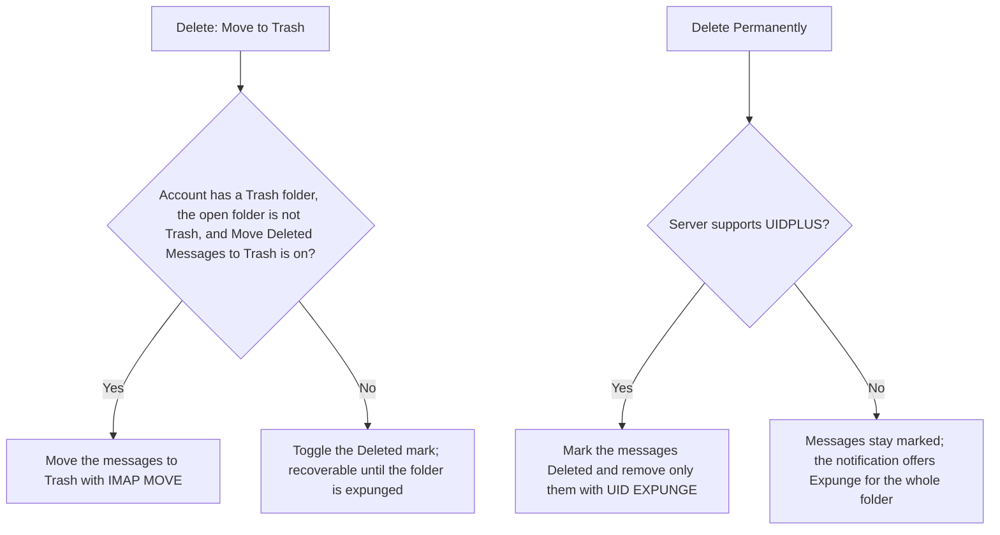

# Plasma Impresario interface design

**[Documentation](../README.md)** · **[Roadmap](../ROADMAP.md)** ·
**[Caveats](../CAVEATS.md)** · **[Scope](scope.md)** ·
**[Inspirations](inspirations.md)** · **[Compatibility](compatibility.md)** ·
**[UI parity](../parity/ui.md)**

This guide is the single source for Plasma Impresario's interface and layout:
what the shell looks like today and where it is headed. Statuses are as of
2026-11-25.

- [Current interface](#current-interface) describes what the code implements
  after M01 through M04, all merged into `main`.
- [Proposed Plasma Impresario shell](#proposed-plasma-impresario-shell) and the
  sections after it describe design intent, not implemented behavior, except
  where a badge says otherwise.

Legend: ![Done][done] · ![Needs verification][needs-verification] ·
![In progress][in-progress] · ![Planned][planned] · ![Decided][decided] ·
![Recommended][recommended] · ![Limitation][limitation]

## Contents

- [Current interface](#current-interface)
  - [Shell status](#shell-status)
  - [Layouts and regions](#layouts-and-regions)
  - [Account sidebar and header](#account-sidebar-and-header)
  - [Row density and restored selection](#row-density-and-restored-selection)
  - [Current embedded panels](#current-embedded-panels)
  - [Mail operations](#mail-operations)
  - [Reader colors](#reader-colors)
  - [Search highlighting](#search-highlighting)
  - [Remote content and links](#remote-content-and-links)
  - [Loading and unavailable content](#loading-and-unavailable-content)
  - [Reader actions](#reader-actions)
  - [Reading and triage](#reading-and-triage)
  - [Accounts in reading and composing](#accounts-in-reading-and-composing)
  - [Status bar](#status-bar)
- [Proposed Plasma Impresario shell](#proposed-plasma-impresario-shell)
  - [Panes and placement](#panes-and-placement)
  - [Embedded panels](#embedded-panels)
  - [Optional tabs](#optional-tabs)
  - [Toolbars and customization](#toolbars-and-customization)
  - [Themes and appearance](#themes-and-appearance)
  - [Message list presentation](#message-list-presentation)
  - [Aqua Mail-inspired desktop
    customization](#aqua-mail-inspired-desktop-customization)
  - [eM Client-inspired feature
    candidates](#em-client-inspired-feature-candidates)
- [Proposed interface widgets](#proposed-interface-widgets)
- [Interaction and accessibility](#interaction-and-accessibility)
- [Layout recommendations](#layout-recommendations)
- [Implementation sequence](#implementation-sequence)

## Current interface

> [!IMPORTANT]
>
> The shell described in this section was built in M02 and extended in M03 and
> M04. Offscreen tests and opt-in live IMAP tests against a synthetic Dovecot
> server in `tools/dev-container/` cover it; it has not been verified in a real
> Plasma session, which M15
> ([#319](https://github.com/mikepadiernos/plasma-impresario/issues/319))
> tracks.

The Qt Widgets application has a shell with a left column, a main column, a
right column and a footer, followed by the status bar. The Navigation toolbar
docks at the left window edge by default and can be moved to another edge; the
menu bar is hidden by default and opens from the toolbar's main menu button. The
diagram below shows the regions only, not the toolbar's position. With the
default settings it looks like the classic three-pane layout:

```text
Toolbar / menu
┌╌╌╌╌╌╌╌╌╌╌╌╌╌╌╌╌╌╌╌╌╌╌╌╌╌╌╌╌╌╌╌╌╌╌╌╌╌╌╌╌╌╌╌╌╌╌╌╌╌╌╌╌╌╌╌╌╌╌╌╌╌╌╌╌╌╌╌╌╌╌╌╌╌╌╌╌┐
╎ Header (View › Show Header, off by default): account, folder and status    ╎
└╌╌╌╌╌╌╌╌╌╌╌╌╌╌╌╌╌╌╌╌╌╌╌╌╌╌╌╌╌╌╌╌╌╌╌╌╌╌╌╌╌╌╌╌╌╌╌╌╌╌╌╌╌╌╌╌╌╌╌╌╌╌╌╌╌╌╌╌╌╌╌╌╌╌╌╌┘
┌────────────────────┬──────────────────────────────────────────┬ ─ ─ ─ ─ ─ ┐
│ Left column        │ Main column                              │ Right
│ Mailbox tree       │ Message list                             │ column
│                    ├──────────────────────────────────────────┤ (hidden
│                    │ Message reader                           │ while
│                    ├──────────────────────────────────────────┤ empty)
│                    │ Attachments panel                        │
├────────────────────┴──────────────────────────────────────────┴ ─ ─ ─ ─ ─ ┤
│ Footer (hidden while empty)                                                │
└────────────────────────────────────────────────────────────────────────────┘
Status bar
```

### Shell status

![Done][done] marks issues that are Completed or Merged on the [project
board](https://github.com/users/mikepadiernos/projects/4),
![In progress][in-progress] marks work in Development and ![Planned][planned]
marks work that has not started. Every item marked done is
covered by offscreen or synthetic-server tests only; the real Plasma session
check is [#315](https://github.com/mikepadiernos/plasma-impresario/issues/315).

| Feature                                                                                                    | Status                      | Milestone | Issue                                                                                                                                                                                                           |
| ---------------------------------------------------------------------------------------------------------- | --------------------------- | --------- | --------------------------------------------------------------------------------------------------------------------------------------------------------------------------------------------------------------- |
| Shell regions: toolbar, left, main and right columns, footer                                               | ![Done][done]               | M02       | [#35](https://github.com/mikepadiernos/plasma-impresario/issues/35)                                                                                                                                             |
| Mailbox sidebar in either side column                                                                      | ![Done][done]               | M02       | [#35](https://github.com/mikepadiernos/plasma-impresario/issues/35)                                                                                                                                             |
| Compact, wide and one-at-a-time layouts with sizes saved per layout                                        | ![Done][done]               | M02       | [#35](https://github.com/mikepadiernos/plasma-impresario/issues/35)                                                                                                                                             |
| Attachments panel, shown by default                                                                        | ![Done][done]               | M02       | [#35](https://github.com/mikepadiernos/plasma-impresario/issues/35)                                                                                                                                             |
| Message Details, Contacts and Related Messages panels, off by default                                      | ![Done][done]               | M02       | [#35](https://github.com/mikepadiernos/plasma-impresario/issues/35), caveat [#264](https://github.com/mikepadiernos/plasma-impresario/issues/264)                                                               |
| <kbd>F6</kbd> / <kbd>Shift</kbd>+<kbd>F6</kbd> focus cycling                                               | ![Done][done]               | M02       | [#35](https://github.com/mikepadiernos/plasma-impresario/issues/35)                                                                                                                                             |
| Multiple accounts with a toolbar selector                                                                  | ![Done][done]               | M02       | [#222](https://github.com/mikepadiernos/plasma-impresario/issues/222), caveat [#262](https://github.com/mikepadiernos/plasma-impresario/issues/262)                                                             |
| Connection, authentication and offline status                                                              | ![Done][done]               | M02       | [#79](https://github.com/mikepadiernos/plasma-impresario/issues/79)                                                                                                                                             |
| Folder counts and per-account saved searches                                                               | ![Done][done]               | M02       | [#76](https://github.com/mikepadiernos/plasma-impresario/issues/76)                                                                                                                                             |
| Compact and comfortable row density                                                                        | ![Done][done]               | M02       | [#75](https://github.com/mikepadiernos/plasma-impresario/issues/75)                                                                                                                                             |
| Restore layout, sizes, density and selected message across sessions                                        | ![Done][done]               | M02       | [#81](https://github.com/mikepadiernos/plasma-impresario/issues/81)                                                                                                                                             |
| Account groups in the folder sidebar                                                                       | ![Done][done]               | M02       | [#80](https://github.com/mikepadiernos/plasma-impresario/issues/80)                                                                                                                                             |
| Optional header with the account, folder and status                                                        | ![Done][done]               | M02       | [#74](https://github.com/mikepadiernos/plasma-impresario/issues/74)                                                                                                                                             |
| Actions hidden when the account protocol cannot perform them                                               | ![Done][done]               | M02       | [#215](https://github.com/mikepadiernos/plasma-impresario/issues/215)                                                                                                                                           |
| [Special folders, Go to Folder and folder management](#special-folders-and-navigation)                     | ![Done][done]               | M03       | [#37](https://github.com/mikepadiernos/plasma-impresario/issues/37)                                                                                                                                             |
| [Quick actions](#quick-actions), recent destinations and confirmations                                     | ![Done][done]               | M03       | [#83](https://github.com/mikepadiernos/plasma-impresario/issues/83), [#89](https://github.com/mikepadiernos/plasma-impresario/issues/89)                                                                        |
| [Quick filters](#message-list-toolbar-and-quick-filters), grouping, relevance sorting and per-folder views | ![Done][done]               | M03       | [#38](https://github.com/mikepadiernos/plasma-impresario/issues/38), [#85](https://github.com/mikepadiernos/plasma-impresario/issues/85), [#90](https://github.com/mikepadiernos/plasma-impresario/issues/90)   |
| Multi-selection, batch feedback, [Select Similar and dense layout](#fast-triage)                           | ![Done][done]               | M03       | [#84](https://github.com/mikepadiernos/plasma-impresario/issues/84), [#88](https://github.com/mikepadiernos/plasma-impresario/issues/88)                                                                        |
| Two-line and column [message rows](#message-list-presentation)                                             | ![Done][done]               | M03       | [#87](https://github.com/mikepadiernos/plasma-impresario/issues/87)                                                                                                                                             |
| [Unified Inbox](#unified-inbox)                                                                            | ![Done][done]               | M03       | [#223](https://github.com/mikepadiernos/plasma-impresario/issues/223)                                                                                                                                           |
| [Reader action bar](#reader-actions)                                                                       | ![Done][done]               | M04       | [#39](https://github.com/mikepadiernos/plasma-impresario/issues/39)                                                                                                                                             |
| [Reading layout and triage keys](#reading-and-triage)                                                      | ![Done][done]               | M04       | [#91](https://github.com/mikepadiernos/plasma-impresario/issues/91), [#92](https://github.com/mikepadiernos/plasma-impresario/issues/92)                                                                        |
| [Conversation navigation and subject threading](#conversations-and-their-subjects)                         | ![Done][done]               | M04       | [#40](https://github.com/mikepadiernos/plasma-impresario/issues/40), [#96](https://github.com/mikepadiernos/plasma-impresario/issues/96), [#369](https://github.com/mikepadiernos/plasma-impresario/issues/369) |
| [Reader colors](#reader-colors) in dark color schemes                                                      | ![Done][done]               | M04       | [#370](https://github.com/mikepadiernos/plasma-impresario/issues/370)                                                                                                                                           |
| [Accounts in reading and composing](#accounts-in-reading-and-composing)                                    | ![Done][done]               | M04       | [#224](https://github.com/mikepadiernos/plasma-impresario/issues/224), [#41](https://github.com/mikepadiernos/plasma-impresario/issues/41)                                                                      |
| Verified signature and decryption results in Message Details                                               | ![Done][done]               | M04       | [#303](https://github.com/mikepadiernos/plasma-impresario/issues/303), caveat [#442](https://github.com/mikepadiernos/plasma-impresario/issues/442)                                                             |
| Related messages from the server and other folders                                                         | ![Planned][planned]         | M05.01    | [#302](https://github.com/mikepadiernos/plasma-impresario/issues/302)                                                                                                                                           |
| Search across folders and accounts, saved searches as virtual folders                                      | ![Planned][planned]         | M05       | [Roadmap](../ROADMAP.md#m05-search-and-indexing)                                                                                                                                                                |
| Search Results panel                                                                                       | ![Planned][planned]         | M05.05    | [#348](https://github.com/mikepadiernos/plasma-impresario/issues/348)                                                                                                                                           |
| My Day / Agenda panel                                                                                      | ![Planned][planned]         | M06.04    | [#304](https://github.com/mikepadiernos/plasma-impresario/issues/304)                                                                                                                                           |
| Address-book names, photos and organizations in Contacts                                                   | ![Planned][planned]         | M06.04    | [#305](https://github.com/mikepadiernos/plasma-impresario/issues/305)                                                                                                                                           |
| Optional mail workspace tabs                                                                               | ![Planned][planned]         | M08       | [#246](https://github.com/mikepadiernos/plasma-impresario/issues/246)                                                                                                                                           |
| Themes and appearance                                                                                      | ![In progress][in-progress] | M09       | [#10](https://github.com/mikepadiernos/plasma-impresario/issues/10); [roadmap](../ROADMAP.md#m09-themes-and-branding-foundation)                                                                                |
| Designed header with search, compose, account switcher and status                                          | ![Planned][planned]         | M14.02    | [#306](https://github.com/mikepadiernos/plasma-impresario/issues/306)                                                                                                                                           |
| Sliding and floating panels; rearranging panels in customization mode                                      | ![Planned][planned]         | M14.02    | [#307](https://github.com/mikepadiernos/plasma-impresario/issues/307)                                                                                                                                           |
| Toolbar customization and the navigation icon toolbar                                                      | ![Planned][planned]         | M14.02    | [#151](https://github.com/mikepadiernos/plasma-impresario/issues/151)                                                                                                                                           |

### Layouts and regions

The folder sidebar goes in the left or right column, chosen in **View › Folder
Sidebar Position**. **View › Layout** arranges the main column:

| Layout        | Main column                                                                                             |
| ------------- | ------------------------------------------------------------------------------------------------------- |
| Compact       | Message list stacked above the reader column                                                            |
| Wide          | Message list beside the reader column                                                                   |
| One At a Time | Shows the mailbox tree, list and reader in turn; the side columns keep any embedded panels placed there |

Region sizes follow these rules:

- A side column or the footer is shown only while it holds the mailbox tree or a
  shown embedded panel. When it returns, it gets its previous size back.
- Region widths, the main column's split, the sidebar side and the selected
  layout are saved for each layout.
- Each embedded panel starts with room for its title and a few rows (three
  attachments, four contacts, five detail or related lines). Panels side by side
  in the footer share its width.
- A size the user sets by dragging a divider is kept for that panel, including
  after it is hidden or moved back, and saved with the layout.
- Panels sharing a column with the mailbox tree, or the reader column with the
  reader, take at most two thirds of it.
- ![Limitation][limitation] Sizes saved by versions before the shell are not
  migrated, so the panes start at their default sizes once after upgrading; see
  [CAVEATS](../CAVEATS.md#related-messages-and-message-details-panels).

### Account sidebar and header

With two or more accounts, the folder sidebar shows a header for each account
and the folder tree under the active one; with one account it shows the tree
alone. Each header shows the account's name and flags an account that needs
attention. Clicking another account's header switches to that account, like the
toolbar's account selector; clicking the active account's header collapses or
expands its folders. The headers take keyboard focus and announce whether the
folders are shown. Once an account's INBOX count is known, its header shows the
unread count in bold, for example _Work (3)_, and screen readers announce
_Work, 3 unread_; background accounts are included.

**View › Show Header** adds a header region above the columns with the active
account, the current folder and the account's status when it needs attention.
It is off by default, saved as `ShowHeader` in the `Appearance` group of
`plasma-impresariorc`, and is the first region in the <kbd>F6</kbd> focus cycle
while shown. The designed header with search, compose and the account switcher
remains planned for M14.02
([#306](https://github.com/mikepadiernos/plasma-impresario/issues/306)).

Actions the active account's protocol cannot perform are hidden rather than
disabled: with a POP3 account, folder management, archiving, junk and tags are
hidden, and they return when switching to an IMAP or JMAP account. Actions that
are hidden for another reason stay hidden.

### Row density and restored selection

**View › Row Density** selects **Compact** or **Comfortable** spacing for folder
and message rows. The selected folder and message are restored when they become
available, unless the user navigates elsewhere first. Message restoration checks
the mailbox's UIDVALIDITY before selecting a saved UID.

### Current embedded panels

Four embedded panels are available. Only Attachments is shown by default, so the
default look matches the classic layout.

| Panel            | Default             | Content                                                                                                                                                                                       | Actions                                                                                  |
| ---------------- | ------------------- | --------------------------------------------------------------------------------------------------------------------------------------------------------------------------------------------- | ---------------------------------------------------------------------------------------- |
| Attachments      | Shown, below reader | The current message's attachments with type icons, names and sizes. Attachments that arrive late, such as after decryption, are added as they appear.                                         | Open, Save As, context menu, drag into the composer                                      |
| Message Details  | Off, right column   | Subject, From, To, Cc, date, size, folder, read/flagged/replied/forwarded state and the reader's signature and decryption result. Rows without a value are hidden.                            | None                                                                                     |
| Contacts         | Off, right column   | The From, Reply-To, To and Cc addresses, each listed once with all its roles. Reply-To is listed only when it names other addresses than From.                                                | Write Email, Copy Address, Open in Address Book (only when an address-book plugin loads) |
| Related Messages | Off, right column   | Messages of the current folder in the same conversation (see [Conversations](#conversations-and-their-subjects)) and other messages from the same sender, newest first, at most 25 per group. | Activating a message selects it in the message list                                      |

Each panel has a submenu in **View › Embedded Panels**. Preferences are saved in
the `Appearance` group of `plasma-impresariorc`, where `<Panel>` is
`AttachmentPanel`, `MessageDetailsPanel`, `ContactPanel` or
`RelatedMessagesPanel`:

| Menu item                                                       | Key                | Default                                                   |
| --------------------------------------------------------------- | ------------------ | --------------------------------------------------------- |
| **Show Panel**                                                  | `<Panel>Visible`   | On for Attachments, off for the others                    |
| **Hide When Empty**                                             | `<Panel>AutoHide`  | Off                                                       |
| **Position:** Below Reader, Left Column, Right Column or Footer | `<Panel>Placement` | Below Reader for Attachments, Right Column for the others |

Panels in one region keep a fixed order (attachments, details, contacts, related
messages) after the mailbox tree or reader. They follow the message in the
reader and update when its envelope, flags or structure arrive later. While a
message is loading they say so; with **Hide When Empty** they stay hidden until
there is something to show. Without **Hide When Empty**, the Attachments panel
keeps a stable position and shows _No message selected_, _Loading message…_ or
_This message has no attachments_.

The Attachments panel lists files differently from the message-list paperclip:

- It lists only what a reader would call a file: inline images that HTML
  references through `multipart/related`, signatures and the encrypted envelope
  are omitted.
- An attached message (`message/rfc822`) is listed once, not expanded into its
  own attachments.

> [!NOTE]
>
> Related Messages considers only messages whose envelope the list has already
> loaded, so the panel never makes the client download envelopes. See
> [CAVEATS](../CAVEATS.md#related-messages-and-message-details-panels).

**Security in Message Details** follows the reader's cryptography results and
updates when verification or decryption finishes; the panel never starts either
itself. Each state has its own text, a theme icon and an accessible name, and
the row's tooltip adds the reader's summary, the signing date and details.

<details>
<summary>Security results with their text and icons</summary>

| Result                             | Text                                                                                | Icon               |
| ---------------------------------- | ----------------------------------------------------------------------------------- | ------------------ |
| Verification in progress           | _Signed, verifying the signature…_                                                  | `clock`            |
| Valid, trusted signature           | _Valid signature from <signer>_                                                     | `security-high`    |
| Valid, untrusted signature         | _Valid signature from <signer>, but the signer is not trusted or is not the sender_ | `security-medium`  |
| Signer's key not available         | _Signed with an unknown key, not verified_                                          | `security-medium`  |
| Bad signature                      | _Invalid signature from <signer>_                                                   | `security-low`     |
| Verification could not run         | _Signed, but the signature could not be verified_                                   | `dialog-warning`   |
| No reader result (MIME level only) | _Signed, not verified_                                                              | `document-sign`    |
| Decryption in progress             | _Encrypted, decrypting…_                                                            | `clock`            |
| Decrypted                          | _Encrypted and decrypted_                                                           | `document-decrypt` |
| Decryption failed                  | _Encrypted, decryption failed_                                                      | `dialog-error`     |
| Not decrypted (MIME level only)    | _Encrypted, not decrypted_                                                          | `document-encrypt` |

</details>

A message that is both encrypted and signed shows one line for each; the icon
reflects the signature. Without a signer name, the signer is left out.

Inline PGP armor in loaded text is labelled as such but is never verified or
decrypted, because the reader does not process inline PGP
([#442](https://github.com/mikepadiernos/plasma-impresario/issues/442)).

### Mail operations

M03 added folder navigation, message operations, filtering, grouping and
per-folder views; each topic below describes the implemented behavior. See
[caveats](../CAVEATS.md#mail-operations) for their limitations.

#### Special folders and navigation

The mailbox tree recognizes **special folders**: Inbox, Drafts, Sent, Archive,
Junk and Trash (plus All Mail and Flagged on servers that announce them). The
server's RFC 6154 SPECIAL-USE attributes decide first, including the legacy
XLIST names; the client asks for them when the server supports LIST-EXTENDED and
SPECIAL-USE. The account's configured archive folder also counts as Archive.
Without attributes, top-level folders and direct children of INBOX with a common
English name (for example _Sent Items_, _Deleted Items_ or _Junk E-mail_) are
used, at most one per kind. Special folders get Plasma theme icons and are
listed first among their siblings in that order; other folders keep the server's
order. **Mailbox › Go to Folder** opens the active account's Inbox, Drafts,
Sent, Archive, Junk or Trash; an entry is disabled while the account has no such
folder. **Mailbox › Go to Folder…** (<kbd>Ctrl</kbd>+<kbd>J</kbd>) opens a
searchable list of the folders already loaded in the tree: typing filters it,
the arrow keys move through matches and <kbd>Enter</kbd> opens the folder. Both
select the folder in the tree and move focus to the message list, also in
one-panel-at-a-time navigation. **Mailbox › Go to Next Unread Folder**
(<kbd>Ctrl</kbd>+<kbd>Alt</kbd>+<kbd>N</kbd>) opens the next folder of the
active account, in tree order and wrapping around, that has unread messages.
**Mailbox › Check for New Mail** (<kbd>F5</kbd>) asks every online account for
new counts, including background accounts, and resynchronizes the open folder.

#### Unified Inbox

**View › Unified Inbox** (<kbd>Ctrl</kbd>+<kbd>Shift</kbd>+<kbd>I</kbd>) lists
the INBOX of every account in one message list, sorted on the client, with the
scope shown as _Unified Inbox_ and each account's state in its tooltip. **View ›
Unified Inbox Accounts** leaves accounts out; at least one stays included.
Two-line rows name each message's account, and the status line names accounts
that are offline or unavailable while their cached messages stay listed.
Reading, flagging, moving, deleting, replying, forwarding and notifications use
the account of each message, so a selection spanning accounts is split per
account; moving or copying such a selection is refused because folders belong to
one account. Threads, Group By, quick search and Show Related stay with single
folders and are disabled meanwhile. Choosing a folder or another account leaves
the Unified Inbox, and its state is restored at startup
([#223](https://github.com/mikepadiernos/plasma-impresario/issues/223),
[caveats](../CAVEATS.md#mail-operations)).

#### Deleting and expunging



**Deleting messages** depends on the account's Trash folder. While the active
account has one and the open folder is not that Trash, Delete (the **Move to
Trash** action) moves the selected messages there with IMAP MOVE. In Trash,
without a Trash folder, or with **Message › Move Deleted Messages to Trash**
turned off, Delete toggles the `\Deleted` mark as before: the messages stay
recoverable until the folder is expunged. The option is stored per account as
`imap.deleteMovesToTrash` and is **on by default**. **Delete Permanently…**
(<kbd>Shift</kbd>+<kbd>Delete</kbd>, in the Message menu and the message list's
context menu) marks the selected messages `\Deleted` and removes only them with
UID EXPUNGE. A server without UIDPLUS cannot do that, so the messages stay
marked and the notification offers **Expunge** for the whole folder. **Expunge**
(<kbd>Ctrl</kbd>+<kbd>E</kbd>) removes every marked message in the open folder
and says how many of the loaded messages are marked.

#### Folder management

The folder tree's context menu and the Mailbox menu offer **Rename Folder…**,
which asks for the new last name component and sends IMAP RENAME, keeping the
folder's subscription. Renaming is unavailable offline, for INBOX and for
containers that cannot be selected. A name containing the hierarchy separator is
refused. When the open folder or one of its parents is renamed, the window
reopens it under the new name. **Empty Trash…** and **Empty Junk…** are
available in the Mailbox menu while the account has those folders, and in the
context menu of the Trash or Junk folder itself. They mark every message in the
folder `\Deleted` and expunge it; an empty folder is only reported as empty.

#### Quick actions

**Quick actions** for the selected messages are in the Message menu, the message
list's context menu and the main toolbar, and are disabled offline or without a
selection:

- **Archive** (<kbd>A</kbd>) moves the messages to the account's archive folder:
  the folder set in the account settings, otherwise the Archive special folder
  the tree recognizes (such as the server's `\Archive` folder), otherwise
  `Archive`.
- **Move to Folder…** (<kbd>V</kbd>) and **Copy to Folder…**
  (<kbd>Shift</kbd>+<kbd>V</kbd>) open the folder picker without the open folder
  and without folders that cannot hold messages. The **Move To** and **Copy To**
  submenus list the account's five most recent destinations, newest first,
  followed by **Other Folder…**. Destinations are remembered per account as
  `imap.recentDestinationFolders` when an operation starts. Folders the loaded
  tree shows as deleted or not selectable are dropped when a menu opens; folders
  below a branch that has not been loaded are kept. On the toolbar, Move to
  Folder… has the recent destinations behind its arrow.
- **Mark as Read** (<kbd>M</kbd>) and **Mark as Flagged** (<kbd>S</kbd>) are
  toggles that show the state of the selection. **Mark as Unread**
  (<kbd>Shift</kbd>+<kbd>M</kbd>) always marks the selection unread.

Toolbar-sized icons use the theme's `-symbolic` variants when available.
Per-message hover actions in the list are planned separately.

#### Confirmations and the notification bar

Delete Permanently, Expunge and the Empty actions ask first, naming the number
of messages when it is known. The question has a **Do not ask again** check box,
which takes effect only when the operation is accepted. The answers are stored
in `plasma-impresariorc`, group `Confirmations`, as `ConfirmExpunge`,
`ConfirmDeletePermanently` and `ConfirmEmptyFolder` (`false` skips the
question). Moving to Trash, archiving and moving or copying to other folders are
not confirmed because they can be undone or are harmless.

Results appear in a **notification bar** between the quick search field and the
message list instead of a dialog. For example, it reports _Moved 3 messages to
Trash_, _Archived 2 messages_, _Permanently deleted 1 message_, renames, emptied
folders and failures, including the server's message. Information hides itself
after eight seconds; errors stay until closed. After a move to Trash, Archive or
another folder, **Undo** moves the messages back to the source folder when the
server reported their new UIDs (RFC 4315 COPYUID). Otherwise the bar offers
**Open Trash**, **Open Archive** or **Open Folder**. Copies report _Copied 2
messages to …_ with **Open Folder** and cannot be undone. Marking more than one
message reports _Marked 5 messages as read_, _Marked 5 messages as unread_,
_Flagged 5 messages_, tag and junk changes once the server has confirmed them; a
single message is not reported. When an operation runs longer than 400 ms, the
bar shows what is happening with an indeterminate progress indicator, such as
_Moving 250 messages to Archive…_, until the result replaces it. Quick
operations show no progress. Every failed move, copy, delete, read, flag, tag or
junk change is reported with the number of messages and the server's message,
such as _Could not flag 3 messages: …_. The bar is cleared when the account
changes.

#### Message list toolbar and quick filters

The **message list toolbar** shares a row with the quick search field. It holds
checkable **quick filters**, **Unread**, **Flagged** and **With Attachments**,
as icon buttons with tooltips and accessible names, followed by **Clear
Filters** (shown only while a filter is on) and a **Sort** button that opens the
Mailbox › Sorting menu and shows the sort column and direction in its icon and
tooltip. The same filters are in **View › Filter** and in the context menu of
the empty area below the messages. Active filters must all match, and they
combine with the quick search. **Hide Read Messages** is the Unread filter under
its old name. Filters are stored per account as `gui/msgList.filterUnread`,
`filterFlagged` and `filterAttachments`, so they apply to every folder of that
account. An account without its own filters starts with the former global Hide
Read Messages preference. A thread is shown when any of its messages matches,
and then all of its messages are shown. A message whose flags are not loaded yet
is hidden by Unread and Flagged until they arrive. A message whose structure is
not loaded yet is shown by With Attachments, so that rows do not disappear while
scrolling. The current message stays listed while it is current, even after it
stops matching (for example, when reading marks it read under Unread). It is
hidden once another message becomes current. Turning a filter on or off, or
changing the grouping, keeps the current message current, listed and, in a
threaded list, inside its expanded thread
([#96](https://github.com/mikepadiernos/plasma-impresario/issues/96)).

#### Grouping

**View › Group By** and the Sort button's menu offer **None**, **Conversation**,
**Date**, **Sender**, **Subject**, **Tag**, **Read State** and **Mailing List**.
None and Conversation are the flat and threaded lists from before. The other
choices turn threading off and add a bold, collapsible header for each group
with its message and unread counts, such as _Today (5, 2 unread)_. Date groups
are Today, Yesterday, Earlier This Week, Last Week, Earlier This Month and then
one group per month. Sender groups by address, Subject by the subject without
reply prefixes and list tags, and Mailing List by the List-Post address, with
_Not from a list_ last. Tag puts a message with several tags under its first
favourite tag, or else under its alphabetically first tag, with _No Tag_ last.
Read State shows Unread before Read, so reading a message moves it to Read.
Messages whose envelope has not arrived wait in a _Loading…_ group while it is
requested. Date groups follow the sort direction, newest first when descending;
the other groups are alphabetical, and the sorting applies inside each group.
**Expand All Groups** and **Collapse All Groups** are in the Group By menu and,
while grouping, in the context menu. Likewise **Expand All Conversations**
(<kbd>Ctrl</kbd>+<kbd>.</kbd>) and **Collapse All Conversations**
(<kbd>Ctrl</kbd>+<kbd>,</kbd>) open and close every thread while the list is
grouped by Conversation. Collapsed groups stay collapsed until the grouping or
the account changes. Headers cannot be selected; message actions, Select All,
drag and drop, the reader and the related-messages panel skip them. Up and Down
step over the headers of expanded groups, and Left and Right collapse and expand
a group from its header.

#### Per-folder views and positions

Each folder remembers its own **view**: sort column and direction, threading and
grouping. Choosing a sorting, threading or grouping changes only the open
folder. A folder without its own view uses the account's default view, and an
account without one uses the sorting saved with the list's columns and the
former threading preference. **Use This View for All Folders** (after a
confirmation) makes the open folder's view the account default and removes the
views of the other folders. **Reset View for This Folder** lets the folder
follow the account default again; it is disabled while the folder has no view of
its own. Both are in View, after Group By, and in the Sort button's menu. Views
are stored per account as JSON in `gui/msgList.folderViews` (at most 200
folders, the least recently used dropped first) and `gui/msgList.defaultView`.
`gui/msgList.groupBy` keeps the grouping of the account default for older
versions. Views follow a renamed folder and are dropped once a folder is gone.
Quick filters stay per account, and Relevance is never remembered.

Each folder also remembers its **position**: the current and selected messages
and the message at the top of the view. Coming back to the folder through the
folder tree, Go to Folder or an account switch selects them again and scrolls to
them. If the current message is gone or the folder's UIDVALIDITY changed,
nothing is selected and the list shows its newest messages, at the top when
sorted descending and at the bottom otherwise. Positions are kept in the state
configuration (`MessageListPositions`, one JSON entry per account, at most 200
folders) and survive restarts. While the folder is open, new mail, flag changes,
messages removed by other clients and the server sorting or threading again keep
the same messages selected and current, and the current message stays where it
was on the screen. A list scrolled to its top stays at its top when new mail
arrives there. When a resynchronization replaces all messages of the folder, the
same messages are selected again by UID.

#### Relevance sorting

**Relevance** in the Sorting menu is available only while a quick search or Show
Related filter is on; otherwise it is disabled and its tooltip says why. It
ranks the loaded messages locally: a search word in the subject counts most,
then in the sender, then in the recipients, and the newer message wins a tie.
Messages which have not loaded yet come last. When the search is cleared, the
list returns to the sorting from before.

#### Status line and selection

Below the list, a **status line** starts with the **scope**, the account and
folder of the list (_Work › INBOX_), with the full folder name in its tooltip
and an accessible name such as _Showing folder INBOX of account Work_. It is
hidden while no folder is open. The status line then shows the folder's message
and unread counts as reported by the server (_120 messages, 7 unread_). It adds
_showing 7 of 120_ while filters are on and _3 selected_ when more than one
message is selected. **Select All** (<kbd>Ctrl</kbd>+<kbd>A</kbd>), **Select
Thread**, **Invert Selection** and **Deselect** are in the Message menu. Their
shortcuts apply only while the message list has the focus, so
<kbd>Ctrl</kbd>+<kbd>A</kbd> still selects text in the reader or the search
field. Select Thread selects the current message's whole thread and is available
only while threading is on. Invert Selection treats a collapsed thread as one
row. Only Select All has a default shortcut; the others can be assigned one in
the shortcut settings. The message context menu offers Select Thread and Select
All; the empty area offers Select All, the filters and **Mark Mailbox as Read**.
All message actions, including read, flag, tags, archive, delete and move or
copy, apply to the whole selection.

In the message list, Shift with Up, Down, Page Up, Page Down, Home or End
extends the selection from the message where it started. Ctrl with the same keys
moves the cursor without changing the selection, and
<kbd>Ctrl</kbd>+<kbd>Space</kbd> adds or removes the message at the cursor.
Single-key shortcuts such as M, S, A and V act on the whole selection; while
several messages are selected, other letters do not jump to a matching message,
so the selection is not lost. When the current message leaves the list because
it was moved, archived, deleted or expunged, the next remaining message becomes
current and the only selected one, or the previous message at the end of the
list. Other selected messages are skipped, and the keyboard focus stays in the
list. The reader shows the new current message under the usual mark-as-read
settings. Nothing is selected when the list becomes empty.

#### Fast triage

For working through a busy folder, a few commands borrow The Bat!'s quick filter
and fast triage. **Message › Show Related** and the message context menu limit
the current folder to **Messages from This Sender**, **to This Recipient**,
**with This Subject** or, for a message with a `mailto:` List-Post header,
**from This Mailing List**. The subject ignores reply and forward prefixes (Re:,
Fwd:, AW:, SV: and similar) and list tags such as `[dev]`. They run as a server
search through the quick search field, which shows the condition as `from:`,
`to:`, `subject:` or `list:` followed by the value. Typing the same form
searches that field only, and <kbd>Escape</kbd> or the clear button returns to
the whole folder. The current message stays current when it matches. **Select
Similar** in the same places selects **All from This Sender**, **All with This
Subject**, **Unread** or **Flagged** messages among those the list has loaded.
Sender and subject only consider messages whose envelope is already loaded, and
threads with a match are expanded so that the usual actions apply to exactly the
selected rows. **Mark as Read and Go to Next Unread**
(<kbd>Shift</kbd>+<kbd>N</kbd>) marks the selection read and shows the next
unread message. **Next Message** (<kbd>F</kbd>) and **Previous Message**
(<kbd>B</kbd>) step through the list without skipping read messages. N and P
still go to the next and previous unread message. **View › Dense Processing
Layout** switches to compact rows, turns off the Message Details, Contacts and
Related Messages panels and focuses the message list. The attachments panel
stays, since it often decides what happens to a message. Turning the layout off
restores the density and the panels it changed; its state is kept across
restarts.

#### Keyboard shortcut overview

**Help › Keyboard Shortcuts** (<kbd>?</kbd>) opens a searchable list of every
action and its current shortcut, grouped by menu, then Message List, Message
Reader, General and Other Windows. It is read-only; its **Configure Shortcuts…**
button opens the shortcut settings, and the list shows the changes afterwards.

### Reader colors

The reader follows the active color scheme without changing the message:

- **Plain text** uses the scheme's background, text and link colors.
- **HTML that sets a background of its own** (a `background` or `bgcolor` on
  the page or its body) keeps all its colors.
- **Other HTML** is written for white paper, so in a dark scheme it is shown on
  a white page with black default text; in a light scheme it uses the scheme's
  colors. Colors the message sets for any element still win.

The reader's **Color scheme** context menu can still force black on white.
Colors are applied from an isolated script that only adds a stylesheet; message
scripts stay disabled and no remote content is loaded for it. A changed color
scheme applies to open messages at once.

### Search highlighting

A message opened while a quick search is on shows the search text in the
reader's **find bar** when its body contains it. The matches are highlighted and
the first is selected; <kbd>F3</kbd> and <kbd>Shift</kbd>+<kbd>F3</kbd> step
through them. The keyboard focus stays in the message list, so the next result
is still a key press away.

- The text comes from a **Subject** or **Body** search, a `subject:` filter, or
  the first `SUBJECT`, `BODY` or `TEXT` value of a raw IMAP search.
  Sender, recipient and `list:` filters search headers only, so they highlight
  nothing.
- Only the loaded parts of the message are searched. Nothing is fetched for it,
  and remote content stays blocked.
- A message without a match opens without the find bar. Clearing the search
  turns highlighting off for the next message; the open one is left as it is.

### Remote content and links

The reader blocks remote content, such as images and style sheets on other
servers, until the user asks for it. A bar above the message names the servers
it would contact, up to three and then a count, and explains that loading it can
tell the sender when the message is read. **Load Remote Content** loads it for
the open message only; the next message starts blocked again.

Links open in the default browser. Before opening an http or https link, the
reader asks for confirmation when the link may not go where it appears to:

- the link text is a web address on another site than the target;
- the address has a user name before the host;
- the host is a numeric IP address;
- the host has internationalized labels, which can imitate another name.

The dialog names the site that would open, lists the reasons and shows the full
address. **Cancel** is the default. Other links open without asking; their
target is shown in a tooltip on hover. Scripts stay disabled throughout; the
link text is read from an isolated script. See
[caveats](../CAVEATS.md#reading-privacy).

### Loading and unavailable content

The reader fetches a message's parts when it shows them. Parts which are not
downloaded and cannot be fetched are reported in the reader rather than left
blank:

- Offline, an error bar above the message says that part of the message is not
  available offline and loads when the network is back. It does so on its own.
- When the server does not send a part, the bar says that it could not be
  loaded and offers **Try Again**.
- When the message's structure itself cannot be fetched, the reader shows a
  page saying that the message is not available offline, or could not be
  loaded, with **Try Again** when online. Before this, the reader waited
  without end.
- Chromium's own error page is turned off; the bar is the only report.
- Saving an attachment that cannot be downloaded or written reports
  **Could Not Save File** with the reason.

On an expensive connection, large parts still wait behind a **Load** button
with their type and size. See
[caveats](../CAVEATS.md#loading-on-demand).

### Reader actions

A bar above the message in the main window acts on the open message, whatever
is selected in the list ([#39](https://github.com/mikepadiernos/plasma-impresario/issues/39)):

- **Reply**, with the reply menu, and **Forward**.
- **Archive** and **Move to Trash**. Without a Trash folder, or with moving to
  Trash turned off, the button becomes **Delete** or **Undelete**. Undo returns
  the message to its own folder, also when it was opened from Related Messages.
- **Read** and **Flag** toggles, which show the message's marks as the server
  reports them. Offline, these and the move buttons are disabled.
- An attachment chip, such as **2 attachments**, shown only when the message
  has attachments. It shows the Attachments panel, also when the panel was
  turned off, and moves the focus to it.
- **Zoom Out**, **Reset Zoom** and **Zoom In** for the open message, and
  **Prefer Plain Text**, which changes the reader setting and reloads the
  message.

Buttons use the theme's symbolic icons and have accessible names; the bar
collapses into an overflow menu when narrow. See
[caveats](../CAVEATS.md#reader-actions).

### Reading and triage

The reader is laid out for reading, and the list keys work through a folder
without the mouse ([#91](https://github.com/mikepadiernos/plasma-impresario/issues/91)):

- Plain-text mail wraps at about 90 characters of its font, so lines stay
  readable in a wide reader; hard-wrapped mail and a few levels of quotes still
  fit. A `message.css` in the data folder can override the width.
- With the focus in the message list, <kbd>Space</kbd> and
  <kbd>Backspace</kbd> page through the open message. At its end,
  <kbd>Space</kbd> opens the next unread message, as in Thunderbird; after the
  last unread message it does nothing.
- <kbd>N</kbd> and <kbd>P</kbd> go to the next and previous unread message,
  <kbd>Shift</kbd>+<kbd>N</kbd> marks the selection read and goes to the next
  unread one, and <kbd>F</kbd> and <kbd>B</kbd> go to the next and previous
  message. Archive and Trash select the following message.
- Opening a message marks it read, after the delay set in the reader settings.
- <kbd>Alt</kbd>+<kbd>Down</kbd> and <kbd>Alt</kbd>+<kbd>Up</kbd> (**Next** and
  **Previous Message in Conversation** in the Mailbox menu) step through the
  conversation of the current message from the oldest message to the newest,
  whatever the list's sorting, and stop at either end
  ([#40](https://github.com/mikepadiernos/plasma-impresario/issues/40)). In a
  threaded list the conversation is the thread, and a collapsed thread opens
  on the way. In a flat or grouped list it is the conversation of the current
  message among the loaded messages (see
  [Conversations](#conversations-and-their-subjects)), so a reply under a new
  subject is included. A message that a filter hides is shown while it is
  current, so the steps reach the whole conversation
  ([#96](https://github.com/mikepadiernos/plasma-impresario/issues/96)). The
  steps do nothing in the Unified Inbox; see
  [Conversations](../CAVEATS.md#conversations).

#### Conversations and their subjects

Threads, Related Messages and the conversation steps share one notion of a
conversation ([#369](https://github.com/mikepadiernos/plasma-impresario/issues/369)):

- Messages that share a Message-ID, as their own, in In-Reply-To or in
  References, belong together. A message whose References name two
  conversations merges them.
- Only a reply that has neither In-Reply-To nor References joins by subject.
  Its subject must start with a reply or forward prefix, and it joins the
  closest earlier message with the same normalized subject, or else the closest
  later one, at most 30 days apart. Two messages without prefixes, such as two
  unrelated "Hello" mails, never join.
- The normalized subject ignores case, spacing, leading list tags such as
  `[team]`, and repeated or counted prefixes in common languages: Re:, Fw:,
  Fwd:, AW:, WG:, SV:, VS:, VB:, Antw:, Doorst:, TR:, RIF:, R:, RES:, ENC:,
  RV:, Odp:, PD:, YNT:, ILT:, VL:, VÁ:, 回复:, 转发:, 회신:, Отв:, ΑΠ: and others,
  with `[2]` or `(2)` counters and a full-width colon.
- In a threaded list, the server's threads that hold one conversation are shown
  as one: the thread with the earliest message keeps its place and takes the
  others in as replies to its first message. Only messages whose envelopes are
  loaded count, and the list merges again as more envelopes load.

### Accounts in reading and composing

With two or more accounts, mail keeps the account it belongs to from reading to
sending ([#224](https://github.com/mikepadiernos/plasma-impresario/issues/224)):

- The reader's headers and the Message Details panel have an **Account** row
  naming the account that received the open message, also in the Unified Inbox
  and the standalone message window. With one account the row is hidden.
- Replies and forwards open with the account that received the message and the
  identity that the message was addressed to, whichever account is active.
- The composer has an account selector beside the **From** identities. Choosing
  another account offers its identities, keeping the identity a reply calls
  for or the same address when it has one, and sends and files the message
  with that account's outgoing server, Sent folder and credentials. The
  original message is still marked answered or forwarded on its own account.
- A warning above the composer explains what would stop or surprise the send:
  an account without an outgoing server, an identity that belongs to another
  account, a draft identity that no longer exists, or a draft whose account was
  removed. Sending without an outgoing server is refused with the same reason.
  Renaming or removing an account updates open composers at once.
- A reply or forward switched to another account is assembled on the desktop
  before it is uploaded, because one IMAP server cannot copy parts held by
  another; the original account's server is used only to fetch those parts.
- Drafts, including the copy saved before each send, remember the account. A
  draft opens with that account even when another one is active; if it was
  removed, the draft opens with the active account and says so.

See [caveats](../CAVEATS.md#multiple-accounts).

### Status bar

The status bar below the footer reports IMAP connection activity, offline state,
network errors and connection or authentication failures. The toolbar's account
selector flags accounts that need attention, including background accounts.
Richer per-account and background-task status remains planned.

## Proposed Plasma Impresario shell

The target follows the [Plasma Opus five-region
layout](https://github.com/mikepadiernos/plasma-opus/blob/main/docs/philosophy/designs.md#interface-structure):
header, left column, main column, right column and footer. The regions
themselves exist today (see [Current interface](#current-interface)); the
designed header and the placements below are not yet implemented unless marked.

```text
┌─────────────────────────────────────────────────────────────────────┐
│ Header: search, compose, account and connection status              │
├──────────────────┬─────────────────────────────┬────────────────────┤
│ Left column      │ Main column                 │ Right column       │
│ Sidebar or       │ Message list                │ Sidebar or         │
│ embedded panels  ├─────────────────────────────┤ embedded panels    │
│                  │ Reading pane                │                    │
├──────────────────┴─────────────────────────────┴────────────────────┤
│ Footer: status and optional embedded panels                         │
└─────────────────────────────────────────────────────────────────────┘
```

This illustrates one arrangement; users configure the placement and visibility
of supporting panels.

### Panes and placement

| Area                 | Design                                                                                                                                                                                 | Status                                                                                                                                                                                                                                           |
| -------------------- | -------------------------------------------------------------------------------------------------------------------------------------------------------------------------------------- | ------------------------------------------------------------------------------------------------------------------------------------------------------------------------------------------------------------------------------------------------ |
| Sidebar panels       | Account groups, folder navigation, saved views and similar navigation panels in either side column.                                                                                    | ![Done][done] folder sidebar ([#35](https://github.com/mikepadiernos/plasma-impresario/issues/35)) and account groups ([#80](https://github.com/mikepadiernos/plasma-impresario/issues/80))                                                      |
| Main content panes   | Message list and reading pane in the main column, side by side or stacked, preserving account, folder and message context when the arrangement changes.                                | ![Done][done] [#35](https://github.com/mikepadiernos/plasma-impresario/issues/35)                                                                                                                                                                |
| Embedded panels      | Message metadata, attachments, contacts and similar tools in a side column, below the reader or in the footer. Panels in main-column space preserve the message-list and reader state. | ![Done][done] [#35](https://github.com/mikepadiernos/plasma-impresario/issues/35)                                                                                                                                                                |
| Sliding and floating | Additional configurable placements outside the five fixed regions, following the Plasma Opus design, with panels rearranged in the customization mode.                                 | ![Planned][planned] M14.02 [#307](https://github.com/mikepadiernos/plasma-impresario/issues/307)                                                                                                                                                 |
| Header               | Global actions, search, compose, account switcher and connection context.                                                                                                              | ![Done][done] account, folder and status ([#74](https://github.com/mikepadiernos/plasma-impresario/issues/74)); ![Planned][planned] search, compose and switcher in M14.02 [#306](https://github.com/mikepadiernos/plasma-impresario/issues/306) |
| Footer and status    | Sync progress, errors and background-work status.                                                                                                                                      | ![Done][done] connection status ([#79](https://github.com/mikepadiernos/plasma-impresario/issues/79)); ![Planned][planned] sync and task status                                                                                                  |

### Embedded panels

Embedded panels are context-aware: each follows the account, folder or message
in focus. Each can be turned off from **View › Embedded Panels** and can hide
itself while it has nothing to show. Hiding must not move focus or selection,
and a hidden panel's size is restored when it returns.

- ![Done][done] **Attachments, Message Details, Contacts and Related
  Messages:** merged in M02
  ([#35](https://github.com/mikepadiernos/plasma-impresario/issues/35)); see
  [Current embedded panels](#current-embedded-panels). The real Plasma session
  check is [#315](https://github.com/mikepadiernos/plasma-impresario/issues/315)
  and the open caveat is
  [#264](https://github.com/mikepadiernos/plasma-impresario/issues/264).
- ![Done][done] **Verified security in Message
  Details** ([M04, #303](https://github.com/mikepadiernos/plasma-impresario/issues/303)).
- ![Planned][planned] **Panel extensions:** related messages from the server and
  across folders ([M05.01,
  #302](https://github.com/mikepadiernos/plasma-impresario/issues/302)), a
  Search Results panel ([M05.05,
  #348](https://github.com/mikepadiernos/plasma-impresario/issues/348)) and
  address-book details ([M06.04,
  #305](https://github.com/mikepadiernos/plasma-impresario/issues/305)).
- ![Planned][planned] **My Day / Agenda** ([M06.04,
  #304](https://github.com/mikepadiernos/plasma-impresario/issues/304)): a daily
  overview beside the mail workflow, described below.

The My Day / Agenda panel shows:

- today's events and upcoming meetings, with time, title, location and a join or
  open action;
- tasks due today or overdue;
- flagged messages and messages marked for follow-up, opened in the reader
  without leaving the current folder.

Calendar and task data come from KDE PIM and Akonadi when they are available.
Without them, the panel shows only mail-derived items and says that calendars
are unavailable rather than showing an empty schedule. By default it goes in a
side column, with a condensed footer form showing the next event and the count
of due items. With **Hide When Empty**, it disappears when there are no events,
tasks or follow-ups for the day. Items are reachable from the keyboard in time
order, each with an accessible name that combines its time, title and source.
The day boundary follows the system time zone and updates at midnight. The panel
does not create or edit calendar data; editing hands off to the KDE PIM
application.

Save panel placement, visibility, sizes and focus with the layout. Provide
keyboard access and clear context for actions, and preserve drafts and selection
when panels are moved or hidden. Saved views, workspace context and rich status
surfaces remain planned. Evolve the working mailbox/list/reader flow without
losing existing behavior.

### Optional tabs

> [!NOTE]
>
> Planned for M08
> ([#246](https://github.com/mikepadiernos/plasma-impresario/issues/246),
> Defined on the board); not implemented.

![Decided][decided] Offer a Thunderbird-inspired tabbed mail workspace as an
explicit setting, **off by default**. With tabs disabled, use the normal
single-workspace shell without a tab bar.

- **Content:** Mail views and individual messages open in separate tabs within
  the main workspace. Each tab's account, folder, selection and reading context
  stays clear when switching, with labeled tabs, closing and keyboard
  navigation. Tabs complement rather than replace stacked or side-by-side
  content panes.
- **Placement:** When first enabled, the tab bar goes in the header. Users can
  move it to any shell region (header, left column, main column, right column or
  footer), horizontally or vertically, independently of the content panes. Its
  placement and orientation are saved with the layout, and labels, focus and
  keyboard navigation stay usable in either orientation.
- **Safety:** Define session restoration and behavior for unavailable accounts
  or removed messages. Disabling tabs or closing a tab must not silently discard
  drafts or pending work; the user resolves or cancels the change. Future
  productivity views can use tabs when those integrations are available.

### Toolbars and customization

> [!NOTE]
>
> Planned for M14.02
> ([#151](https://github.com/mikepadiernos/plasma-impresario/issues/151)). Today
> the existing Navigation toolbar docks at the left window edge and the menu bar
> is hidden by default.

Follow the [Plasma Opus toolbar
model](https://github.com/mikepadiernos/plasma-opus/blob/main/docs/philosophy/designs.md#toolbars-and-customization)
as a target: toolbars can occupy any of the five regions, including the top or
bottom of a column, and main content panes can have their own toolbars. Items
and widgets can be mixed across built-in and custom toolbars while keeping the
intended account, folder, message and pane context.

One customization mode rearranges panels, toolbars and toolbar items. Outside
that mode, the layout and toolbar contents stay fixed while normal actions
remain available. Customizations, shortcuts and saved layouts are preserved.

Impresario's distinctive navigation icon toolbar can be placed in any shell
region:

- In either side column it can dock to the top, bottom, left or right edge,
  including vertically.
- It also has a full-app-height placement at the left or right window edge,
  spanning from the top of the header to the bottom of the status bar, with
  space reserved so it does not cover the shell.
- Other toolbars remain horizontal. The pictured left-edge arrangement separates
  mail and utility or menu actions with expanding space.

This toolbar is separate from movable sidebar panels. See the
[navigation toolbar](../refinements/toolbars/main-window-toolbar.md).

### Themes and appearance

> [!NOTE]
>
> M09 ([#10](https://github.com/mikepadiernos/plasma-impresario/issues/10)) is
> in Development: the rename
> ([#221](https://github.com/mikepadiernos/plasma-impresario/issues/221)) is
> merged and branding and visual language
> ([#269](https://github.com/mikepadiernos/plasma-impresario/issues/269)) has
> started. None of the theme options below is implemented; row density and
> message rows are the only appearance options available today. See the
> [M09 roadmap](../ROADMAP.md#m09-themes-and-branding-foundation).

Appearance options adapt the [Plasma Opus themes
milestone](https://github.com/mikepadiernos/plasma-opus/blob/main/docs/ROADMAP.md#m17-themes)
to mail.

| Topic                 | Design                                                                                                                                                                                                                                                                 |
| --------------------- | ---------------------------------------------------------------------------------------------------------------------------------------------------------------------------------------------------------------------------------------------------------------------- |
| Plasma first          | Every option follows the active Plasma color scheme, accent, fonts, icon theme and animation speed until the user changes it. App-local choices never change the desktop's global appearance, widget style or window decorations.                                      |
| Layering              | Plasma defaults, then the theme profile, then workspace overrides, then the optional custom stylesheet. Options a workspace does not select keep their global values.                                                                                                  |
| Mail surfaces         | Themes cover the shell, folder tree, message list, message headers, composer, panels, tabs and status bar. HTML message content keeps its own styling and the reader's privacy policy; app stylesheets and palettes do not restyle it or load remote resources for it. |
| Mail-specific options | Account and folder colors appear in the folder tree, unified-inbox source indicators, message cards and tabs. Tree lines apply to both folders and threads. The message list gains a card layout beside compact and comfortable rows.                                  |
| Effects               | Blur uses KWin through KWindowEffects and is reported as unavailable without compositing. Text, icons, selection and message content stay fully opaque.                                                                                                                |
| Accessibility         | Unread, account and thread state are never conveyed through color alone. Every custom color is contrast-checked; effects can be suspended with high-contrast schemes; one step resets to Plasma defaults.                                                              |
| Sharing               | Theme profiles are versioned and validated, never execute code, and can be exchanged with Plasma Opus; see [Plasma Opus integrations](../integrations/plasma-opus.md#themes-and-appearance).                                                                           |

### Message list presentation

> [!NOTE]
>
> Built in M03
> ([#87](https://github.com/mikepadiernos/plasma-impresario/issues/87)) without
> preview text or contact images. **View › Message Rows** chooses Two Lines,
> the default, or the single-line Columns, and Two Lines can show the sender's
> initials. Both follow the
> [compact or comfortable density](#row-density-and-restored-selection), and
> the dense processing layout switches to Columns. In the Unified Inbox
> ([#223](https://github.com/mikepadiernos/plasma-impresario/issues/223)),
> Two Lines names each message's account, and Columns show it in the row's
> tooltip; see the [caveats](../CAVEATS.md#mail-operations).

An Aqua Mail-inspired, multi-line message list is the target presentation,
adapted to a keyboard- and mouse-driven Plasma desktop. Each row emphasizes the
sender and subject, with the date or time, unread state, flag and attachment
indicators easy to scan. An optional short message preview appears when
available, and combined views identify the source account and folder.

```text
Sender name                                  10:42  flag  attachment
Subject
Optional message preview...
```

- Compact and comfortable spacing, optional contact images and preview text,
  and date grouping when supported.
- Selection stays distinct from unread state, with clear focus, keyboard
  navigation and accessible names for indicators and actions. Quick actions are
  also available without a pointer.
- Rows follow the active Plasma theme and handle narrow panes, long text and
  text scaling without hiding essential state.
- Rows never fetch remote contact images or message bodies merely to populate
  the list without the user's privacy choice.

See Aqua Mail's [customization
reference](https://www.aqua-mail.com/android/features/customizations). These are
proposed Impresario behaviors, not claims about the current client.

### Aqua Mail-inspired desktop customization

> [!NOTE]
>
> Planned for M08
> ([#114](https://github.com/mikepadiernos/plasma-impresario/issues/114)). Today
> row density, per-account identities, plain-text identity signatures and the
> composer's account selector are available; the other options below are not
> implemented.

Aqua Mail's customization patterns are adapted to the Plasma desktop rather
than copied from its mobile interface:

- **Reading and lists:** Per-surface text sizing, list density, optional preview
  text and contact images, and optional date grouping. Folder color indicators
  never serve as the only identifier. Options follow the active Plasma theme,
  display scaling and accessibility settings.
- **Actions and navigation:** Message actions are arranged in the shared
  [customization mode](#toolbars-and-customization), with configurable keyboard
  shortcuts. Touch-capable devices can enable configurable gestures that do not
  replace mouse or keyboard actions or interfere with normal scrolling. An
  optional Vim mode, off by default, adds Vim-style movement and multi-key
  actions with a which-key style hint panel, and can share its settings with
  [Plasma Opus](../integrations/plasma-opus.md#vim-mode-and-shortcuts).
- **Accounts and composition:** Building on per-account identities, plain-text
  signatures and the composer's
  [account selector](#accounts-in-reading-and-composing), rich-text signatures
  are offered where supported.
- **Notifications and sync:** Per-account and per-folder notification
  preferences, quiet periods and privacy-conscious previews respect Plasma Do
  Not Disturb. Account sync schedules and loading preferences are offered where
  the service supports them, with clear offline and failure states.
- **Desktop widgets:** The separate
  [Plasma widgets](../integrations/kde-plasma.md#plasma-widgets) stay optional,
  with configurable account and folder scope, presentation and privacy.

Defaults are sensible and inherited account or folder settings are explained.
Preferences are saved through KConfig, only options backed by available features
are shown, and choices persist across restarts. Message content is never
preloaded, remote contact images are never fetched and content is never sent to
external services without the appropriate privacy choice.

References: Aqua Mail's [customization
page](https://www.aqua-mail.com/android/features/customizations), [font-size
controls](https://aquamail.freshdesk.com/support/solutions/articles/77000519559-how-do-i-adjust-font-size-),
[account
signatures](https://aquamail.freshdesk.com/support/solutions/articles/77000519349-account-signature),
[core
functions](https://aquamail.freshdesk.com/support/solutions/articles/77000519534-aqua-mail-s-core-functions)
and [action
arrangement](https://www.aqua-mail.com/blog/unlocking-efficiency-rearrange-action-icons-in-aqua-mail-message-view).
These are design targets, not claims of feature parity or implementation.

### eM Client-inspired feature candidates

Selected ideas from [eM Client](https://www.emclient.com/?lang=en) are adapted
to the Plasma shell. These are candidates, not implemented features or milestone
completion criteria:

- **Context panels:** Communication and attachment history for the selected
  contact, keeping account and folder scope visible. Calendar and agenda
  information can appear when the corresponding integration is available.
- **Triage and follow-up:** Pinning, snoozing and reply reminders. Persistence,
  offline behavior, account scope and provider support must be defined before
  promising cross-device synchronization.
- **Command discovery:** A keyboard-accessible command palette alongside
  existing menus and shortcuts, showing only actions available in the active
  context.
- **Composition and attachments:** Reusable text and templates, plus an
  attachment search view that identifies each file's source message and account
  while preserving identity, draft and attachment state.

#### Recommendation: improve spam filtering

> [!NOTE]
>
> Tracked in M14.07
> ([#185](https://github.com/mikepadiernos/plasma-impresario/issues/185)); not
> implemented beyond the inherited Trojitá actions **Mark as Junk**
> (<kbd>J</kbd>) and **Mark as Not Junk** (<kbd>Shift</kbd>+<kbd>J</kbd>),
> which set the IMAP `$Junk` and `$NotJunk` keywords.

![Recommended][recommended] Use the mail provider's spam filtering as the
primary layer where available, and
offer explicit, reversible **Mark as junk** and **Not junk** actions. Provide
optional per-account sender or domain block rules and explain whether they run
locally or on the provider; do not imply that a local rule protects other
devices. Submit provider training feedback only when supported and clearly
report failures or unavailable services.

Let users review junk messages and undo mistaken classifications or rules. Treat
sender addresses as spoofable: allow rules must not bypass malware, phishing or
other security checks. Avoid automatic permanent deletion and external message
submission; require informed consent for any external classification. Keep
malware scanning separate from spam classification, and show unknown or
unavailable results rather than suggesting a message is safe. Test account
isolation, offline recovery, false positives and provider capability
differences.

eM Client's [spam controls](https://www.emclient.com/blogpost.aspx?id=748)
illustrate the distinction between local and provider-side rules. The
recommendation above is a proposed Impresario design, not a claim that those
protections are implemented.

## Proposed interface widgets

These are in-app interface components, not Plasma desktop widgets; see the
[KDE Plasma integration guide](../integrations/kde-plasma.md#plasma-widgets) for
desktop and panel widget proposals. They adapt ideas from the
[inspirations](inspirations.md) and are design candidates unless marked
otherwise.

| Widget                         | Design                                                                                                | Inspired by             | Status                                                                                                                                                                                                                                                                                                                                                   |
| ------------------------------ | ----------------------------------------------------------------------------------------------------- | ----------------------- | -------------------------------------------------------------------------------------------------------------------------------------------------------------------------------------------------------------------------------------------------------------------------------------------------------------------------------------------------------- |
| Search                         | Search the current folder or selected accounts, with visible scope, filters and saved searches.       | Vivaldi Mail, Aqua Mail | ![Done][done] per-account saved searches ([#76](https://github.com/mikepadiernos/plasma-impresario/issues/76)); ![Planned][planned] cross-account scope, index and virtual folders in [M05](../ROADMAP.md#m05-search-and-indexing)                                                                                                                       |
| Account and folder navigation  | Account groups, folder hierarchy and unread counts with clear account context.                        | Trojitá, Aqua Mail      | ![Done][done] account selector, counts, special folders and folder picker ([#37](https://github.com/mikepadiernos/plasma-impresario/issues/37)) and account groups ([#80](https://github.com/mikepadiernos/plasma-impresario/issues/80))                                                                                                                 |
| Unified inbox                  | Combine selected accounts while identifying each message's source and keeping actions account-aware.  | Vivaldi Mail            | ![Done][done] INBOX of selected accounts with account labels and account-aware actions ([#223](https://github.com/mikepadiernos/plasma-impresario/issues/223)); ![Planned][planned] other folders and threads                                                                                                                                            |
| Message list and quick actions | Sender, subject, date and unread state with accessible archive, move, flag and delete actions.        | Aqua Mail, The Bat!     | ![Done][done] [quick actions](#mail-operations), recent destinations ([#83](https://github.com/mikepadiernos/plasma-impresario/issues/83)) and [compact rows](#message-list-presentation) ([#87](https://github.com/mikepadiernos/plasma-impresario/issues/87)); ![Planned][planned] hover actions                                                       |
| Filters and sorting            | Active filters, sort order and threading, without obscuring the current folder or selection.          | Vivaldi Mail, The Bat!  | ![Done][done] [quick filters, grouping, relevance sort and per-folder views](#mail-operations) ([#38](https://github.com/mikepadiernos/plasma-impresario/issues/38), [#85](https://github.com/mikepadiernos/plasma-impresario/issues/85), [#90](https://github.com/mikepadiernos/plasma-impresario/issues/90)); ![Planned][planned] tag and date filters |
| Conversation reader            | Message content, metadata, quoted text and reply actions in a focused reading pane.                   | Trojitá, Aqua Mail      | ![Done][done] [reader actions](#reader-actions), [reading and triage](#reading-and-triage) and conversation navigation in M04 ([#39](https://github.com/mikepadiernos/plasma-impresario/issues/39), [#40](https://github.com/mikepadiernos/plasma-impresario/issues/40), [#91](https://github.com/mikepadiernos/plasma-impresario/issues/91))            |
| Compose and recipients         | Identity selection, recipient entry, drafts and sending feedback.                                     | Trojitá, Kontact        | ![Done][done] [account-aware composing](#accounts-in-reading-and-composing) and live failed-send recovery in M04 ([#41](https://github.com/mikepadiernos/plasma-impresario/issues/41), [#224](https://github.com/mikepadiernos/plasma-impresario/issues/224)); ![Needs verification][needs-verification] SMTP submission                                 |
| Attachments                    | File names, sizes, loading progress and safe open or save actions.                                    | Aqua Mail, The Bat!     | ![Done][done] [Attachments panel](#current-embedded-panels) ([#35](https://github.com/mikepadiernos/plasma-impresario/issues/35)) and reader attachment chip ([#39](https://github.com/mikepadiernos/plasma-impresario/issues/39))                                                                                                                       |
| My Day / Agenda                | Today's events, due tasks and flagged or follow-up mail in an embedded panel.                         | ePim, Kontact           | ![Planned][planned] M06.04 ([#304](https://github.com/mikepadiernos/plasma-impresario/issues/304))                                                                                                                                                                                                                                                       |
| Connection and task status     | Account state, sync progress, errors and actionable recovery without interrupting reading.            | KDE, Kontact            | ![Done][done] connection status; ![Planned][planned] sync and task progress                                                                                                                                                                                                                                                                              |
| Rules and bulk actions         | Inspect rule conditions and apply operations to selected messages with progress and failure feedback. | The Bat!                | ![Done][done] [batch feedback, Select Similar and dense layout](#mail-operations) ([#84](https://github.com/mikepadiernos/plasma-impresario/issues/84), [#88](https://github.com/mikepadiernos/plasma-impresario/issues/88)); ![Planned][planned] rules in M07                                                                                           |
| Workspace and productivity     | Optional account/workspace, contact and scheduling entry points when integrations are available.      | ePim, Kontact           | ![Planned][planned] M08                                                                                                                                                                                                                                                                                                                                  |

## Interaction and accessibility

![Done][done] Implemented, with offscreen tests only
([#80](https://github.com/mikepadiernos/plasma-impresario/issues/80),
[#92](https://github.com/mikepadiernos/plasma-impresario/issues/92)):

- <kbd>Ctrl</kbd>+<kbd>Alt</kbd>+<kbd>PgDown</kbd> and
  <kbd>Ctrl</kbd>+<kbd>Alt</kbd>+<kbd>PgUp</kbd> switch to the next or previous
  account without reconnecting.
- <kbd>F6</kbd> and <kbd>Shift</kbd>+<kbd>F6</kbd> cycle focus between the
  account switcher, folder tree, message list, reader and each shown embedded
  panel, skipping hidden panes. The order follows the screen: the header first,
  then each column from the leading side, top to bottom, then the footer. It
  mirrors in right-to-left layouts and follows the folder tree and panel
  placement.
- <kbd>Escape</kbd> in the reader, the reader's action bar or an embedded panel
  returns focus to the message list; in One At a Time it first goes back to the
  list. The find bar and the quick search keep their own <kbd>Escape</kbd>.
- Folder expansion is remembered per account, so switching accounts restores
  each account's tree.

![Decided][decided] Design rules for all new interface work:

- Keep account, folder, selection and connection context visible.
- Make primary actions keyboard accessible with visible focus and predictable
  focus restoration.
- Do not use color as the only way to convey unread, connection or security
  state.
- Validate narrow windows, high-DPI scaling, long translations, RTL layouts and
  screen-reader names.
- Keep destructive and external-content actions explicit and recoverable.

## Layout recommendations

The **Compact**, **Wide** and **One At a Time** layouts arrange panes; the
separate **Row Density** menu sets compact or comfortable row spacing. A
focus-reading mode remains planned (M08 settings, validated in M14.02).

Prototype each density with realistic mail data and long folder names. Preserve
saved splitter sizes where practical, and test keyboard navigation and message
selection while switching layouts.

## Implementation sequence

| Step                                                                             | Status                                                                                                                                                                                                                |
| -------------------------------------------------------------------------------- | --------------------------------------------------------------------------------------------------------------------------------------------------------------------------------------------------------------------- |
| 1. Record the current main-window behavior and its acceptance tests              | ![Done][done] Offscreen QtTest suites such as `test_EmbeddedPanels`, `test_MainWindowDensity` and `test_SessionRestart`                                                                                               |
| 2. Build the new shell without changing IMAP, cache or composition behavior      | ![Done][done] Merged in M02 ([#35](https://github.com/mikepadiernos/plasma-impresario/issues/35))                                                                                                                     |
| 3. Validate layouts, accessibility and navigation with representative data       | ![In progress][in-progress] Synthetic Dovecot checks (`test_LiveImapPanels`) pass; a real Plasma session (M15, [#319](https://github.com/mikepadiernos/plasma-impresario/issues/319)) and accessibility review remain |
| 4. Migrate settings and saved window state only after the new behavior is tested | ![Limitation][limitation] Pre-shell pane sizes are not migrated; see caveat [#264](https://github.com/mikepadiernos/plasma-impresario/issues/264) (in Review)                                                         |

[decided]: https://img.shields.io/badge/Decided-1a7f37
[done]: https://img.shields.io/badge/Done-1a7f37
[in-progress]: https://img.shields.io/badge/In_progress-9a6700
[limitation]: https://img.shields.io/badge/Limitation-bc4c00
[needs-verification]: https://img.shields.io/badge/Needs_verification-0969da
[planned]: https://img.shields.io/badge/Planned-6e7781
[recommended]: https://img.shields.io/badge/Recommended-1b7c83
