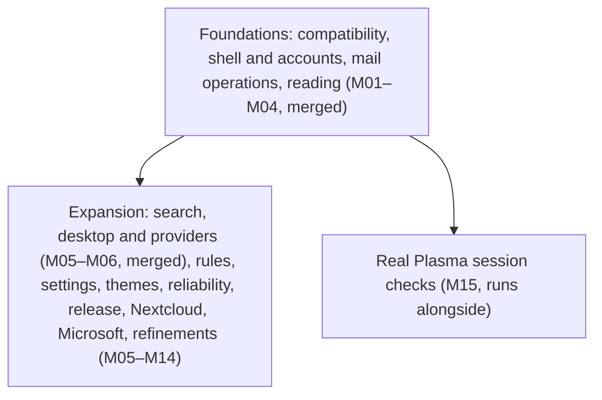

# Plasma Impresario scope and objective

**[Documentation](../README.md)** · **[Roadmap](../ROADMAP.md)** ·
**[Caveats](../CAVEATS.md)** · **[Designs](designs.md)** ·
**[Inspirations](inspirations.md)** · **[Compatibility](compatibility.md)**

This page decides what Plasma Impresario is for, what it covers and which
principles settle trade-offs. Statuses are as of 2026-11-25; milestones and
their order live in the [roadmap](../ROADMAP.md).

Plasma Impresario is a KDE Plasma-only IMAP desktop mail client, forked from
Trojitá, for users who need reliable account management, fast triage and
readable conversations. Other desktop environments are outside the supported
product scope.

Legend: ![Decided][decided] · ![Done][done] ·
![Needs verification][needs-verification] · ![In progress][in-progress] ·
![Planned][planned]

> [!IMPORTANT]
>
> IMAP and SMTP reliability, account isolation and predictable message state are
> foundational. Provider-specific, workspace and desktop integrations expand the
> product after those fundamentals are complete.



## Current baseline

The client is built with C++20, Qt 6 and KDE Frameworks 6. IMAP mailboxes stay
on the server; the application synchronizes metadata and fetches message parts
on demand, with an optional local cache. The
[backend parity guide](../parity/backend.md) describes the inherited
implementation, [designs](designs.md#current-interface) describes the current
interface, and [caveats](../CAVEATS.md) records security and platform
limitations.

M01 through M06 are merged into `main`. Live checks so far run against a
synthetic Dovecot server in `tools/dev-container/`; nothing has been checked in
a real Plasma session, which M15
([#319](https://github.com/mikepadiernos/plasma-impresario/issues/319)) tracks.

| Capability                                                    | Status                                    | Notes                                                                                                                                                                                                                                                                                                                   |
| ------------------------------------------------------------- | ----------------------------------------- | ----------------------------------------------------------------------------------------------------------------------------------------------------------------------------------------------------------------------------------------------------------------------------------------------------------------------- |
| KDE / Qt 6 baseline (M01)                                     | ![Done][done]                             | Merged into `main`; see [compatibility](compatibility.md).                                                                                                                                                                                                                                                              |
| IMAP reading with on-demand fetching and local cache          | ![Needs verification][needs-verification] | Inherited from Trojitá. M04 ([#93](https://github.com/mikepadiernos/plasma-impresario/issues/93)) exercised the reading flow against the synthetic Dovecot server; not checked with a real provider or in a Plasma session.                                                                                             |
| SMTP and other submission paths                               | ![Needs verification][needs-verification] | Inherited from Trojitá. M04 ([#41](https://github.com/mikepadiernos/plasma-impresario/issues/41)) exercised composing, sending and failed-send recovery through a local sendmail script, not an SMTP server; see [caveats](../CAVEATS.md#composing-and-sending).                                                        |
| Multiple simultaneous IMAP accounts                           | ![Done][done]                             | Merged in M02 ([#222](https://github.com/mikepadiernos/plasma-impresario/issues/222)).                                                                                                                                                                                                                                  |
| Mail shell and embedded panels                                | ![Needs verification][needs-verification] | Merged in M02 ([#35](https://github.com/mikepadiernos/plasma-impresario/issues/35)); Plasma check in [#315](https://github.com/mikepadiernos/plasma-impresario/issues/315); see [designs](designs.md#shell-status).                                                                                                     |
| Mail operations, sorting and the unified inbox                | ![Done][done]                             | Merged in M03, including the unified inbox ([#223](https://github.com/mikepadiernos/plasma-impresario/issues/223)); see [mail operations](designs.md#mail-operations).                                                                                                                                                  |
| Reading, conversations and account-aware replies              | ![Done][done]                             | Merged in M04 ([#39](https://github.com/mikepadiernos/plasma-impresario/issues/39), [#40](https://github.com/mikepadiernos/plasma-impresario/issues/40), [#224](https://github.com/mikepadiernos/plasma-impresario/issues/224)); see [reading and triage](designs.md#reading-and-triage).                               |
| OAuth account authentication                                  | ![Needs verification][needs-verification] | Merged in M02 ([#218](https://github.com/mikepadiernos/plasma-impresario/issues/218)); live sign-in in [#317](https://github.com/mikepadiernos/plasma-impresario/issues/317) and limitations in [caveats](../CAVEATS.md#oauth-sign-in).                                                                                 |
| Search across folders and accounts with an opt-in local index | ![Done][done]                             | Merged in M05 ([#324](https://github.com/mikepadiernos/plasma-impresario/issues/324)); server search stays the default and the index covers downloaded mail only; see [caveats](../CAVEATS.md#search).                                                                                                                  |
| POP3 retrieval with SMTP submission                           | ![Done][done]                             | Merged in M06.05 ([#216](https://github.com/mikepadiernos/plasma-impresario/issues/216)). Mail is downloaded into a store on this computer and shown as a single inbox, with no server folder synchronization; see [caveats](../CAVEATS.md#pop3-accounts).                                                              |
| JMAP accounts                                                 | ![Done][done]                             | Merged in M06.05 ([#217](https://github.com/mikepadiernos/plasma-impresario/issues/217)). Mail is kept in a store on this computer and synchronized both ways; sending goes through the JMAP server or SMTP. There is no push yet; see [caveats](../CAVEATS.md#jmap-accounts).                                          |
| Themes and branding                                           | ![In progress][in-progress]               | M09 ([#10](https://github.com/mikepadiernos/plasma-impresario/issues/10)) is in Development; the rename ([#221](https://github.com/mikepadiernos/plasma-impresario/issues/221)) is merged and branding ([#269](https://github.com/mikepadiernos/plasma-impresario/issues/269)) has started. No theme options exist yet. |
| Consumer Outlook, Exchange Online and Exchange Server         | ![Planned][planned]                       | M13; see the [Microsoft guide](../integrations/microsoft.md). Exchange Online and on-premises Exchange Server differ in interfaces, authentication options and administrator policies.                                                                                                                                  |

## Target experience

- Configure and manage multiple simultaneous accounts and mail identities.
- Triage selected accounts together in a unified inbox with visible message
  origins and account-aware actions.
- Synchronize folders and preserve unread and offline state.
- Read and organize threaded conversations.
- Search mail across folders and accounts, saving searches as virtual
  folders and optionally indexing downloaded mail for offline search.
- Compose and recover drafts without losing account context.
- Perform bulk actions with clear progress and failure recovery.
- Use Plasma-native notifications, credentials, files and settings.

## Scope boundaries

![Decided][decided] Only KDE Plasma is supported. Each in-scope area still needs
the validation in the right-hand column before it is claimed for a release.

| In scope                                                     | Requires explicit validation                                               |
| ------------------------------------------------------------ | -------------------------------------------------------------------------- |
| KDE Plasma desktop with Qt Widgets and KDE Frameworks        | Supported distributions, Plasma versions, sessions and dependencies        |
| IMAP, POP3, JMAP and SMTP workflows                          | Protocol and provider authentication, capabilities and storage differences |
| OAuth sign-in; planned Microsoft and Exchange accounts (M13) | Provider consent, supported interfaces and administrator policies          |
| Local cache and optional Maildir organization                | Cache retention, storage limits and migration behavior                     |
| Plasma and KDE desktop services                              | Session, notification and service availability                             |
| Accessibility, localization and keyboard workflows           | Screen-reader and scaled-display coverage                                  |

## Product principles

| Principle       | Meaning                                                                                                 |
| --------------- | ------------------------------------------------------------------------------------------------------- |
| Native          | Follow Plasma conventions and KDE facilities rather than duplicating desktop services.                  |
| Reliable        | Surface connection, authentication and partial-operation state; never imply that failed work completed. |
| Readable        | Keep default layouts compact but prioritize hierarchy, selection and focus visibility.                  |
| User-controlled | Make remote content, external services and destructive actions explicit.                                |
| Composable      | Separate account, mailbox, desktop and cross-app behavior so integrations remain optional.              |

## Reference model

Trojitá provides the IMAP-first, KDE-native baseline. Aqua Mail, Vivaldi Mail,
Thunderbird, eM Client, The Bat!, Kontact, ePim and E-Mail inform triage,
cross-account views, optional tabs, follow-up, dense power-user workflows,
Plasma integration and safe defaults; Plasma Opus is the shell reference. The
[inspirations](inspirations.md#design-synthesis) document lists what each
contributes.

## Configuration model

> [!NOTE]
>
> The YAML below is an illustrative product concept, not a supported
> configuration file. Today the client stores profile and account settings
> through `QSettings`, appearance and embedded-panel preferences in the
> `Appearance` group of `plasma-impresariorc` (see
> [designs](designs.md#current-embedded-panels)), and session selection in
> KConfig state.

<details>
<summary>Illustrative configuration concept</summary>

```yaml
appearance:
  theme: "Plasma Default"
  accent: "blue"
  density: "compact"
  high_contrast: false

layout:
  left_pane: visible
  right_pane: visible
  preview_mode: "split"
  focus_mode: false

mail:
  threaded_view: true
  mark_read_on_click: true
  preview_text_lines: 2
  default_sort: "date-desc"

notifications:
  desktop_toasts: true
  sync_alerts: true
  badge_counts: true

productivity:
  quick_reply: true
  keyboard_nav: true
  bulk_actions: true
```

</details>

[decided]: https://img.shields.io/badge/Decided-1a7f37
[done]: https://img.shields.io/badge/Done-1a7f37
[in-progress]: https://img.shields.io/badge/In_progress-9a6700
[needs-verification]: https://img.shields.io/badge/Needs_verification-0969da
[planned]: https://img.shields.io/badge/Planned-6e7781
